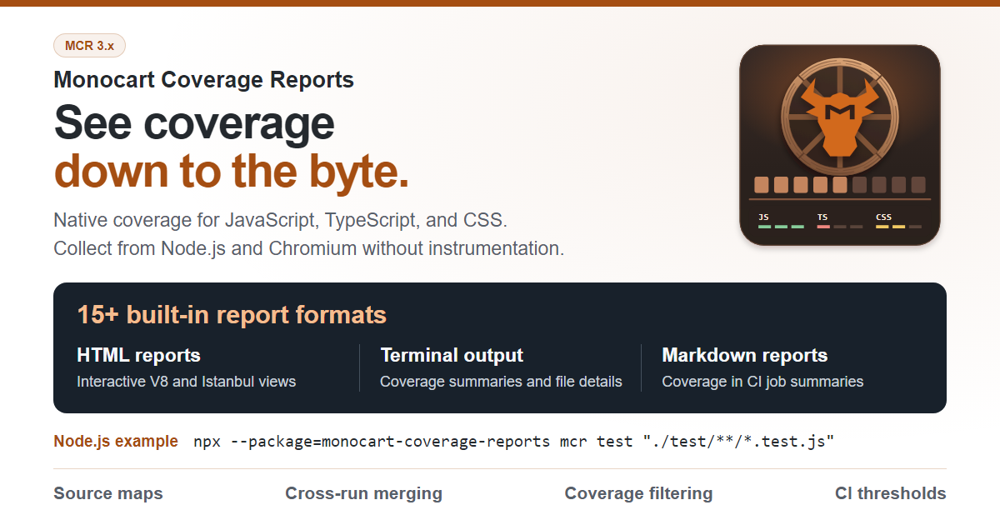

[](https://cenfun.github.io/monocart-coverage-reports/)

# Monocart Coverage Reports

[](https://github.com/cenfun/monocart-coverage-reports)
[](https://www.npmjs.com/package/monocart-coverage-reports)


[](https://npmgraph.js.org/?q=monocart-coverage-reports)

[](https://www.npmjs.com/package/monocart-coverage-reports)

> **See coverage down to the byte.**
>
> Native byte-level coverage for JavaScript, TypeScript, and CSS. No instrumentation in native mode, no need to change test frameworks. Share results in 15+ report formats.

[Get started](https://cenfun.github.io/monocart-coverage-reports/pages/get-started.html) · [AI Agent Skill](https://cenfun.github.io/monocart-coverage-reports/pages/ai-agent-skill.html) · [Live demo](https://cenfun.github.io/monocart-coverage-reports/#live-demo) · [Examples](https://cenfun.github.io/monocart-coverage-reports/pages/examples.html) · [中文文档](https://cenfun.github.io/monocart-coverage-reports/zh/)

## Try it with Node.js

Run this from your project root and adjust the test file pattern as needed:

```sh
npx --package=monocart-coverage-reports mcr test "./test/**/*.test.js"
```

MCR 3.x requires Node.js 22.18.0 or later. For older Node.js versions, use a compatible MCR 2.x release. [`mcr test`](https://cenfun.github.io/monocart-coverage-reports/pages/node-test-runner.html#quick-start) uses the built-in Node.js test runner. For projects that already use another runner, see the [framework integrations](https://cenfun.github.io/monocart-coverage-reports/pages/integrate-with-your-framework.html).

## From collection to CI

- **Native coverage:** See which JavaScript and TypeScript ranges ran in Node.js or Chromium, and which CSS ranges Chromium used.
- **Reports for different workflows:** Explore interactive V8 reports with light and dark modes, terminal output, and Markdown job summaries in the [live demo](https://cenfun.github.io/monocart-coverage-reports/#live-demo). Other formats include Istanbul and LCOV, and you can write a custom reporter.
- **Source maps and merging:** Map bundled code back to the original files and combine coverage across test runs, processes, and CI shards.
- **Filtering and thresholds:** Focus on the source files you maintain and use hooks to fail CI when coverage falls below your thresholds.

## Documentation

- [Full documentation](https://cenfun.github.io/monocart-coverage-reports/) / [中文文档](https://cenfun.github.io/monocart-coverage-reports/zh/)
- Getting started
    - [Get started](https://cenfun.github.io/monocart-coverage-reports/pages/get-started.html)
    - [Run tests with mcr test](https://cenfun.github.io/monocart-coverage-reports/pages/node-test-runner.html)
    - [TypeScript support](https://cenfun.github.io/monocart-coverage-reports/pages/typescript.html)
    - [Best practices](https://cenfun.github.io/monocart-coverage-reports/pages/best-practices.html)
    - [Examples](https://cenfun.github.io/monocart-coverage-reports/pages/examples.html)
    - [AI Agent Skill](https://cenfun.github.io/monocart-coverage-reports/pages/ai-agent-skill.html)
- Coverage collection
    - [V8 collection](https://cenfun.github.io/monocart-coverage-reports/pages/v8.html)
    - [Istanbul collection](https://cenfun.github.io/monocart-coverage-reports/pages/istanbul.html)
    - [V8 vs Istanbul](https://cenfun.github.io/monocart-coverage-reports/pages/compare-reports.html)
- CLI & API Reference
    - [Command line](https://cenfun.github.io/monocart-coverage-reports/pages/cli.html)
    - [Configuration files](https://cenfun.github.io/monocart-coverage-reports/pages/configuration.html)
    - [Configuration options](https://cenfun.github.io/monocart-coverage-reports/pages/options.html)
    - [Hooks](https://cenfun.github.io/monocart-coverage-reports/pages/hooks.html)
    - [CDPClient](https://cenfun.github.io/monocart-coverage-reports/pages/cdp-client.html)
    - [V8 coverage data](https://cenfun.github.io/monocart-coverage-reports/pages/coverage-data.html)
    - [Type declarations](https://cenfun.github.io/monocart-coverage-reports/pages/types.html)
- Coverage Workflows
    - [Filtering](https://cenfun.github.io/monocart-coverage-reports/pages/filtering.html)
    - [Source paths](https://cenfun.github.io/monocart-coverage-reports/pages/source-path.html)
    - [Untested files](https://cenfun.github.io/monocart-coverage-reports/pages/untested-files.html)
    - [Ignoring code](https://cenfun.github.io/monocart-coverage-reports/pages/ignoring-code.html)
    - [Reports](https://cenfun.github.io/monocart-coverage-reports/pages/reports.html)
    - [Merging reports](https://cenfun.github.io/monocart-coverage-reports/pages/merging.html)
    - [Multiple processes](https://cenfun.github.io/monocart-coverage-reports/pages/multiprocessing.html)
- Integrations
    - [Integrate with your framework](https://cenfun.github.io/monocart-coverage-reports/pages/integrate-with-your-framework.html)
    - [Frameworks and tools](https://cenfun.github.io/monocart-coverage-reports/pages/frameworks-and-tools.html)
    - [Coverage services](https://cenfun.github.io/monocart-coverage-reports/pages/coverage-services.html)
- Troubleshooting
    - [Common issues](https://cenfun.github.io/monocart-coverage-reports/pages/common-issues.html)
    - [Sourcemaps and debugging](https://cenfun.github.io/monocart-coverage-reports/pages/sourcemaps.html)
    - [CSS coverage issues](https://cenfun.github.io/monocart-coverage-reports/pages/css-coverage-issues.html)
- Migrations
    - [Migrating to 3.x](https://cenfun.github.io/monocart-coverage-reports/pages/migration-to-3.html)
- Community
    - [Contributing](https://cenfun.github.io/monocart-coverage-reports/pages/contributing.html)
    - [Thanks](https://cenfun.github.io/monocart-coverage-reports/pages/thanks.html)

[](https://cenfun.github.io/monocart-coverage-reports/)
