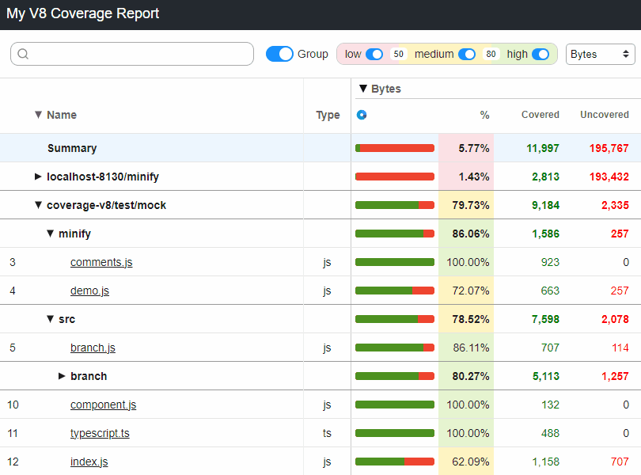
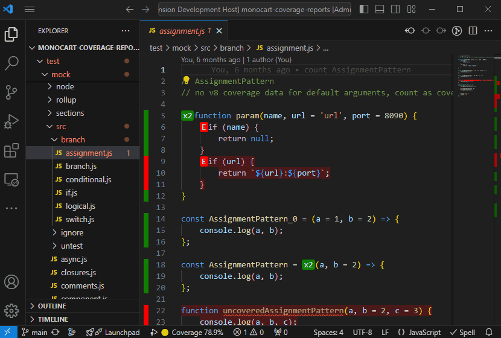
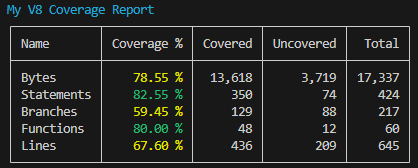
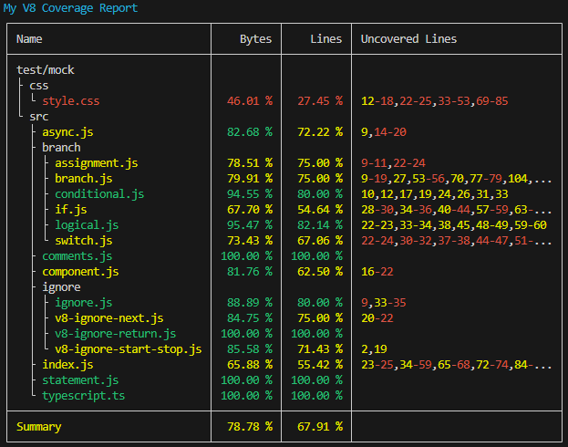
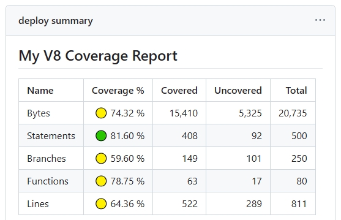
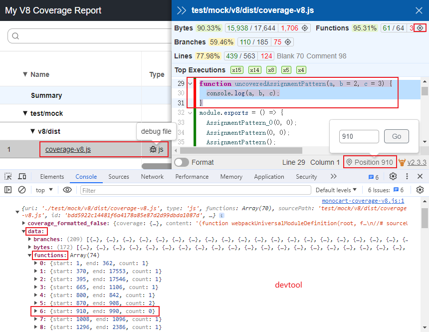
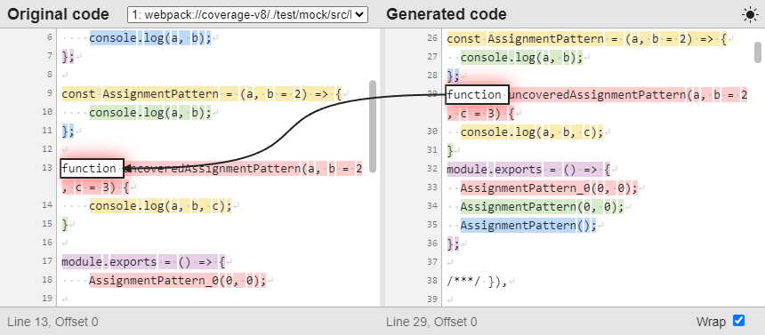
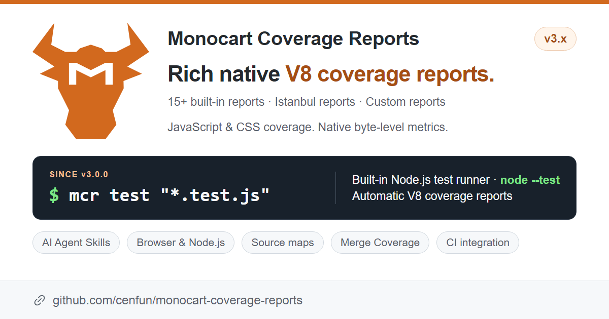

# Monocart Coverage Reports

[](https://www.npmjs.com/package/monocart-coverage-reports)


[](https://packagephobia.com/result?p=monocart-coverage-reports)
[](https://npmgraph.js.org/?q=monocart-coverage-reports)

[](https://www.npmjs.com/package/monocart-coverage-reports)

🌐 [English](README.md) | 简体中文

> JS代码覆盖率工具，用来生成原生的[V8](https://v8.dev/blog/javascript-code-coverage)或者[Istanbul](https://istanbul.js.org/)代码覆盖率报告

* [用法](#usage)
* [最佳实践](#best-practices)
* [选项配置](#options)
* [所有支持的报告类型](#available-reports)
* [比较两种报告](#compare-reports)
* [如何收集Istanbul覆盖率数据](#collecting-istanbul-coverage-data)
* [如何收集V8覆盖率数据](#collecting-v8-coverage-data)
    - [用Playwright](#collecting-v8-coverage-data-with-playwright)
    - [用Puppeteer](#collecting-raw-v8-coverage-data-with-puppeteer)
    - [从Node.js](#collecting-v8-coverage-data-from-nodejs)
    - [使用`CDPClient`API](#collecting-v8-coverage-data-with-cdpclient-api)
    - [参考V8覆盖率的API](#v8-coverage-data-api)
* [过滤V8覆盖率数据](#filtering-results)
* [使用 `sourcePath` 修改源文件路径](#resolve-sourcepath-for-the-source-files)
* [为未测试的文件添加空的覆盖率报告](#adding-empty-coverage-for-untested-files)
* [回调钩子 Hooks](#hooks)
* [如何忽略未覆盖的代码](#ignoring-uncovered-codes)
* [多进程支持](#multiprocessing-support)
* [如何使用CLI命令行](#command-line)
* [如何加载配置文件](#config-file)
* [使用 `mcr test` 运行测试](#run-tests-with-mcr-test)
* [如何合并覆盖率报告](#merge-coverage-reports)
    - [自动合并](#automatic-merging)
    - [手动合并](#manual-merging)
* [常见问题](#common-issues)
    - [Unexpected coverage](#unexpected-coverage)
    - [Unparsable source](#unparsable-source)
    - [JavaScript heap out of memory](#javascript-heap-out-of-memory)
* [如何调试覆盖率数据和查看sourcemap](#debug-for-coverage-and-sourcemap)
* [如何跟其他框架集成](#integration-with-any-testing-framework)
* [集成的例子](#integration-examples)
    - [Playwright](#playwright)
    - [c8](#c8)
    - [CodeceptJS](#codeceptjs)
    - [VSCode](#vscode)
    - [Jest](#jest)
    - [Vitest](#vitest)
    - [Node Test Runner](#node-test-runner)
    - [Puppeteer](#puppeteer)
    - [Cypress](#cypress)
    - [WebdriverIO](#webdriverio)
    - [Storybook Test Runner](#storybook-test-runner)
    - [TestCafe](#testcafe)
    - [Selenium Webdriver](#selenium-webdriver)
    - [Mocha](#mocha)
    - [TypeScript](#typescript)
    - [AVA](#ava)
    - [Codecov](#codecov)
    - [Codacy](#codacy)
    - [Coveralls](#coveralls)
    - [Sonar Cloud](#sonar-cloud)
* [Contributing](#contributing)
* [更新日志](CHANGELOG.md)
* [感谢](#thanks)

## Usage
> **MCR 3.x 的所有 API 和 CLI 命令均要求 [Node.js >= 22.15.0](https://nodejs.org/)**，包括普通命令、`merge` 和 `test`。

**从 2.x 升级：** 请参阅 [3.x 迁移指南](migrate-to-3.md)。

- 安装
```sh
npm install monocart-coverage-reports
```
- API
```js
import { MCR } from 'monocart-coverage-reports';
const mcr = MCR({
    name: 'My Coverage Report - 2024-02-28',
    outputDir: './coverage-reports',
    reports: ['v8', 'console-details'],
    cleanCache: true
});
await mcr.add(coverageData);
await mcr.generate();
```
也可以使用ESM的 `import` 然后加载[配置文件](#config-file)
```js
import { CoverageReport } from 'monocart-coverage-reports';
const mcr = new CoverageReport();
await mcr.loadConfig();
```
> `MCR({...})` 和 `new CoverageReport()` 创建的是同一个实例。`MCR()` 是简写工厂函数；`new CoverageReport()` 更适合需要单独调用 `loadConfig()` 的场景。

参见 [多进程支持](#multiprocessing-support)

- CLI
```sh
mcr node my-app.js -r v8,console-details
```
参见 [命令行](#command-line)

## Best Practices

为新项目建立测试方案时，优先使用无需插桩的原生覆盖率采集：

| 测试目标 | 推荐方案 | 职责划分 |
| --- | --- | --- |
| Node.js 端 | **Node.js 原生 test runner + `mcr test`** | `node:test` 执行测试断言；MCR 自动采集 JavaScript 原生 V8 覆盖率并生成报告。 |
| 浏览器端 | **Playwright Test + MCR** | Playwright 执行测试断言；自动 fixture 采集 Chromium JS/CSS 覆盖率；MCR 合并并生成报告。 |
| 浏览器端，需要统一测试报告 | **Playwright Test + [monocart-reporter](https://github.com/cenfun/monocart-reporter#code-coverage-report)** | reporter 已集成 MCR；配置其 coverage 选项，并由 fixture 提交覆盖率数据，统一管理测试报告和覆盖率报告。 |

详细配置步骤和示例见[最佳实践指南](skills/monocart-coverage-reports/references/best-practices.md)。

## AI Agent Skill

使用 AI 辅助开发本仓库源码时，请先阅读 [AGENTS.md](https://github.com/cenfun/monocart-coverage-reports/blob/main/AGENTS.md)，了解源码结构、开发命令、验证流程和安全边界。`.github/copilot-instructions.md` 为 GitHub Copilot 提供可独立使用的核心规则摘要。这些指南仅用于源码仓库，不随 npm 包发布，与下面可复用的集成技能相互独立。

项目提供可复用的 [Monocart Coverage Reports 技能](skills/monocart-coverage-reports/SKILL.md)，帮助 AI coding agent 采集覆盖率、配置 CLI、排查 sourcemap 和过滤问题、合并 raw 报告及设置 CI 阈值。结构为主 `SKILL.md` 加按需加载的专题参考文档，仅面向 MCR 3.x，并检查其运行环境要求。

npm 包包含 `skills/monocart-coverage-reports/`。请将**整个目录**（包括 `references/`）复制到 agent 支持的 skills 目录，或直接让 agent 读取 `SKILL.md`。安装 MCR 不会自动注册技能或修改 agent 配置。技能说明使用英文，但提问和回复可以使用中文或其他语言。

在使用 MCR 的项目根目录中定位已安装的技能和包配置（旧版本可能尚未包含技能）：

```sh
node -p "require.resolve('monocart-coverage-reports/skills/monocart-coverage-reports/SKILL.md')"
node -p "require.resolve('monocart-coverage-reports/package.json')"
```

读取定位到的技能文件，再按相对链接读取专题文档。请以已安装包的运行时、API 和版本要求为准，不要假设所有示例都适用于旧版本。以上命令用于定位文件，不是将 Markdown 作为 JavaScript 导入。

## Options
- 默认选项: [lib/default/options.js](./lib/default/options.js)
- 选项的类型描述，见 `CoverageReportOptions` [lib/index.d.ts](./lib/index.d.ts)
- [配置文件](#config-file)

| 选项 | 类型 | 默认值 | 说明 |
| :-- | :-- | :-- | :-- |
| `logging` | `"off" \| "error" \| "info" \| "debug"` | `"info"` | 日志级别。设为 `"debug"` 会保留原始缓存并输出 sourcemap，便于排查问题。参见 [调试覆盖率和sourcemap](#debug-for-coverage-and-sourcemap)。 |
| `name` | `string` | `"Coverage Report"` | 报告标题，显示在 UI 以及 summary 报告中。 |
| `reports` | `string \| (string \| ReportDescription)[]` | `""` (自动) | 生成哪些报告。V8 数据默认 `"v8"`，Istanbul 数据默认 `"html"`。参见 [所有支持的报告类型](#available-reports)。 |
| `outputDir` | `string` | `"./coverage-reports"` | 所有报告以及 `.cache` 的输出目录。 |
| `inputDir` | `string \| string[]` | `null` | 导入的原始覆盖率数据目录（用于 [合并](#merge-coverage-reports)）。 |
| `baseDir` | `string` | `process.cwd()` | 规范化相对源路径的基准目录。当生成报告的工作目录和源码目录不一致时需要设置。 |
| `dataDir` | `string` | `null` | `generate()` 阶段自动加载的覆盖率数据目录，作为 `addFromDir()` 的替代。 |
| `entryFilter` | `string \| object \| function` | `null` | （仅 V8）按 URL 过滤入口文件，参见 [过滤V8覆盖率数据](#filtering-results)。 |
| `sourceFilter` | `string \| object \| function` | `null` | （仅 V8）过滤从 sourcemap 解包出的源文件。 |
| `outputFilter` | `string \| object \| function` | `null` | （仅 V8）在 sourcemap 转换后，按最终 `sourcePath` 过滤文件。参见 [过滤V8覆盖率数据](#filtering-results)。 |
| `filter` | `string \| object \| function` | `null` | 合并 `entryFilter` 和 `sourceFilter` 的统一过滤器。 |
| `sourcePath` | `object \| function` | `null` | 修改源文件路径，参见 [使用 `sourcePath`](#resolve-sourcepath-for-the-source-files)。 |
| `all` | `string \| string[] \| object` | `null` | 为未测试文件添加空覆盖率，参见 [为未测试的文件添加空的覆盖率报告](#adding-empty-coverage-for-untested-files)。 |
| `outputFile` | `string` | `"index.html"` | （仅 V8）V8 报告的 `[子目录/]文件名`。 |
| `inline` | `boolean` | `false` | （仅 V8）将所有资源内联到单一 HTML 文件。 |
| `assetsPath` | `string` | `"./assets"` | （仅 V8）非内联模式下的资源目录。 |
| `lcov` | `boolean` | `false` | 额外生成 `lcov.info`，等同于添加 `lcovonly` 报告。 |
| `v8Ignore` | `boolean` | `true` | （仅 V8）启用/禁用基于注释的忽略（`v8 ignore …`），参见 [忽略未覆盖代码](#ignoring-uncovered-codes)。 |
| `reportPath` | `string \| () => string` | `null` | 覆盖默认的报告入口路径（默认 `outputDir/index.html`）。多个报告共用同一 `outputDir` 时很有用。 |
| `watermarks` | `[number, number] \| object` | `[50, 80]` | 覆盖率高/低阈值百分比。也支持按指标配置：`{ bytes:[50,80], lines:[50,80] }`。 |
| `clean` | `boolean` | `true` | 生成报告前清理 `outputDir` 中的旧报告（`.cache` 目录在 `cleanCache` 也为 `true` 时才会被清理）。 |
| `cleanCache` | `boolean` | `false` | 启动时清理缓存目录。当 `clean` 和 `cleanCache` 都为 `false` 时，之前运行的缓存数据会保留，可在多进程间复用。 |
| `gc` | `number` | `null` | 内存阈值（MB），在关键阶段若 JavaScript 堆内存使用量（`heapUsed`）超过阈值则强制触发 GC，适用于超大数据集，参见 [JavaScript heap out of memory](#javascript-heap-out-of-memory)。 |
| `sourceMap` | `boolean` | `false` | 将源文件和 sourcemap 也保存到 cache 便于调试（需要 `logging: "debug"`）。 |
| `sourceMapResolver` | `(url, defaultResolver) => Promise<string \| object>` | `null` | 自定义 sourcemap 加载逻辑（例如从构建缓存中读取），可调用 `defaultResolver(url)` 回退到默认解析。 |
| `onEntry` | `(entry) => void \| Promise<void>` | `null` | （仅 V8）每个入口文件处理前触发，参见 [Hooks](#hooks)。 |
| `onEnd` | `(coverageResults) => void \| Promise<void>` | `null` | 报告生成完成后触发，参见 [Hooks](#hooks)。 |

## Available Reports

> 内置V8报告(仅V8格式数据支持):

- `v8`
    - 推荐使用: 
        - 全新的原生V8覆盖率报告界面，更好的用户体验
        - 支持原生的Bytes覆盖率指标
        - 支持高性能处理大数据
        - 支持任何运行时代码的覆盖率（压缩后的）
        - 支持CSS代码覆盖率（用于分析CSS的冗余代码）
        - 对Sourcemap转换有更好的支持
    - 预览: [V8](https://cenfun.github.io/monocart-coverage-reports/v8) and [more](https://cenfun.github.io/monocart-coverage-reports/)



- `v8-json`
    - 保存 `CoverageResults` 到一个json文件 (默认是 [`coverage-report.json`](https://cenfun.github.io/monocart-coverage-reports/v8-and-istanbul/coverage-report.json))
    - 用于VSCode扩展来显示原生V8代码覆盖率: [Monocart Coverage for VSCode](https://github.com/cenfun/monocart-coverage-vscode)



> 内置Istanbul报告 (V8和Istanbul格式数据都支持):

- `clover`
- `cobertura`
- `html`
    - [Istanbul html](https://cenfun.github.io/monocart-coverage-reports/istanbul/) 
    - [V8 to Istanbul](https://cenfun.github.io/monocart-coverage-reports/v8-and-istanbul/istanbul)
- `html-spa`
- `json`
- `json-summary`
- `lcov`
- `lcovonly`
    - [V8 lcov.info](https://cenfun.github.io/monocart-coverage-reports/v8/lcov.info)
    - [Istanbul lcov.info](https://cenfun.github.io/monocart-coverage-reports/istanbul/lcov.info)
- `none`
- `teamcity`
- `text`
- `text-lcov`
- `text-summary`

> 其他内置报告 (V8和Istanbul格式数据都支持):

- `codecov` 保存覆盖率数据到 [Codecov](https://docs.codecov.com/docs/codecov-custom-coverage-format) 专属的json文件 (默认是`codecov.json`), 见[例子](https://app.codecov.io/github/cenfun/monocart-coverage-reports) 

- `codacy` 保存覆盖率数据到 [Codacy](https://api.codacy.com/swagger#tocscoveragereport) 专属的json文件 (默认是`codacy.json`)

- `console-summary` 在控制台显示覆盖率概要



- `console-details` 在控制台显示每个文件的覆盖率概要。如果是Github actions，可以使用环境变量`FORCE_COLOR: true`来强制开启颜色支持



- `markdown-summary` 保存概要信息到markdown文件 (默认是`coverage-summary.md`)。 如果是Github actions, 可以把markdown的内容添加到[a job summary](https://docs.github.com/en/actions/using-workflows/workflow-commands-for-github-actions#adding-a-job-summary)
```sh
cat path-to/coverage-summary.md >> $GITHUB_STEP_SUMMARY
```


- `markdown-details` 保存覆盖率详情到markdown文件 (默认是 `coverage-details.md`)
    - 预览运行结果 [runs](https://github.com/cenfun/monocart-coverage-reports/actions/workflows/ci.yml)

- `raw` 只是保存原始覆盖率数据, 用于使用`inputDir`参数来导入多个原始数据进行合并报告。参见 [合并覆盖率报告](#merge-coverage-reports)

- 自定义报告
    ```js
    const coverageOptions = {
        reports: [
            [path.resolve('./test/custom-istanbul-reporter.js'), {
                type: 'istanbul',
                file: 'custom-istanbul-coverage.text'
            }],
            [path.resolve('./test/custom-v8-reporter.js'), {
                type: 'v8',
                outputFile: 'custom-v8-coverage.json'
            }],
            [path.resolve('./test/custom-v8-reporter.mjs'), {
                type: 'both'
            }]
        ]
    };
    ```
    - Istanbul自定义报告
    > 例子: [./test/custom-istanbul-reporter.js](./test/custom-istanbul-reporter.js), see [istanbul built-in reporters' implementation](https://github.com/istanbuljs/istanbuljs/tree/master/packages/istanbul-reports/lib) for reference.
    - V8自定义报告
    > 例子: [./test/custom-v8-reporter.js](./test/custom-v8-reporter.js)

    `type` 选项决定报告接口及执行时机：
    - `'istanbul'` — 使用 Istanbul 报告接口：先调用 `new Reporter(reportOptions)`，再调用 `execute(context)`。context 提供 Istanbul 报告树和源码查找能力。V8 输入会先转换为 Istanbul 覆盖率数据。
    - `'v8'`（默认值）— 对 V8 输入，先调用 `new Reporter(reportOptions, globalOptions)`，再调用 `await generate(reportData)`。`reportData` 是 V8 覆盖率结果，包含 `type`、`summary` 和 `files`；每个文件包含 V8 覆盖范围和汇总。
    - `'both'` — 对 V8 或 Istanbul 输入均使用上述 `generate(reportData)` 接口。请检查 `reportData.type`，按对应的结果结构处理。它**不会**同时提供两份原始格式的数据，结果中不存在 `v8Data` 或 `istanbulData` 属性。

    报告统一使用原生 ESM `import()` 加载。ESM 报告使用 `export default Reporter`；通过 Node 内置互操作，也可加载 `module.exports = Reporter` 的 CommonJS 报告（在 ESM 项目中使用 `.cjs`）。本地路径必须明确指定文件扩展名，不补全扩展名、不解析目录入口，不提供独立的 CommonJS 加载器。报告加载或初始化失败会使报告生成失败，不会静默跳过。

### Multiple Reports:
如何配置多个报告
```js
import { MCR } from 'monocart-coverage-reports';
const coverageOptions = {
    outputDir: './coverage-reports',
    reports: [
        // built-in reports
        ['console-summary'],
        ['v8'],
        ['html', {
            subdir: 'istanbul'
        }],
        ['json', {
            file: 'my-json-file.json'
        }],
        'lcovonly',

        // custom reports
        // Specify reporter name with the NPM package
        ['custom-reporter-1'],
        ['custom-reporter-2', {
            type: 'istanbul',
            key: 'value'
        }],
        // Specify reporter name with local path
        ['/absolute/path/to/custom-reporter.js']
    ]
};
const mcr = MCR(coverageOptions);
```

## Compare Reports
> 如果是V8数据格式使用Istanbul的报告，将自动从V8转换到Istanbul

| | Istanbul | V8 | V8 to Istanbul |
| :--------------| :------ | :------ | :----------------------  |
| 数据格式 | [Istanbul](https://github.com/gotwarlost/istanbul/blob/master/coverage.json.md) (Object) | [V8](#v8-coverage-data-format) (Array) | [V8](#v8-coverage-data-format) (Array) |
| 输出报告 | [Istanbul reports](#available-reports) | [V8 reports](#available-reports)  | [Istanbul reports](#available-reports) |
| - Bytes 字节覆盖率 | ❌ | ✅ | ❌ |
| - Statements 语句覆盖率 | ✅ | ✅ | ✅ |
| - Branches 分支覆盖率 | ✅ | ✅ | ✅ |
| - Functions 函数覆盖率 | ✅ | ✅ | ✅ |
| - Lines 行覆盖率 | ✅ | ✅ | ✅ |
| - Execution counts 函数执行数 | ✅ | ✅ | ✅ |
| CSS 覆盖率 | ❌ | ✅ | ✅ |
| 压缩过的代码 | ❌ | ✅ | ❌ |

## Collecting Istanbul Coverage Data
- 在收集Istanbul覆盖率数据之前，需要编译源代码来安装Istanbul计数器 
    - webpack babel-loader: [babel-plugin-istanbul](https://github.com/istanbuljs/babel-plugin-istanbul), 参见例子: [webpack.config-istanbul.js](./test/build/webpack.config-istanbul.js)
    - 官方CLI: [nyc instrument](https://github.com/istanbuljs/nyc/blob/master/docs/instrument.md) 或API: [istanbul-lib-instrument](https://github.com/istanbuljs/istanbuljs/blob/main/packages/istanbul-lib-instrument/api.md)
    - vite: [vite-plugin-istanbul](https://github.com/ifaxity/vite-plugin-istanbul)
    - rollup: [rollup-plugin-istanbul](https://github.com/artberri/rollup-plugin-istanbul)
    - swc: [swc-plugin-coverage-instrument](https://github.com/kwonoj/swc-plugin-coverage-instrument)

- 从浏览器
    - Istanbul的覆盖率数据会保存到全局的`window.__coverage__`，直接读取即可, 参见例子: [test-istanbul.js](./test/test-istanbul.js)

- 从Node.js
    - 同理对于Node.js会保存到全局的`global.__coverage__`

- 使用CDP
    - `getIstanbulCoverage()` 参见[`CDPClient` API](#collecting-v8-coverage-data-with-cdpclient-api)

## Collecting V8 Coverage Data
- 在收集V8覆盖率数据之前，需要开启构建工具的`sourcemap`支持，并且不要压缩代码
    - [webpack](https://webpack.js.org/configuration/): `devtool: source-map` and `mode: development`, example [webpack.config-v8.js](./test/build/webpack.config-v8.js)
    - [rollup](https://rollupjs.org/configuration-options/): `sourcemap: true` and `treeshake: false`
    - [esbuild](https://esbuild.github.io/api/): `sourcemap: true`, `treeShaking: false` and `minify: false`
    - [vite](https://vitejs.dev/config/build-options.html): `sourcemap: true` and `minify: false`

- 浏览器 (仅支持基于Chromium的浏览器)
    - [使用Playwright](#collecting-v8-coverage-data-with-playwright)
    - [使用Puppeteer](#collecting-raw-v8-coverage-data-with-puppeteer)

- 从Node.js
    - [从Node.js收集V8覆盖率数据](#collecting-v8-coverage-data-from-nodejs)

- 使用CDP
    - [使用`CDPClient` API收集V8覆盖率数据](#collecting-v8-coverage-data-with-cdpclient-api)

### Collecting V8 Coverage Data with Playwright
使用Playwright的覆盖接口收集覆盖率数据
```js
await Promise.all([
    page.coverage.startJSCoverage({
        // reportAnonymousScripts: true,
        resetOnNavigation: false
    }),
    page.coverage.startCSSCoverage({
        // Note, anonymous styles (without sourceURLs) are not supported, alternatively, you can use CDPClient
        resetOnNavigation: false
    })
]);

await page.goto('your page url');

const [jsCoverage, cssCoverage] = await Promise.all([
    page.coverage.stopJSCoverage(),
    page.coverage.stopCSSCoverage()
]);

const coverageData = [... jsCoverage, ... cssCoverage];

```
Playwright Test 自动 fixture 参见完整 [playwright-coverage 示例](https://github.com/cenfun/playwright-coverage)中的 [fixtures.js](https://github.com/cenfun/playwright-coverage/blob/main/fixtures.js)，接入方式见[最佳实践指南](skills/monocart-coverage-reports/references/best-practices.md#complete-project-example)。
参见例子 [./test/test-v8.js](./test/test-v8.js), [css](./test/test-css.js)


### Collecting Raw V8 Coverage Data with Puppeteer

> 取决于包管理器配置，Puppeteer 可能不会在安装依赖时下载浏览器。如果没有可用浏览器，请手动安装：
>
> ```sh
> npx puppeteer browsers install chrome
> ```

使用Puppeteer的覆盖接口收集覆盖率数据，注意Puppeteer默认不会提供原生V8的覆盖率数据，需要设置`includeRawScriptCoverage`
```js
await Promise.all([
    page.coverage.startJSCoverage({
        // reportAnonymousScripts: true,
        resetOnNavigation: false,
        // provide raw v8 coverage data
        includeRawScriptCoverage: true
    }),
    page.coverage.startCSSCoverage({
        resetOnNavigation: false
    })
]);

await page.goto('your page url');

const [jsCoverage, cssCoverage] = await Promise.all([
    page.coverage.stopJSCoverage(),
    page.coverage.stopCSSCoverage()
]);

// to raw V8 script coverage
const coverageData = [... jsCoverage.map((it) => {
    return {
        source: it.text,
        ... it.rawScriptCoverage
    };
}), ... cssCoverage];
```
参见: [./test/test-puppeteer.js](./test/test-puppeteer.js)

### Collecting V8 Coverage Data from Node.js
有多种方法可以从Node.js收集V8覆盖率数据:
- [NODE_V8_COVERAGE](https://nodejs.org/docs/latest/api/cli.html#node_v8_coveragedir)=`dir`
    - 使用Node.js环境变量`NODE_V8_COVERAGE`=`dir`来启动程序, 然后在进程正常结束之后，覆盖率数据将自动保存到指定的`dir`目录.
    - 从`dir`目录读取所有的JSON文件，来生成覆盖率报告
    - 参见例子:
    > cross-env NODE_V8_COVERAGE=`.temp/v8-coverage-env` node [./test/test-node-env.js](./test/test-node-env.js) && node [./test/generate-report.js](./test/generate-report.js)

- [V8](https://nodejs.org/docs/latest/api/v8.html#v8takecoverage) API + NODE_V8_COVERAGE
    - 如果进程不能正常结束，比如被强制关闭，或者压根就不结束，比如启动了一个服务类的，那么需要手动写入覆盖率数据，这里需要调用接口`v8.takeCoverage()`
    - 参见例子:
    > cross-env NODE_V8_COVERAGE=`.temp/v8-coverage-api` node [./test/test-node-api.js](./test/test-node-api.js)

- [Inspector](https://nodejs.org/docs/latest/api/inspector.html) API
   - 首先连接到Node.js的V8 inspector
   - 然后使用inspector的覆盖相关API来开启和收集覆盖率数据
   - 参见例子: 
   > node [./test/test-node-ins.js](./test/test-node-ins.js)
   - vm的例子 (注意这里需要使用`scriptOffset`，因为vm里一般都会加一层包裹代码，需要这个偏移位置来修正覆盖率数据块的位置):
   > node [./test/test-node-vm.js](./test/test-node-vm.js)
   
- [CDP](https://chromedevtools.github.io/devtools-protocol/) API
    - 开启[Node调试](https://nodejs.org/en/guides/debugging-getting-started/)
    - 使用CDP的覆盖率接口开启和收集覆盖率数据
    - 参见例子: 
    > node --inspect=9229 [./test/test-node-cdp.js](./test/test-node-cdp.js)

- [Node Debugging](https://nodejs.org/en/guides/debugging-getting-started) + CDP + NODE_V8_COVERAGE + V8 API
    - 如果启动了一个Node服务，可以手动调用`v8.takeCoverage()`接口来保存覆盖率数据，开启Node调试就可以远程通过CDP连接的`Runtime.evaluate`，来调用这个接口.
    - 参见[koa](https://github.com/koajs/koa)的例子:
    > node [./test/test-node-koa.js](./test/test-node-koa.js)

- [Child Process](https://nodejs.org/docs/latest/api/child_process.html) + NODE_V8_COVERAGE
    - 如果是子进程，可参见 [命令行](#command-line)

### Collecting V8 Coverage Data with `CDPClient` API

`timeout` 控制 HTTP 调试目标发现和 WebSocket 连接的超时（默认 10000ms）；`requestTimeout` 控制内置 WebSocket 会话中每条 CDP 命令的超时（默认 30000ms）。设为 `0` 可禁用相应超时。外部 Playwright/Puppeteer 会话自行管理命令超时。自定义 socket 可使用 `new MCR.WSSession(ws, { timeout: 30000 })`。

- `CDPClient`为`MCR`提供的内置接口类，用来更便捷的处理覆盖率相关数据，所有的API如下
```ts
interface CoverageClient {
    // 开始和停止并收集JS的覆盖率数据
    startJSCoverage: () => Promise<void>;
    stopJSCoverage: () => Promise<V8CoverageEntry[]>;

    // 开始和停止并收集CSS的覆盖率数据，支持匿名文件(比如style里的css)
    startCSSCoverage: () => Promise<void>;
    stopCSSCoverage: () => Promise<V8CoverageEntry[]>;

    // 开始和停止并收集JS和CSS的覆盖率数据
    startCoverage: () => Promise<void>;
    stopCoverage: () => Promise<V8CoverageEntry[]>;

    /** 如果开启了NODE_V8_COVERAGE，这个接口用来手动保存当前覆盖率数据 */
    writeCoverage: () => Promise<string>;

    /** 收集istanbul覆盖率数据 */
    getIstanbulCoverage: (coverageKey?: string) => Promise<any>;
}
```

- 结合使用Node调试端口`--inspect=9229` 或者浏览器调试端口 `--remote-debugging-port=9229`
```js
import { MCR } from 'monocart-coverage-reports';
const client = await MCR.CDPClient({
    port: 9229
});
await client.startJSCoverage();
// run your test here
const coverageData = await client.stopJSCoverage();
```

- 结合使用 [Playwright CDPSession](https://playwright.dev/docs/api/class-cdpsession)
```js
import { chromium } from 'playwright';
import { MCR } from 'monocart-coverage-reports';
const browser = await chromium.launch();
const page = await browser.newPage();
const session = await page.context().newCDPSession(page);
const client = await MCR.CDPClient({
    session
});
// both js and css coverage
await client.startCoverage();
// run your test page here
await page.goto('your page url');
const coverageData = await client.stopCoverage();
```

- 结合使用 [Puppeteer CDPSession](https://pptr.dev/api/puppeteer.cdpsession)
```js
import puppeteer from 'puppeteer';
import { MCR } from 'monocart-coverage-reports';
const browser = await puppeteer.launch({});
const page = await browser.newPage();
const session = await page.target().createCDPSession();
const client = await MCR.CDPClient({
    session
});
// both js and css coverage
await client.startCoverage();
// run your test page here
await page.goto('your page url');
const coverageData = await client.stopCoverage();
```

- 结合使用 [Selenium Webdriver](https://www.selenium.dev/documentation/webdriver/) WebSocket (仅支持Chrome/Edge浏览器)
```js
import { Builder, Browser } from 'selenium-webdriver';
import { MCR } from 'monocart-coverage-reports';
const driver = await new Builder().forBrowser(Browser.CHROME).build();
const pageCdpConnection = await driver.createCDPConnection('page');
const session = new MCR.WSSession(pageCdpConnection._wsConnection);
const client = await MCR.CDPClient({
    session
});
```

### V8 Coverage Data API
- [JavaScript V8代码覆盖官方说明](https://v8.dev/blog/javascript-code-coverage)
- [Playwright的覆盖率接口](https://playwright.dev/docs/api/class-coverage)
- [Puppeteer的覆盖率接口](https://pptr.dev/api/puppeteer.coverage)
- [DevTools Protocol的覆盖率接口](https://chromedevtools.github.io/devtools-protocol/tot/Profiler/#method-startPreciseCoverage) 参见 [ScriptCoverage](https://chromedevtools.github.io/devtools-protocol/tot/Profiler/#type-ScriptCoverage) 和 [v8-coverage](https://github.com/bcoe/v8-coverage)
```ts
// Coverage data for a source range.
export interface CoverageRange {
    // JavaScript script source offset for the range start.
    startOffset: integer;
    // JavaScript script source offset for the range end.
    endOffset: integer;
    // Collected execution count of the source range.
    count: integer;
}
// Coverage data for a JavaScript function.
/**
 * @functionName can be an empty string.
 * @ranges is always non-empty. The first range is called the "root range".
 * @isBlockCoverage indicates if the function has block coverage information.
    If this is false, it usually means that the function was never called.
    It seems to be equivalent to ranges.length === 1 && ranges[0].count === 0.
*/
export interface FunctionCoverage {
    // JavaScript function name.
    functionName: string;
    // Source ranges inside the function with coverage data.
    ranges: CoverageRange[];
    // Whether coverage data for this function has block granularity.
    isBlockCoverage: boolean;
}
// Coverage data for a JavaScript script.
export interface ScriptCoverage {
    // JavaScript script id.
    scriptId: Runtime.ScriptId;
    // JavaScript script name or url.
    url: string;
    // Functions contained in the script that has coverage data.
    functions: FunctionCoverage[];
}
export type V8CoverageData = ScriptCoverage[];
```

| JavaScript Runtime | V8 Coverage |  |
| :--------------| :----: | :----------------------  |
| Chrome (65%) | ✅ | Chromium-based |
| Safari (18%) | ❌ |  |
| Edge (5%) | ✅ | Chromium-based |
| Firefox (2%) | ❌ |  |
| Node.js | ✅ |  |
| Deno | ❌ | [issue](https://github.com/denoland/deno/issues/23359) |
| Bun | ❌ | [issue](https://github.com/oven-sh/bun/issues/30968) |

> MCR 为每个 V8 覆盖率条目扩展了以下字段：

| 字段 | 类型 | 说明 |
| :-- | :-- | :-- |
| `url` | `string` | 脚本 URL 或文件路径 |
| `type` | `"js" \| "css"` | 条目类型 |
| `source` | `string` | （JS）源代码文本 |
| `sourceMap` | `object` | （JS）已解析的 sourcemap 对象 |
| `scriptOffset` | `number` | （JS）脚本包裹层的字节偏移（例如 `vm` 模块中）。此偏移会自动加到所有 range 的 start/end 值上 |
| `distFile` | `string` | （JS）该 source 解包自的 dist 打包文件 |
| `empty` | `boolean` | 当条目通过 `all` 选项添加（无真实覆盖率数据）时标记为 `true`，显示为 0% 覆盖 |
| `fake` | `boolean` | 当源代码非原始代码（例如从 `.ts`/`.jsx` 编译而来）时标记为 `true`。AST 解析器会跳过 fake 源的覆盖率提取 |

这些字段可以在 [`onEntry`](#hooks) 钩子中读取或修改。

## Filtering Results
### Using `entryFilter` and `sourceFilter` to filter the results for V8 report
当收集到V8的覆盖数据时，它实际上包含了所有的入口文件的覆盖率数据, 比如有以下3个文件:

- *dist/main.js*
- *dist/vendor.js*
- *dist/something-else.js*

这个时候可以使用`entryFilter`来过滤这些入口文件. 比如我们不需要看到`vendor.js`和`something-else.js`的覆盖率，就可以过滤掉，只剩下1个文件 

- *dist/main.js*

如果一个入口文件存在行内或者链接的sourcemap文件，那么我们会尝试读取并解析sourcemap，以获取入口文件包含的所有源文件，并添加到列表。此时如果`logging`没有设置成`debug`，那么这个入口文件在成功解出源文件后会被移除

- *src/index.js*
- *src/components/app.js*
- *node_modules/dependency/dist/dependency.js*

这个时候可以使用`sourceFilter`来过滤这些源文件。比如我们不需要看到源文件`dependency.js`的覆盖率，就可以过滤掉，最后只剩下如下文件

- *src/index.js*
- *src/components/app.js*

过滤可以使用函数:
```js
const coverageOptions = {
    entryFilter: (entry) => entry.url.indexOf('main.js') !== -1,
    sourceFilter: (sourcePath) => sourcePath.search(/src\//) !== -1
};
```
也可以使用便捷的[`minimatch`](https://github.com/isaacs/minimatch)来匹配（推荐）:
```js
const coverageOptions = {
    entryFilter: '**/main.js',
    sourceFilter: '**/src/**'
};
```
支持多个匹配:
```js
const coverageOptions = {
    entryFilter: {
        '**/node_modules/**': false,
        '**/vendor.js': false,
        '**/src/**': true
    },
    sourceFilter: {
        '**/node_modules/**': false,
        '**/**': true
    }
};
```
作为CLI参数（JSON字符串，Added in: v2.8）:
```sh
mcr --sourceFilter "{'**/node_modules/**':false,'**/**':true}"
```
注意，这些匹配实际上会转换成一个过滤函数（如下），所以如果一个匹配成功则会直接返回，后面的将不再继续匹配。请注意先后顺序，如果存在包含关系的，可以调整上下顺序，最后如果都未匹配，则默认返回false
```js
const coverageOptions = {
    entryFilter: (entry) => {
        if (minimatch(entry.url, '**/node_modules/**')) {
            return false;
        }
        if (minimatch(entry.url, '**/vendor.js')) {
            return false;
        }
        if (minimatch(entry.url, '**/src/**')) {
            return true;
        }
        // else unmatched
        return false;
    }
};
```

### Using `filter` instead of `entryFilter` and `sourceFilter`
如果你不想定义两个过滤器，可以使用 `filter` 选项代替，可以将多个匹配合并在一起. (Added in: v2.8)
```js
const coverageOptions = {
    // combined patterns
    filter: {
        '**/node_modules/**': false,
        '**/vendor.js': false,
        '**/src/**': true,
        '**/**': true
    }
};
```

### 使用 `outputFilter` 过滤最终文件
> **版本要求：** `outputFilter` 是 **v3.0.0** 新增的选项，v2.13.x 及更早版本不支持。

**两套过滤方案选一套即可，不要混淆。** `outputFilter` 与已有的 `entryFilter` + `sourceFilter` 都用于决定报告中保留哪些文件，功能重叠，是两种替代方案，而不是必须叠加配置的过滤器。合并选项 `filter` 只是 `entryFilter` + `sourceFilter` 的简写，不会配置 `outputFilter`。

| 方案 | 过滤时机和对象 | 优点 | 代价与注意事项 |
| :-- | :-- | :-- | :-- |
| `entryFilter` + `sourceFilter`（或 `filter`） | 从输入端过滤：在发现入口文件时，`entryFilter` 按 URL 过滤；在 sourcemap 解包源文件时，`sourceFilter` 按源路径过滤。 | 尽早排除不需要的文件，减少后续无效处理，性能更高。大型项目或 bundle 较多时，优先推荐此方案。 | 需要区分入口文件和 sourcemap 源文件，并配置两个阶段的规则。如果通过 `entryFilter` 排除整个 bundle，其中需要保留的源文件也会一起丢失。 |
| `outputFilter` | 从输出结果过滤：在 sourcemap 转换、合并和添加未测试文件（`all`）完成后、生成报告前，按最终 `sourcePath` 过滤。 | 配置更简单，一套规则直接面向最终文件列表，无需区分入口文件和解包后的源文件。 | 不需要的文件在被丢弃前仍会经历前期发现和处理，无法节省这些开销。当最终排除的文件较多时，可能带来明显的生成耗时和内存开销，存在性能问题。 |

**选择建议：** 优先考虑性能时，使用输入过滤方案（`entryFilter` + `sourceFilter`，或 `filter`）；更看重配置简单、希望直接过滤最终结果，且可以接受额外处理成本时，选择 `outputFilter`。切换到 `outputFilter` 时，应移除同一范围的旧输入过滤配置：输入阶段已经排除的文件，无法通过输出过滤恢复。

对于 V8 输入，`outputFilter` 同时作用于 V8 报告和转换后的 Istanbul 报告。默认值为 `null`，不启用过滤。

它与 `entryFilter` 和 `sourceFilter` 使用相同的字符串和有序对象匹配规则：按顺序返回第一个匹配项的值，未匹配的文件不保留。匹配目标是经过 `sourcePath` 改写后的最终路径。函数形式接收最终文件对象，而不是路径字符串。

```js
const coverageOptions = {
    outputFilter: {
        '**/node_modules/**': false,
        '**/src/**': true
    }
};
// 也可以使用：
// outputFilter: '**/src/**'
// outputFilter: (entry) => entry.sourcePath.startsWith('src/')
```

命令行示例（使用引号避免 shell 展开匹配规则）：
```sh
mcr merge --inputDir ./raw --outputFilter "**/src/**"
mcr merge --inputDir ./raw --outputFilter "{'**/node_modules/**':false,'**/src/**':true}"
```

`outputFilter` 不改变 raw 原始覆盖率导出，也不适用于 Istanbul 格式的输入数据。

## Resolve `sourcePath` for the Source Files
当一个文件从sourcemap解包，它的路径可能是个虚拟路径, 此时可以使用`sourcePath`选项来修改文件路径。比如，我们测试了多个dist包的入口文件，它们的源文件可能包含了一些共同的文件，但路径可能不同，如果我们需要相同的文件覆盖率数据可以自动合并，那么需要使用`sourcePath`来统一这些相同文件的路径
```js
const coverageOptions = {
    sourcePath: (filePath) => {
        // Remove the virtual prefix
        const list = ['my-dist-file1/', 'my-dist-file2/'];
        for (const str of list) {
            if (filePath.startsWith(str)) {
                return filePath.slice(str.length);
            }
        }
        return filePath;
    }
};
```
内置报告路径规范化采用尽力而为的原则，无法完全兼容所有非标准、虚拟或来自其他操作系统的路径。此类特殊情况应通过 `sourcePath` 自行修正，而不是依赖自动推断。回调接收规范化后的 `filePath`；对于 V8 入口和 sourcemap 源文件，`info.url` 提供报告路径规范化前的原始 URL（sourcemap 存在 `sourceRoot` 时包含该前缀）。它修改的是报告路径，不是读取缺失源码时使用的文件系统路径。缺少 `sourcesContent` 时，本地源码相对于外部 map 的 URL 加载（内联 map 则相对于生成文件），并将 `sourceRoot` 作为目录应用。

它也支持简单key/value的替换:
```js
const coverageOptions = {
    sourcePath: {
        'my-dist-file1/': '',
        'my-dist-file2/': ''
    }
};
```
解决文件路径不完整的问题：
```js
import path from 'node:path';

// MCR coverage options
const coverageOptions = {
    sourcePath: (filePath, info) => {
        if (!filePath.includes('/') && info.distFile) {
            return `${path.dirname(info.distFile)}/${filePath}`;
        }
        return filePath;
    }
};
```

## Adding Empty Coverage for Untested Files
默认不包含未测试文件。使用 `all` 可将它们以 0% 覆盖率加入报告，即使没有采集到任何覆盖率数据也可生成报告。同一原始源码的真实 V8 覆盖率优先于空覆盖率条目。
```js
const coverageOptions = {
    all: './src'

    // 支持多个目录
    // all: ['./src', './lib']
};
```
未测试的文件也适用于`sourceFilter`过滤器. 而且也可以指定自己的`filter`过滤器 (可以返回文件类型来支持js或css的覆盖率格式):
```js
const coverageOptions = {
    all: {
        dir: ['./src'],
        filter: {
            // exclude files
            '**/ignored-*.js': false,
            '**/*.html': false,
            // empty css coverage
            '**/*.scss': 'css',
            '**/*': true
        }
    }
};
```
可以将未测试的文件转换成 JavaScript，以便进行 AST 分析。以下示例仅处理**不含 JSX 的 TypeScript**，并假定已安装 `@swc/core`。JSX/TSX 或 Vue 应使用匹配的编译器和解析器，这不是通用转换器。保留完整文件路径，避免不同目录下的同名文件冲突；SWC 返回的 sourcemap 是 JSON 字符串，赋值前需要解析。
```js
import { fileURLToPath } from 'node:url';
import { transform } from '@swc/core';
const coverageOptions = {
    all: {
        dir: ['./src'],
        filter: '**/*.ts',
        transformer: async (entry) => {
            const { code, map } = await transform(entry.source, {
                filename: fileURLToPath(entry.url),
                sourceMaps: true,
                isModule: true,
                jsc: {
                    parser: {
                        syntax: 'typescript'
                    }
                }
            });
            entry.source = code;
            entry.sourceMap = JSON.parse(map);
        }
    }
};
```

## Hooks

### `onEnd` — 报告生成后触发
典型用法：检测覆盖率是否达标，失败时抛错，让 API 调用方处理异常、CLI 返回非零状态；不要使用 `process.exit()` 提前中断清理。
```js
const getCoverageError = (metric, summary, minimum) => {
    if (!summary || !(summary.total > 0)) {
        return `${metric}: missing or empty coverage`;
    }
    const { pct } = summary;
    if (typeof pct !== 'number' || !Number.isFinite(pct) || pct < minimum) {
        return `${metric}: ${pct}%, required ${minimum}%`;
    }
    return '';
};
const coverageOptions = {
    name: 'My Coverage Report',
    outputDir: './coverage-reports',
    onEnd: (coverageResults) => {
        if (!coverageResults) {
            throw new Error('No coverage results');
        }
        const thresholds = {
            bytes: 80,
            lines: 60
        };
        const errors = [];
        for (const [metric, minimum] of Object.entries(thresholds)) {
            const error = getCoverageError(metric, coverageResults.summary?.[metric], minimum);
            if (error) {
                errors.push(error);
            }
        }
        if (errors.length) {
            throw new Error(errors.join('\n'));
        }
    }
};
```

本示例拒绝缺失或总数为零的指标；如果某项指标允许为空，应明确调整策略。没有可用输入时，`generate()` 可能直接返回 `undefined` 而不调用 `onEnd`。API 调用方必须检查返回值；普通 CLI 流程应使用干净的输出目录，并验证本次生成的非空报告。参见 [严格 CI 示例](skills/monocart-coverage-reports/references/reports-and-ci.md#reject-stale-reports-and-missing-collection-in-ci)。

### `onEntry` — 每个V8入口在处理前触发（仅V8）
可以在进入AST解析前改写 entry（例如对非标准语法的源码做预编译），参见 [Unparsable source](#unparsable-source)
```js
const coverageOptions = {
    onEntry: async (entry) => {
        // entry.source, entry.sourceMap, entry.fake, ...
    }
};
```

### `onTestEnd` — 仅 `mcr test` 可用

`onTestEnd(testResults)` 在测试运行器退出、JSON 测试结果采集完成后触发一次，早于测试结果缓存发布、`onReady` 和覆盖率报告生成。支持异步等待，测试断言失败时也会触发。其他命令、API 调用，以及因未提供目标而跳过的测试，不触发该 hook。现有 `onEnd(coverageResults)` 保持不变。

`mcr test` 始终通过内部 JSON reporter 采集结构化测试结果，同时保留终端输出和用户指定的 reporter/destination 配对。`onTestEnd` 为可选回调，不配置也不会关闭采集。如需留待后续使用，请启用 `raw` 报告或 debug 日志；默认的缓存清理规则仍然生效。

```js
// mcr.config.js
export default {
    test: './test/**/*.test.js',
    onTestEnd: (testResults) => {
        console.log(testResults.summary);
        for (const test of testResults.tests) {
            console.log(test.name, test.status, test.error);
        }
    }
};
```

- `id`：采用与覆盖率缓存数据相同的 `Util.uid()` 机制生成的采集 ID。
- `framework`：`'node:test'`。
- `complete`：是否收到运行器最终汇总，不代表测试是否通过。
- `summary`：`{ tests, suites, passed, failed, cancelled, skipped, todo, duration, success }`，报告不完整时为 `null`。计数采用运行器最终汇总，`tests` 不包含 suite，耗时单位为毫秒。
- `tests`：已完成的测试及 suite 记录，包含嵌套测试：`{ name, type, nesting, testNumber, file?, line?, column?, duration, status, skip?, todo?, error? }`。状态为 `passed`、`failed`、`cancelled`、`skipped` 或 `todo`。错误固定包含字符串 `name`、`message`，不可用或非字符串时分别使用 `'Error'`、`''`。其余只复制自有、可枚举的数据属性，值仅限字符串、布尔值、有限数字和 `null`；BigInt 转为十进制字符串。不递归遍历，跳过 getter/setter、对象/数组、函数、Symbol、`undefined`、`NaN` 和无穷数。除两个固定字段外，不采集继承或不可枚举属性，因此通常不包含 `stack`，也不展开 `cause` 内的字段；明确设为可枚举的字符串 `stack` 仍按普通字符串复制。过滤 `__proto__`、`constructor`、`prototype` 等特殊键，额外属性不会覆盖固定字段。

测试失败、报告不完整/缺失/损坏或 hook 抛错，均保持非零退出状态。不完整报告以 `complete: false` 交付；缺失或无效的 JSON 无法交付，会明确记录采集错误。`onTestEnd` 设置的非零 `process.exitCode` 不会被后续覆盖率 hook 清零。hook 或采集失败后仍尝试生成覆盖率报告。hook 抛错时不会发布或导出测试结果，避免回退导出可能尚未脱敏的数据。测试结果独立于覆盖率，因此即使后续覆盖率生成失败，此 hook 仍可执行。

测试结果复用覆盖率缓存的 ID 和文件命名机制：`outputDir/.cache/test-results-<id>.json`，JSON 内容保存同一个 `id`。reporter 将记录逐条写入 `.json.tmp`，输出时即包含采集 ID，并通过很小的 `.meta.tmp` 完成记录校验最终字节数。没有 hook 时，MCR 只读取完成记录并重命名 JSON，不会加载或重写完整报告；配置 hook 时，读取完整结果对象，在 hook 完成后将修改后的数据发布为正式缓存。临时输出和元数据均在生成覆盖率前清理。正式 JSON 遵循覆盖率缓存生命周期：正常生成后清理、调试模式保留，或由 `raw` 报告导出（包括 ZIP）。它不会嵌入 HTML/覆盖率 JSON 报告，导入 raw 数据目前也不会合并测试结果。如需持久化，请自行保存；当 `clean: true` 时，此 hook 写入 `outputDir` 的文件可能被后续覆盖率清理流程删除。

**敏感信息提醒：** 基础类型不等于非敏感数据，字符串 `token`、`password` 或响应正文同样会被复制。错误消息、测试名称和路径也可能包含凭据或个人信息，大字符串仍可能增大报告体积，MCR 不会自动脱敏。请保护输出目录，并在上传 raw/debug 产物前审查内容。可在 `onTestEnd` 中修改结果，对正式保存的 JSON 脱敏；这不会处理 Node 的终端输出或已经写入临时文件的数据。以下规则仅为示例，请按业务数据调整：

```js
export default {
    onTestEnd: (results) => {
        for (const test of results.tests) {
            if (test.error) {
                for (const [key, value] of Object.entries(test.error)) {
                    if (typeof value === 'string') {
                        test.error[key] = value.replace(/(Bearer\s+)\S+/gi, '$1[REDACTED]');
                    }
                }
            }
        }
    }
};
```

### `onStart` / `onReady` — 仅CLI可用
只在使用 `mcr <command>` 时有效:
- `onStart(coverageReport)` — 子进程启动前触发
- `onReady(coverageReport, nodeV8CoverageDir, subprocess)` — 子进程退出后、MCR 读取 `nodeV8CoverageDir` 之前触发。用于子进程尚未写完覆盖数据需要等待的场景
```js
// mcr.config.js
export default {
    onReady: async (coverageReport, nodeV8CoverageDir, subprocess) => {
        // 等待某个信号，或先对 raw 文件做一些预处理
    }
};
```

## Ignoring Uncovered Codes
<!-- readme-lint-disable -->

使用特定的注释，以`v8 ignore `开头可以忽略未覆盖的代码:
- 忽略开始到结束
```js
/* v8 ignore start */
function uncovered() {
}
/* v8 ignore stop */
```
- 忽略接下来一行或者多行
```js
/* v8 ignore next */
const os = platform === 'win32' ? 'Windows' : 'Other';

const os = platform === 'win32' ? 'Windows' /* v8 ignore next */ : 'Other';

// v8 ignore next 3
if (platform === 'linux') {
    console.log('hello linux');
}
```
- 兼容支持 [c8 coverage](https://github.com/bcoe/c8/?tab=readme-ov-file#ignoring-all-lines-until-told) 或 [nodejs coverage](https://nodejs.org/docs/latest/api/test.html#collecting-code-coverage) 的语法格式
```js
/* c8 ignore start */
function uncovered() {
}
/* c8 ignore stop */

/* node:coverage disable */
function uncovered() {
}
/* node:coverage enable */
```
- 可以设置 `v8Ignore: false` 完全禁用基于注释的忽略机制。

<!-- readme-lint-enable -->

## Multiprocessing Support
> 多进程支持可以很好的解决异步并行的情况。所有的覆盖率数据会保存到`[outputDir]/.cache`，在报告生成之后，这些缓存数据会被清除。除非开启了[调试模式](#debug-for-coverage-and-sourcemap)，或者使用了`raw`报告
- 主进程，初始化，清理之前的缓存
```js
import { MCR } from 'monocart-coverage-reports';
import coverageOptions from 'path-to/same-options.js';
const mcr = MCR(coverageOptions);
// clean previous cache before the start of testing
// unless the running environment is new and no cache
mcr.cleanCache();
```

- 子进程1, 测试业务1
```js
import { MCR } from 'monocart-coverage-reports';
import coverageOptions from 'path-to/same-options.js';
const mcr = MCR(coverageOptions);
await mcr.add(coverageData1);
```

- 子进程2, 测试业务2
```js
import { MCR } from 'monocart-coverage-reports';
import coverageOptions from 'path-to/same-options.js';
const mcr = MCR(coverageOptions);
await mcr.add(coverageData2);
```

- 主进程，所有测试完成之后
```js
// generate coverage reports after the completion of testing
import { MCR } from 'monocart-coverage-reports';
import coverageOptions from 'path-to/same-options.js';
const mcr = MCR(coverageOptions);
await mcr.generate();
```

## Command Line
> 使用`mcr`命令行将使用`NODE_V8_COVERAGE=dir`来启动一个[子进程](https://nodejs.org/docs/latest/api/child_process.html)运行程序，直到正常退出，然后自动从`dir`目录来读取覆盖率数据，并生成覆盖率报告

- 全局安装
```sh
npm i monocart-coverage-reports -g
mcr node ./test/specs/node.test.js -r v8,console-details --lcov
```

- 本地项目安装
```sh
npm i monocart-coverage-reports
npx mcr node ./test/specs/node.test.js -r v8,console-details --lcov
```

- CLI 选项

命令使用 Execa 的默认选项执行，不主动开启 shell 模式。请分别传入可执行文件及参数，例如 `mcr node "./my app.js"`，不要把整条命令作为一个带引号的参数传入。MCR 保留参数边界，不展开环境变量或 glob，也不解析管道、重定向、`&&` 等 shell 语法；组合命令请放入脚本。使用 `mcr [options] -- executable ...args` 可以避免子命令参数被当作 MCR 参数解析。平台相关的命令执行由 Execa 处理，包括在 Windows 下按需通过 `cmd.exe` 调用批处理文件并转义参数。

以下选项仅在 CLI 模式（`mcr <command>`）下可用：

| 选项 | 类型 | 默认值 | 说明 |
| :-- | :-- | :-- | :-- |
| `-c, --config` | `string` | — | 自定义配置文件路径 |
| `--import` | `string` | `null` | 通过 `NODE_OPTIONS` 预加载 ESM 模块，如 `tsx`。|
| `--require` | `string` | `null` | `--import` 的已弃用别名；使用 ESM 加载，不使用 CommonJS 解析 |
| `--env` | `string` | `null` | 从 dotenv 文件加载环境变量（默认 `.env`）。|
| `test`（仅配置文件） | `string \| string[] \| null` | `null` | 未指定命令行目标时，原样传给 `node --test` 的默认测试文件路径或 glob，**仅 `mcr test` 使用**；其他命令和 API 忽略。需要 Node.js `>= 22.15.0` |
| `onTestEnd`（仅配置文件） | `(testResults) => void \| Promise<void>` | `null` | 仅 `mcr test`：测试结果采集完成后、`onReady` 和覆盖率生成前触发；参见 [Hooks](#hooks) |
| `onStart` | `(coverageReport) => Promise<void>` | `null` | 子进程启动前触发；参见 [Hooks](#hooks) |
| `onReady` | `(coverageReport, nodeV8CoverageDir, subprocess) => Promise<void>` | `null` | 子进程退出后、MCR 读取覆盖率前触发；参见 [Hooks](#hooks) |

其他选项（如 `--name`、`--reports`、`--outputDir`、`--lcov` 等）参见 [选项配置](#options) 表格，它们在 CLI 中的用法相同。

- 使用 `--` 可以隔离子程序参数，以免两种参数混淆
```sh
mcr -c mcr.config.js -- sub-cli -c sub-cli.config.js
```

- `--import <module>` / `--require <module>`: 通过 `NODE_OPTIONS` 把一个预加载模块传给子进程。常用于 TypeScript/JSX 运行时（`tsx`、`ts-node` 等），也可用于加载 `mcr.config.ts`。在所有受支持的 Node.js 版本中均可用。本地路径以当前工作目录为基准，必须明确指定文件扩展名，支持包含空格的路径。包名由原生 ESM 按 MCR 模块位置解析。两个选项都使用 `import()`，并向 Node 传递 `--import`；`--require` 仅为已弃用别名，不提供 CommonJS 加载逻辑。CJS 模块仅通过 Node 内置的 import 互操作支持。
```sh
mcr --import tsx node ./test.ts
```

- `--env [path]`: 子进程启动前从 dotenv 文件加载环境变量（默认 `.env`）。使用 `process.loadEnvFile`，在所有受支持的 Node.js 版本中均可用
```sh
mcr --env .env.test node ./test.js
```

- `test`：运行 Node.js 测试并生成覆盖率报告，参见[使用 `mcr test` 运行测试](#run-tests-with-mcr-test)。

- `merge`: 直接合并 `inputDir` 中的原始覆盖率数据并生成合并报告，无需启动子进程。
```sh
mcr merge -r v8,console-details --inputDir ./coverage-reports/unit/raw,./coverage-reports/e2e/raw --outputDir ./coverage-reports/merged
```
参见 [合并覆盖率报告](#merge-coverage-reports)。

- 参见例子
    - [Mocha](#mocha)
    - [TypeScript](#typescript)
    - [AVA](#ava)

## Config File
MCR 3.x 中，显式指定的配置不存在，或找到的配置加载失败（包括 JSON 解析、模块语法及初始化错误）时，`loadConfig()` 会直接抛出异常，所有 CLI 命令也会非零退出，不再需要 `strict` 参数。未指定自定义配置且找不到默认配置时，仍使用已有选项继续执行。

根据以下优先级加载配置文件
- 自定义配置文件（如果没有指定则加载后面的默认配置文件）:
    - CLI: `mcr --config <my-config-file-path>`
    - API: `await mcr.loadConfig("my-config-file-path")`
- `mcr.config.js`
- `mcr.config.cjs`
- `mcr.config.mjs`
- `mcr.config.json` - json format
- `mcr.config.ts` （需要预加载 TypeScript 执行模块，比如 `tsx`）:
```sh
mcr --import tsx -c mcr.config.ts node ./test.js
```

> 未指定自定义路径时，MCR 会从当前工作目录向上查找默认配置文件（通过 [`find-up`](https://github.com/sindresorhus/find-up)）。不在搜索路径内的文件会被忽略

## Run Tests with `mcr test`

**MCR 3.x 重要更新：** 使用内置的 [Node.js 测试 runner](https://nodejs.org/docs/latest/api/test.html)，一条命令即可运行测试并自动生成覆盖率报告。需要 **Node.js >= 22.15.0**。

安装 MCR 后，直接指定测试文件即可运行，无需配置文件：

```sh
npm install --save-dev monocart-coverage-reports
npx mcr test "./test/**/*.test.js" -r v8,console-summary -o ./coverage-reports
```

此命令会运行匹配的测试，在终端打印覆盖率摘要，并将 V8 HTML 报告写入 `./coverage-reports/index.html`。请为 glob 加引号，让 Node.js 而不是 shell 处理匹配。

对于需要反复执行的测试，可将测试目标和覆盖率选项保存到 `mcr.config.js`（ESM；需在 `package.json` 设置 `"type": "module"`，或将配置命名为 `mcr.config.mjs`）：

```js
export default {
    test: ['./test/unit/**/*.test.js', './test/integration/**/*.test.js'],
    reports: ['v8', 'console-summary'],
    outputDir: './coverage-reports'
};
```

```sh
# 运行配置中的测试目标
npx mcr test
# 覆盖配置中的测试目标，并在 -- 后透传 Node.js 测试 runner 参数
npx mcr test "./test/unit/**/*.test.js" -- --test-reporter=spec

# 显式指定配置文件
npx mcr test "../tests/**/*.test.js" -c ./mcr.config.js

# 在命令行选择报告
npx mcr test "../tests/**/*.test.js" -r v8,console-summary

# 运行多个测试文件
npx mcr test ./test/first.test.js ./test/second.test.js

# 按测试名称筛选，并指定 reporter
npx mcr test "../tests/**/*.test.js" -c ./mcr.config.js -- --test-name-pattern="my test" --test-reporter=spec

# 将 test 命令放在初始分隔符后
npx mcr -c ./mcr.config.js -- test "../tests/**/*.test.js" -- --test-reporter=spec
```

命令行指定的测试目标会**覆盖**配置中的 `test`，而不是追加；未指定命令行目标时才使用配置。命令行指定目标时可以不使用配置文件。原有 MCR 参数（如 `-c`、`-r`、`-o`、`--lcov`）可以放在目标之前或之后。Node runner 参数请放在 `--` 后，原样透传，不作为 MCR 参数或目标覆盖项解析。建议为 glob 加引号，避免 shell 提前展开。使用另一种 `mcr [options] -- test ...` 形式时，所有 MCR 参数必须放在第一个 `--` 前，Node runner 参数则放在第二个 `--` 后。

测试目标原样传给 `node --test`。MCR 不检查目标类型或文件是否存在，不展开目录/glob，不解析或标准化路径，不转义特殊字符，也不去重；`node --test` 原生接收测试文件路径或 glob 形式的位置参数，而不是 JavaScript 配置对象。MCR 配置中的字符串表示一个这样的参数（不会按空格拆分），字符串数组表示多个按原顺序传递的参数；`null` 仅是 MCR 跳过测试的默认值，不会传给 Node。测试发现、匹配、参数解释及错误行为均交给 Node。相对路径以当前工作目录为基准，而不是配置文件目录。不承诺直接指定目录会递归发现测试；递归匹配请使用 `"../tests/**/*.test.js"` 等 glob，行为以当前 Node 版本的原生支持为准。TypeScript 执行能力取决于 Node 版本或 `--import tsx` 等加载器。

`test` 默认为 `null`；未指定命令行目标，且 `test` 未配置或为 `null`、空字符串、`[]` 时跳过测试，也不生成报告。MCR 仅判断是否提供了目标，无效或未匹配目标由 Node 自行处理。如果没有产生覆盖率数据且无法生成报告，命令仍会在报告生成阶段失败。显式指定的配置文件不存在或配置加载失败时，也会失败退出，不会静默跳过测试。测试失败仍生成覆盖率报告，并保留非零退出状态；报告生成失败同样非零退出。支持现有覆盖率配置和 CLI hooks，可按需通过过滤器排除测试文件。**`test` 配置在其他 CLI 命令和 API 调用中均不生效**，包括 `merge` 和 `generate()`。

其他 CLI 选项参见[命令行](#command-line)。

## Merge Coverage Reports
以下这些使用场景可能需要使用合并覆盖率报告：
- 多个执行环境，比如Node.js服务端，以及浏览器客户端，比如`Next.js`
- 多种测试类型，比如`Jest`单元测试，以及`Playwright`的端到端自动化测试
- 分布式测试，测试结果保存到了多台机器或不同的容器中

### Automatic Merging
- 默认`MCR`在执行`generate()`时会自动合并覆盖率数据。所以可以在[多进程支持](#multiprocessing-support)下，多次添加覆盖率数据，最后将自动合并
- 比如`Next.js`就可以同时添加前后端覆盖率数据，最后再执行`generate()`生成覆盖率报告，见例子[nextjs-with-playwright](https://github.com/cenfun/nextjs-with-playwright)
- 使用`Codecov`在线覆盖率报告服务，请设置输出`codecov`报告, 它会生成专属的`codecov.json`，如果有多个`codecov.json`文件上传，它们会自动合并数据，参见[Codecov](#codecov) 和 [合并报告说明](https://docs.codecov.com/docs/merging-reports)

### Manual Merging
手动合并覆盖率报告需要使用`raw`报告来导出原始的覆盖率数据到指定的目录
- 比如，单元测试保存到`./coverage-reports/unit/raw`，见例子
    - `Jest` + [jest-monocart-coverage](https://github.com/cenfun/jest-monocart-coverage)
    - `Vitest` + [vitest-monocart-coverage](https://github.com/cenfun/vitest-monocart-coverage)
```js
const coverageOptions = {
    name: 'My Unit Test Coverage Report',
    outputDir: './coverage-reports/unit',
    reports: [
        ['raw', {
            // relative path will be "./coverage-reports/unit/raw"
            // defaults to raw
            outputDir: 'raw'
        }],
        ['v8'],
        ['console-details']
    ]
};
```

- 同样的，E2E测试保存到`./coverage-reports/e2e/raw`. 见例子:
    - `Playwright` + [monocart-reporter](https://github.com/cenfun/monocart-reporter) with coverage API
    - `Playwright` + `MCR`, see [playwright-coverage](https://github.com/cenfun/playwright-coverage)
    - see more [Integration Examples](#integration-examples)

- 然后创建一个`merge-coverage.js`文件，使用`inputDir`参数导入`raw`数据，来生成合并的覆盖率报告.
```js
// merge-coverage.js
import fs from 'fs';
import { CoverageReport } from 'monocart-coverage-reports';
const inputDir = [
    './coverage-reports/unit/raw',
    './coverage-reports/e2e/raw'
];
const coverageOptions = {
    name: 'My Merged Coverage Report',
    inputDir,
    outputDir: './coverage-reports/merged',

    // filter for both unit and e2e
    entryFilter: {
        '**/node_modules/**': false,
        '**/*': true
    },
    sourceFilter: {
        '**/node_modules/**': false,
        '**/src/**': true
    },

    sourcePath: (filePath, info) => {
        // Unify the file path for the same files
        // For example, the file index.js has different paths:
        // unit: unit-dist/src/index.js
        // e2e: e2e-dist/src/index.js
        // return filePath.replace("unit-dist/", "").replace("e2e-dist/", "")
        return filePath;
    },

    reports: [
        ['v8'],
        ['console-details']
    ],

    onEnd: () => {
        // remove the raw files if no longer needed
        // inputDir.forEach((p) => {
        //     fs.rmSync(p, {
        //         recursive: true,
        //         force: true
        //     });
        // });
    }
};
await new CoverageReport(coverageOptions).generate();
```
- 最后在所有测试完成后运行`node path/to/merge-coverage.js`. 所有的执行脚本大概如下:
```json
{
    "scripts": {
        "test:unit": "jest",
        "test:e2e": "playwright test",
        "merge-coverage": "node path/to/merge-coverage.js",
        "test": "npm run test:unit && npm run test:e2e && npm run merge-coverage"
    }
}
```
参见例子： [merge-code-coverage](https://github.com/cenfun/merge-code-coverage)

## Common issues
> 常见问题
### Unexpected coverage
覆盖率看起来不正确，多数情况是因为sourcemap转换的问题导致的. 可以先尝试设置构建工具的 `minify=false` 也就是不要压缩代码来解决。下面来看看sourcemap存在问题的具体原因：
```text
const a = tf ? 'true' : 'false';
               ^     ^  ^
              m1     p  m2
```
上面是经过构建工具编译过的代码，通过AST分析，位置`p`对应的原始位置是我们要找的，而从sourcemap里仅能找到离`p`最近的位置映射`m1`和`m2`，也就是位置`p`并没有精确的映射保存到sourcemap里，从而无法直接获取精确的原始位置，但我们能知道`p`的原始位置应该在`m1`和`m2`之间。
- 参见 [调试覆盖率和sourcemap](#debug-for-coverage-and-sourcemap)

`MCR`如何解决这个问题:
- 1, 首先会尝试使用[`diff-sequences`](https://github.com/jestjs/jest/tree/main/packages/diff-sequences)工具来比较`m1`和`m2`之间的生成代码和原始代码，找到`p`对应的字符位置，可以解决绝大多数问题。但是如果代码是非JS格式的，比如Vue模板是HTML，或JSX这些，不管怎么比较也是很难精确找到对应位置的，甚至此时的sourcemap本身都比较乱。
- 2, 然后就是通过分析[AST](https://github.com/acornjs/acorn)，找到所有的functions, statements 和 branches，因为V8覆盖率本身不提供这些指标的覆盖率. (对于分支覆盖暂不支持`AssignmentPattern`类型，因为即使分析AST也无法从V8覆盖率找到它的数据)。


### Unparsable source
源码无法解析问题。由上面我们知道`MCR`通过分析源码的AST获取更多指标的覆盖率信息，但源码如果不是标准的 ECMAScript，比如`ts`, `jsx`这些，那么分析的时候就会报错，此时我们可以手动来编译这些文件（可行但不推荐）.
```js
import * as fs from 'fs';
import * as path from 'path';
import { fileURLToPath } from 'url';
import * as TsNode from 'ts-node';
const coverageOptions = {
    onEntry: (entry) => {
        const filePath = fileURLToPath(entry.url);
        const originalSource = fs.readFileSync(filePath).toString('utf-8');
        const fileName = path.basename(filePath);
        const tn = TsNode.create({});
        const source = tn.compile(originalSource, fileName);
        entry.fake = false;
        entry.source = source;
    }
};
```

### JavaScript heap out of memory
内存溢出问题可能出现在有太多的原生V8覆盖率文件要处理. 我们可以使用Node.js的一个选项来增加内存使用:
```sh
- run: npm run test:coverage
    env:
        NODE_OPTIONS: --max-old-space-size=8192
```


## Debug for Coverage and Sourcemap
> 当你觉得覆盖率存在问题的时候，`MCR`支持自行调试来核验覆盖率的准确性
- 首先打开调试设置`logging: 'debug'`
```js
const coverageOptions = {
    logging: 'debug',
    reports: [
        ['v8'],
        ['console-details']
    ]
};
```
调试模式下，也就是`logging`为`debug`的时候, 原始的覆盖率数据将保留在`[outputDir]/.cache`缓存目录下，不会删除，如果使用了`raw`报告，那么位置变为`[outputDir]/raw`下，这样我们可以打开v8报告的html文件，通过下面新增的一些调试帮助信息来核对覆盖率


- 调试sourcemap可以直接使用[Source Map Visualization](https://evanw.github.io/source-map-visualization/) （esbuild作者提供的sourcemap在线查看器）



- 生成额外的source和sourcemap文件到cache或raw文件夹
```js
const coverageOptions = {
    logging: 'debug',
    sourceMap: true
};
```

- 使用环境变量`MCR_LOG_TIME`显示时间日志
```js
process.env.MCR_LOG_TIME = true;
```

### CSS 覆盖率与 sourcemap

多个 bundle 映射到同一原始文件时，CSS 覆盖率取并集。

对于 `all` 无法直接解析的预处理器语法，请使用 `all.transformer` 编译为 CSS，设置 `entry.type = 'css'`，并保留 sourcemap。

#### Sass mixin 与 `@include`

Sass `@include` 可能将一条生成规则映射到不连续的源码位置。规则无法可靠映射时，MCR 会将**整个 bundle 按生成的 CSS 展示**，而不是预处理器源文件；该 bundle 的覆盖率也不会合并到原始源码的覆盖率中。

#### 未测试预处理源文件的行覆盖率

通过 `all` 加入的未测试文件，其字节覆盖率为 `0%`，包括 sourcemap 还原的原始文件。解析或映射规则之外的行（如变量、未使用的 mixin）可能显示为已覆盖；请以 **bytes** 覆盖率为准。

#### 压缩后 sourcemap 可能不准确
CSS 压缩可能产生不准确的 sourcemap，导致报告回退到生成的 CSS。遇到映射不准确时，可尝试**禁用 CSS 压缩**。

#### V8 会将整个 block 视为已覆盖

Chromium 可能将整个 media query 或嵌套 CSS block 标记为已覆盖。可考虑使用 [postcss-atomic-selectors](https://www.npmjs.com/package/postcss-atomic-selectors) 作为临时解决方案。

## Integration with Any Testing Framework
通用集成方案
- 通过API接口在程序集成
    - 首先，要自行收集覆盖率数据，然后，添加到报告实例 `await mcr.add(coverageData)`
    - 最后，生成覆盖率报告 `await mcr.generate()`
    - 参见 [多进程支持](#multiprocessing-support)
- 通过CLI命令行与其他命令行集成
    - 直接在其他命令行前面添加mcr的命令行即可 `mcr your-cli --your-arguments`
    - 参见 [命令行](#command-line)

## Integration Examples

### [Playwright](https://github.com/microsoft/playwright)
- [playwright-coverage](https://github.com/cenfun/playwright-coverage) - Example for Playwright coverage reports
- [playwright-bdd-coverage](https://github.com/cenfun/playwright-bdd-coverage) - Example for Playwright BDD coverage reports
- [monocart-reporter](https://github.com/cenfun/monocart-reporter) - Playwright custom reporter, supports generating [Code coverage report](https://github.com/cenfun/monocart-reporter?#code-coverage-report)
- Coverage for component testing with `monocart-reporter`:
    - [playwright-ct-vue](https://github.com/cenfun/playwright-ct-vue)
    - [playwright-ct-react](https://github.com/cenfun/playwright-ct-react)
    - [playwright-ct-svelte](https://github.com/cenfun/playwright-ct-svelte)
- Coverage for Next.js, both server side and client side:
    - [nextjs-with-playwright](https://github.com/cenfun/nextjs-with-playwright)
    - [nextjs-with-playwright-istanbul](https://github.com/cenfun/nextjs-with-playwright-istanbul)
- Coverage for Remix:
    - [remix-with-playwright](https://github.com/cenfun/remix-with-playwright)
- see [Collecting V8 Coverage Data with Playwright](#collecting-v8-coverage-data-with-playwright)

### [c8](https://github.com/bcoe/c8)
- c8 has integrated `MCR` as an experimental feature since [v10.1.0](https://github.com/bcoe/c8/releases/tag/v10.1.0)
```sh
c8 --experimental-monocart --reporter=v8 --reporter=console-details node foo.js
```

### [CodeceptJS](https://github.com/codeceptjs/CodeceptJS)
- CodeceptJS is a [BDD](https://codecept.io/bdd/) + [AI](https://codecept.io/ai/) testing framework for e2e testing, it has integrated `MCR` since [v3.5.15](https://github.com/codeceptjs/CodeceptJS/releases/tag/3.5.15), see [plugins/coverage](https://codecept.io/plugins/#coverage)

### [VSCode](https://github.com/microsoft/vscode)
- [Monocart Coverage for VSCode](https://github.com/cenfun/monocart-coverage-vscode) - Shows native V8 code coverage in VSCode

### [Jest](https://github.com/jestjs/jest/)
- [jest-monocart-coverage](https://github.com/cenfun/jest-monocart-coverage) - Jest custom reporter for coverage reports
- [merge-code-coverage](https://github.com/cenfun/merge-code-coverage) - Example for merging code coverage (Jest unit + Playwright e2e sharding)

### [Vitest](https://github.com/vitest-dev/vitest)
- [vitest-monocart-coverage](https://github.com/cenfun/vitest-monocart-coverage) - Vitest custom provider module for coverage reports
- [merge-code-coverage-vitest](https://github.com/cenfun/merge-code-coverage-vitest) - Example for merging code coverage (Vitest unit + Playwright e2e sharding)

### [Node Test Runner](https://nodejs.org/docs/latest/api/test.html)
- [node-monocart-coverage](https://github.com/cenfun/node-monocart-coverage) - Custom reporter for Node test runner for coverage

### [Puppeteer](https://github.com/puppeteer/puppeteer/)
- [jest-puppeteer-coverage](https://github.com/cenfun/jest-puppeteer-coverage) - Example for Jest puppeteer coverage
- [maplibre-gl-js](https://github.com/maplibre/maplibre-gl-js) - Example for Jest (unit) + Puppeteer (e2e) + Codecov
- see [Collecting Raw V8 Coverage Data with Puppeteer](#collecting-raw-v8-coverage-data-with-puppeteer)

### [Cypress](https://github.com/cypress-io/cypress)
- [cypress-monocart-coverage](https://github.com/cenfun/cypress-monocart-coverage) - Cypress plugin for coverage reports

### [WebdriverIO](https://github.com/webdriverio/webdriverio)
- [wdio-monocart-service](https://github.com/cenfun/wdio-monocart-service) - WebdriverIO service for coverage reports

### [Storybook Test Runner](https://github.com/storybookjs/test-runner)
- [storybook-monocart-coverage](https://github.com/cenfun/storybook-monocart-coverage) - Example for Storybook V8 coverage reports

### [TestCafe](https://github.com/DevExpress/testcafe)
- [testcafe-reporter-coverage](https://github.com/cenfun/testcafe-reporter-coverage) - TestCafe custom reporter for coverage reports

### [Selenium Webdriver](https://github.com/seleniumhq/selenium)
- [selenium-webdriver-coverage](https://github.com/cenfun/selenium-webdriver-coverage) - Example for Selenium Webdriver V8 coverage reports

### [Mocha](https://github.com/mochajs/mocha)
```sh
mcr mocha ./test/**/*.js
```

### [TypeScript](https://github.com/microsoft/typescript)

- [tsx](https://github.com/privatenumber/tsx)
```sh
cross-env NODE_OPTIONS="--import tsx" npx mcr tsx ./src/example.ts
cross-env NODE_OPTIONS="--import tsx" npx mcr mocha ./test/**/*.ts
# MCR 3.x: Node.js >= 22.15.0
mcr --import tsx tsx ./src/example.ts
mcr --import tsx mocha ./test/**/*.ts
```
- [ts-node](https://github.com/TypeStrong/ts-node)
```sh
cross-env NODE_OPTIONS="--loader ts-node/esm --no-warnings" npx mcr ts-node ./src/example.ts
cross-env NODE_OPTIONS="--loader ts-node/esm --no-warnings" npx mcr mocha ./test/**/*.ts
```


### [AVA](https://github.com/avajs/ava)
```sh
mcr ava
```

### [Codecov](https://codecov.com/)
[](https://codecov.io/gh/cenfun/monocart-coverage-reports)
- Supports native `codecov` built-in report ([specification](https://docs.codecov.com/docs/codecov-custom-coverage-format))
```js
const coverageOptions = {
    outputDir: './coverage-reports',
    reports: [
        ['codecov']
    ]
};
```
- Github actions:
```yml
- name: Codecov
    uses: codecov/codecov-action@v4
    with:
        token: ${{ secrets.CODECOV_TOKEN }}
        files: ./coverage-reports/codecov.json
```

### [Codacy](https://www.codacy.com/)
[](https://app.codacy.com/gh/cenfun/monocart-coverage-reports/dashboard?utm_source=gh&utm_medium=referral&utm_content=&utm_campaign=Badge_coverage)
- Using `lcov` report:
```js
const coverageOptions = {
    outputDir: './coverage-reports',
    lcov: true
};
```
- Github actions:
```yml
- name: Codacy Coverage Reporter
    uses: codacy/codacy-coverage-reporter-action@v1
    with:
        project-token: ${{ secrets.CODACY_PROJECT_TOKEN }}
        coverage-reports: ./docs/mcr/lcov.info
```

### [Coveralls](https://coveralls.io/)
[](https://coveralls.io/github/cenfun/monocart-coverage-reports?branch=main)
- Using `lcov` report:
```js
const coverageOptions = {
    outputDir: './coverage-reports',
    lcov: true
};
```
- Github actions:
```yml
- name: Coveralls
    uses: coverallsapp/github-action@v2
    with:
        files: ./coverage-reports/lcov.info
```

### [Sonar Cloud](https://sonarcloud.io/)
[](https://sonarcloud.io/summary/new_code?id=monocart-coverage-reports)
- Using `lcov` report. Github actions example:
```yml
- name: Analyze with SonarCloud
    uses: sonarsource/sonarcloud-github-action@master
    env: 
        SONAR_TOKEN: ${{ secrets.SONAR_TOKEN }}
    with:
        projectBaseDir: ./
        args: >
        -Dsonar.organization=cenfun
        -Dsonar.projectKey=monocart-coverage-reports
        -Dsonar.projectName=monocart-coverage-reports
        -Dsonar.javascript.lcov.reportPaths=docs/mcr/lcov.info
        -Dsonar.sources=lib
        -Dsonar.tests=test
        -Dsonar.exclusions=dist/*,packages/*
```

## Contributing
- 推荐使用最新 Node.js 24 LTS 开发；包的最低运行版本为 22.15.0。开发工具可能要求高于最低运行版本的补丁版本。
- VSCode (extensions: eslint/stylelint/vue)
```sh
npm install
npx playwright install --with-deps

npm run build
npm run lint
npm run test

npm run dev
```
README 中的 JavaScript 示例通过 `npm run lint:readme` 和 `npm run lint` 使用项目的 ESLint 配置检查。仅针对省略上下文的片段关闭 `no-undef` 和 `no-unused-vars`，语法、代码风格及其他正确性规则保持启用。TypeScript 声明使用 `ts` 代码块，示意图使用 `text`。刻意保留非标准格式的演示可继续使用 `js` 高亮，并在区域前后分别添加独占一行的 `<!-- readme-lint-disable -->` 和 `<!-- readme-lint-enable -->` 隐藏注释；该区域不参与 lint 和自动修复。标记必须配对且不能嵌套，代码块内部出现的标记仅视为演示文本。

```sh
npm run lint:readme
npm run lint:readme -- --fix
```

- Refreshing `eol=lf` for snapshot of test (Windows)
```sh
git add . -u
git commit -m "Saving files before refreshing line endings"

npm run eol
```

## Thanks
- [@bcoe](https://github.com/bcoe)
- [@edumserrano](https://github.com/edumserrano)


