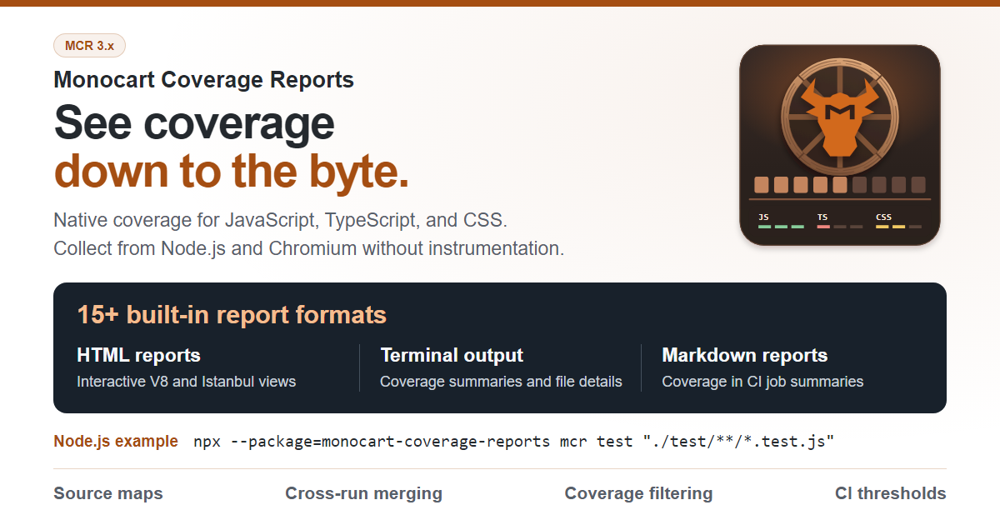

# Monocart Coverage Reports

[](https://www.npmjs.com/package/monocart-coverage-reports)


[](https://packagephobia.com/result?p=monocart-coverage-reports)
[](https://npmgraph.js.org/?q=monocart-coverage-reports)

[](https://www.npmjs.com/package/monocart-coverage-reports)

🌐 [English](https://cenfun.github.io/monocart-coverage-reports/) | 简体中文

> JS代码覆盖率工具，用来生成原生的[V8](https://v8.dev/blog/javascript-code-coverage)或者[Istanbul](https://istanbul.js.org/)代码覆盖率报告

## 文档

- [完整中文文档](https://cenfun.github.io/monocart-coverage-reports/zh/) / [English](https://cenfun.github.io/monocart-coverage-reports/)
- [最佳实践](https://cenfun.github.io/monocart-coverage-reports/zh/getting-started/best-practices.html)
- [配置选项](https://cenfun.github.io/monocart-coverage-reports/zh/reference/options.html)
- [报告演示](https://cenfun.github.io/monocart-coverage-reports/zh/getting-started/examples.html)
- [AI Agent Skill](skills/monocart-coverage-reports/SKILL.md)（随 npm 包发布，支持离线使用）

## Usage
> **MCR 3.x 的所有 API 和 CLI 命令均要求 [Node.js >= 22.15.0](https://nodejs.org/)**，包括普通命令、`merge` 和 `test`。

**从 2.x 升级：** 请参阅 [3.x 迁移指南](https://cenfun.github.io/monocart-coverage-reports/zh/migrations/migration-to-3.html)。

- 安装为开发依赖
```sh
npm i monocart-coverage-reports -D
```
- CLI
```sh
# 使用 Node.js 测试运行器执行测试并采集原生 V8 覆盖率
npx mcr test "./test/**/*.test.js" -r v8,console-summary -o ./coverage-reports
# 或者为任意 Node.js 命令采集覆盖率
npx mcr node my-app.js -r v8,console-details
```
参见[命令行](https://cenfun.github.io/monocart-coverage-reports/zh/reference/cli.html#command-line)和[使用 `mcr test` 运行测试](https://cenfun.github.io/monocart-coverage-reports/zh/getting-started/node-test-runner.html#run-tests-with-mcr-test)

- API
```js
import { MCR } from 'monocart-coverage-reports';
const mcr = MCR({
    name: 'My Coverage Report - 2024-02-28',
    outputDir: './coverage-reports',
    reports: ['v8', 'console-details'],
    cleanCache: true
});
await mcr.add(coverageData);
await mcr.generate();
```
也可以使用ESM的 `import` 然后加载[配置文件](https://cenfun.github.io/monocart-coverage-reports/zh/reference/configuration.html#config-file)
```js
import { CoverageReport } from 'monocart-coverage-reports';
const mcr = new CoverageReport();
await mcr.loadConfig();
```
> `MCR({...})` 和 `new CoverageReport()` 创建的是同一个实例。`MCR()` 是简写工厂函数；`new CoverageReport()` 更适合需要单独调用 `loadConfig()` 的场景。

参见 [多进程支持](https://cenfun.github.io/monocart-coverage-reports/zh/reference/multiprocessing.html#multiprocessing-support)

## License

MIT
