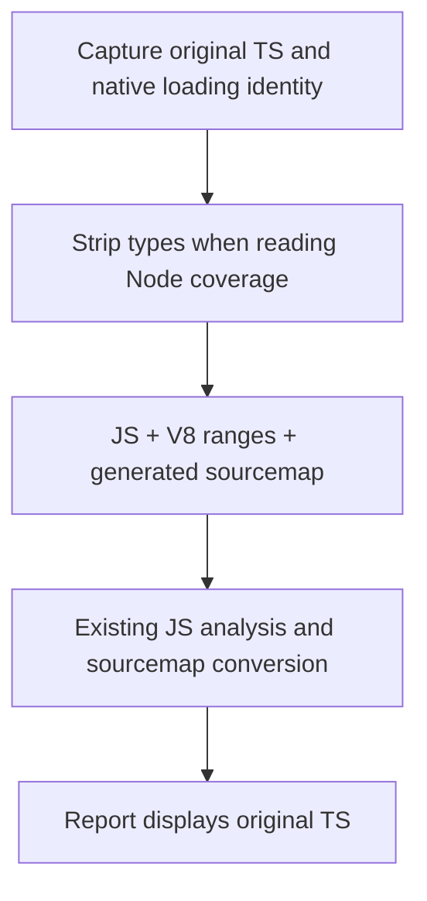

# TypeScript support {#typescript-support}

::: warning Node.js only
The native TypeScript execution described here applies only to Node.js. Browser applications still need to compile TS to JavaScript, collect coverage from the executed JS, and use sourcemaps to recover the original sources.
:::

MCR supports TypeScript executed directly by Node.js using its default **type stripping**. For erasable TS syntax, no build step, external loader or additional TS parser is required:

```sh
npx mcr node ./src/example.ts
npx mcr test "./test/**/*.test.ts"
```

Reports display the original TS, including types. MCR analyzes the stripped JavaScript and generates a sourcemap back to the captured TS, reusing its existing JavaScript/sourcemap reporting pipeline.

## Run a TS program {#run-a-ts-program}

For ESM `.ts` files, set `"type": "module"` in your project's `package.json`. Save the following as `src/math.ts`:

```ts
export interface Input {
    value: number;
}

export function magnitude(input: Input): number {
    if (input.value < 0) {
        return -input.value;
    } else {
        return input.value;
    }
}
```

Create `src/example.ts`:

```ts
import { magnitude } from './math.ts';

console.log(magnitude({ value: -2 }));
```

Install MCR and run the program:

```sh
npm i -D monocart-coverage-reports
npx mcr node ./src/example.ts -r v8,console-summary -o ./coverage-reports
```

Open `coverage-reports/index.html`. The report displays the original TS. Only the negative branch runs in this example.

`mcr node` executes one entry point; `mcr node *.ts` does not run each matching file. Use the test runner for multiple test targets.

## Run TS tests {#run-ts-tests}

Create `test/math.test.ts`:

```ts
import { test } from 'node:test';
import assert from 'node:assert/strict';
import { magnitude } from '../src/math.ts';

test('negative input', (): void => {
    assert.equal(magnitude({ value: -2 }), 2);
});
```

Run Node's built-in test runner and generate coverage:

```sh
npx mcr test "./test/**/*.test.ts" -r v8,console-summary -o ./coverage-reports
```

- Quote globs so Node, not the shell, handles matching. MCR forwards targets to `node --test` without implementing separate TS discovery.
- Tests can use `node:test` and `node:assert/strict`; no additional test runner is required.
- Test failures retain a nonzero exit status while generating available coverage. Report-generation failures are also nonzero.

See [Run tests with mcr test](/getting-started/node-test-runner#run-tests-with-mcr-test) for runner arguments and test-result hooks.

## Configure coverage {#configure-coverage}

An erasable `mcr.config.ts` can use type imports and `satisfies` without preloading a loader:

```ts
import type { McrCliOptions } from 'monocart-coverage-reports';

export default {
    test: './test/**/*.test.ts',
    reports: ['v8', 'console-summary'],
    outputDir: './coverage-reports',
    entryFilter: '**/src/**'
} satisfies McrCliOptions;
```

```sh
npx mcr -c ./mcr.config.ts node ./src/example.ts
# Use the configured test targets
npx mcr -c ./mcr.config.ts test
```

`entryFilter` keeps application sources rather than test files. Use `sourceFilter` for sources unpacked from sourcemaps; native TS also follows this path. See [Filtering](/reference/filtering#filtering).

MCR discovers `mcr.config.ts` after the other default config filenames; an existing `mcr.config.js` takes precedence. Use `-c` to select a config explicitly. Relative paths use the working directory. Configuration syntax outside native stripping still requires a suitable loader.

Native TS loading is identified by MCR's capture hook, not just by a `.ts` extension or a JavaScript parse error. There is no separate `typescript` option or `--typescript` flag in this implementation.

## Reports and source maps {#reports-and-source-maps}



- **Original source:** the CLI captures the loaded `.ts`, `.mts` and `.cts` text, even without sourcemap comments. The generated map contains this exact original in `sourcesContent`; reporting does not need to reread a changed source file.
- **Coordinates:** mappings use line boundaries and transitions between preserved and replaced text. BOM removal is represented in the map rather than by shifting V8 ranges.
- **Functions, branches and statements:** analyzed from the stripped JS and mapped back to TS. Type-only modules do not acquire a synthetic runtime statement merely because a sourcemap is present.
- **Lines and bytes:** currently follow the existing original-source sourcemap reporting rules. Erased type syntax is **not yet treated as comments**, so type-only lines may enter line statistics. Byte coverage uses the original source length and is not a measurement of executable TS tokens.
- **Repeated snapshots:** within a directory import, MCR reuses type stripping and the generated map template for each captured source record. Every entry receives an independent map object and arrays, so `onEntry` changes do not affect later snapshots.
- **Raw reports:** retain stripped JS, V8 ranges, native identity and the generated map containing the original TS. Regeneration and merging do not strip again or require the original source file.
- **Existing map comments:** TS `sourceMappingURL` comments do not replace MCR's generated map, because they may describe another compilation output.

Captures from separate Node processes or worker threads are associated with their own source versions, even when they share a URL and capture directory; this also applies to captured JavaScript. Preserve the original Node coverage filenames and source execution metadata. See [Node coverage imports](/coverage-collection/v8#generate) for legacy capture compatibility and same-process limitations, and [Merging reports](/reference/merging#merging-reports) for combining independent collections.

## Supported syntax {#supported-syntax}

Node's erasable TS syntax includes type annotations, interfaces, type aliases, type-only imports/exports, generic parameters, overload signatures, `as`, `satisfies` and non-null assertions. Syntax support follows the installed Node.js version.

| Extension | Module system |
| --- | --- |
| `.ts` | Determined like `.js`; use `"type": "module"` for ESM. |
| `.mts` | Always ESM. |
| `.cts` | Always CommonJS; use CommonJS runtime exports. |

Use actual extensions in relative imports, such as `import './math.ts'`. Use `import type` for imports that only exist at the type level. This feature does not enable type annotations in `.js` files.

### Check for non-erasable syntax {#check-erasable-syntax}

Node.js strips types but does not generate JavaScript for syntax such as `enum`, constructor parameter properties or namespaces with runtime code. To catch these before running your code, enable `erasableSyntaxOnly` (TypeScript **5.8 or later**) in your project's `tsconfig.json`:

```json
{
    "compilerOptions": {
        "target": "esnext",
        "module": "nodenext",
        "noEmit": true,
        "allowImportingTsExtensions": true,
        "verbatimModuleSyntax": true,
        "erasableSyntaxOnly": true,
        "types": ["node"]
    },
    "include": ["src", "test", "mcr.config.ts"]
}
```

Adjust `include` to cover the TypeScript files your project runs directly. Install TypeScript and the Node.js type declarations, then run the check locally or in CI:

```sh
npm i -D typescript @types/node
npx tsc --noEmit
```

Node.js does not read `tsconfig.json`; the check reports non-erasable syntax without rewriting it. To run directly in Node.js, replace that syntax with standard JavaScript and erasable types.

#### String enums {#replace-string-enums}

Replace `enum Status { Pending = 'pending', Done = 'done' }` with an `as const` object and derive a union of its values:

```ts
export const Status = {
    Pending: 'pending',
    Done: 'done'
} as const;

export type Status = (typeof Status)[keyof typeof Status];
```

`Status.Pending` is available at runtime, while the `Status` type is `'pending' | 'done'`.

#### Constructor parameter properties {#replace-constructor-parameter-properties}

Replace `constructor(public readonly name: string) {}` with a field declaration and an explicit assignment:

```ts
export class User {
    readonly name: string;

    constructor(name: string) {
        this.name = name;
    }
}
```

#### Namespaces with runtime code {#replace-runtime-namespaces}

Prefer named exports in a separate module. To keep calls such as `MathUtils.double(2)`, replace `namespace MathUtils { export function double(...) { ... } }` with a plain object:

```ts
export const MathUtils = {
    double(value: number): number {
        return value * 2;
    }
};
```

## Node.js requirements {#nodejs-requirements}

MCR requires **Node.js 22.18.0 or later**. Check the version that launches MCR with `node --version`.

| Node.js | Type stripping by default | Version notes |
| --- | --- | --- |
| [22.x](https://nodejs.org/docs/latest-v22.x/api/typescript.html) | Since **22.18.0** | In 22.6.0–22.17.x, stripping requires `--experimental-strip-types`; those versions are below MCR's minimum. `.cts` files preloaded by Node's `--require` may be missing from reports because they load before source capture. Use `--import` or load them from your entry point. |
| [24.x](https://nodejs.org/docs/latest-v24.x/api/typescript.html) | Yes | Type stripping became stable in **24.12.0**. |
| [26.x](https://nodejs.org/docs/latest-v26.x/api/typescript.html) | Yes | Type stripping is stable. Node removed `--experimental-transform-types` in **26.0.0**. |

This table covers Node's built-in type stripping, not full TypeScript transpilation. Test discovery and supported syntax depend on the Node.js version.

MCR uses Node's built-in `module.stripTypeScriptTypes()` in strip mode. This API has its own stability status and may emit an experimental warning during report generation, even on Node.js versions where direct TS execution is stable. MCR does not suppress these warnings globally.

See the [Node.js TypeScript documentation](https://nodejs.org/api/typescript.html) for runtime syntax restrictions.

## Limitations {#limitations}

- **No type checking.** Run `tsc --noEmit` separately if needed. TypeScript itself is optional for native execution and coverage.
- **No `tsconfig.json` execution settings.** Node does not apply `paths`, convert module systems or downlevel JS according to `target`.
- **No JSX/TSX or decorator transformation.** Use a suitable loader or build tool.
- **No transform mode.** Node 26 removed `--experimental-transform-types`. On older Node versions that accept the flag, MCR does not capture native TS source in transform mode. The existing coverage import still runs and can use any sourcemaps Node supplies; JavaScript reporting is unchanged. See [Check for non-erasable syntax](#check-erasable-syntax) for checks and alternatives to enums, constructor parameter properties and runtime namespaces. If you need to keep that syntax, use a loader or build tool that emits JavaScript and sourcemaps.
- **No new native analysis for unexecuted TS.** `all` retains its existing behavior. Use `all.transformer` with JS and a sourcemap for accurate AST metrics of unexecuted TS; see [Untested files](/reference/untested-files#transform-source-code).
- **No native TS distribution shortcut.** Node normally refuses to strip TS under `node_modules`; libraries should generally distribute compiled JS.

For projects outside these restrictions, retain an external runtime such as `tsx`:

```sh
npm i -D tsx
npx mcr --import tsx node ./src/example.ts
npx mcr --import tsx test "./test/**/*.test.ts"
```

External loaders and precompiled JS keep their existing coverage paths. See [external loader examples](/integrations/frameworks-and-tools#external-loaders).

## Repository examples {#repository-examples}

In an MCR source checkout with dependencies installed and runtime bundles built:

```sh
npm run test-node-ts
npm run test-mcr-test-ts
```

These execute `test/node-ts/` directly, without building the TS fixtures or loading `tsx`. Their configs are `test/mcr.config.node-ts.ts` and `test/mcr.config.mcr-test-ts.ts`.

Reports are written to `.temp/site/reports/node-ts/index.html` and `.temp/site/reports/mcr-test-ts/index.html`. The fixtures cover `.ts`, `.mts`, `.cts`, type-only modules and runtime branches; they do not enable `all`. See [Report examples](/getting-started/examples#report-examples) for links.
