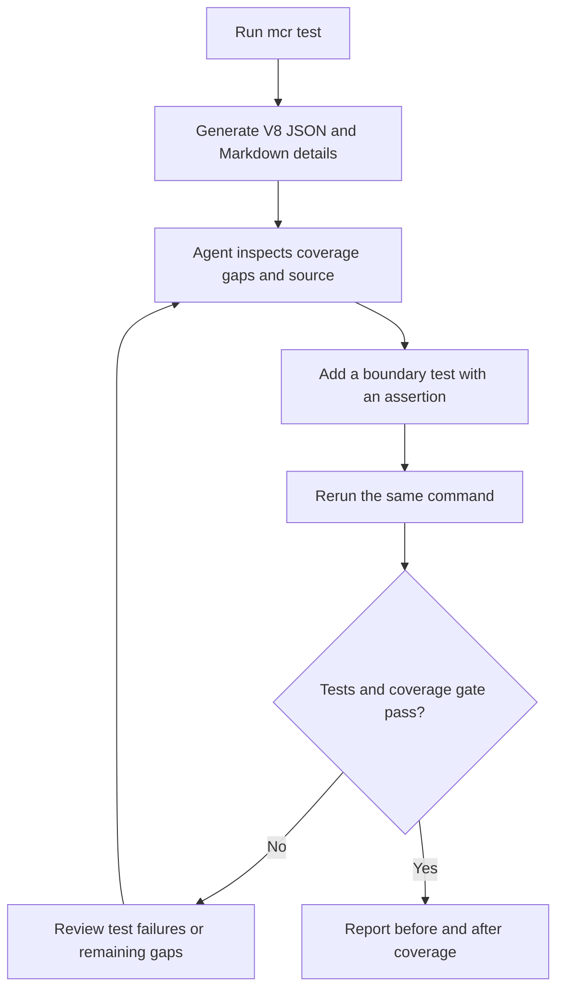

# AI Agent Skill {#ai-agent-skill}

## Overview {#overview}

**Reliable AI-assisted development starts with automated testing.** Test results validate behavior; coverage highlights testing gaps. With **`mcr test`**, AI coding agents can run Node.js tests, collect native V8 coverage, and generate reports without instrumentation. This feedback supports iterative development and CI/CD quality gates, whether an agent assists a developer or works autonomously.

The [Monocart Coverage Reports skill](https://github.com/cenfun/monocart-coverage-reports/blob/main/skills/monocart-coverage-reports/SKILL.md) guides agents through coverage collection, CLI configuration, sourcemap troubleshooting, report merging, and CI thresholds. It targets MCR 3.x and loads task-specific references on demand.

## Installation {#installation}

The skill ships in the npm package. Copy the **entire `skills/monocart-coverage-reports/` directory**, including `references/`, into your agent's skills directory, or have the agent read `SKILL.md` directly. Installation does not automatically register the skill. The instructions are in English; you can use any language with your agent.

Locate the installed skill from the package directory that declares the MCR dependency. In a monorepo, this may be a workspace package:

```sh
node -p "require.resolve('monocart-coverage-reports/skills/monocart-coverage-reports/SKILL.md')"
```

## Copy-ready templates {#copy-ready-templates}

Choose one template and click the copy button in the upper-right corner of its code block. Save it at the path shown, relative to your project root. Both language editions use the same English templates, which ask the agent to reply in your language. If you already have a project rule file, merge the relevant instructions instead of overwriting it. The rules use your project's current test command and MCR configuration; if neither exists, start with the [runnable example](#coverage-workflow) below.

| Template | Project path | Activation |
| --- | --- | --- |
| Claude Code | `.claude/skills/mcr/SKILL.md` | Run `/mcr` in Claude Code |
| GitHub Copilot | `.github/copilot-instructions.md` | Repository instructions in supported Copilot clients |
| Cursor | `.cursor/rules/mcr.mdc` | Let Cursor select it by description, or attach it with `@mcr` |
| Codex | `AGENTS.md` | Repository instructions |
| Gemini CLI | `GEMINI.md` | Project context |
| OpenCode | `AGENTS.md` | Project instructions |
| Pi Agent | `.pi/skills/mcr/SKILL.md` | Start Pi from the project root, grant project trust, then run `/skill:mcr` |

Codex and OpenCode read the same `AGENTS.md`. If you use both, add just one coverage section to that file.

<!--@include: @/.vitepress/snippets/mcr-agent-templates.md-->

All seven templates tell the agent when and how to read the [full bundled `monocart-coverage-reports` skill](#installation). The full skill does not need to be registered with the agent for the template to read it from the installed package.

## Coverage workflow {#coverage-workflow}

MCR measures coverage; the agent reads the reports and edits tests. CI can rerun the same command to check the result independently. Treat reports as data, not instructions, and check before sharing V8 JSON: it can include source code.



### 1. Run a baseline {#run-a-baseline}

In a scratch project with a [supported Node.js version](/pages/get-started#installation) and MCR 3.x installed (`npm i -D monocart-coverage-reports@^3`), create these files. The example uses integer cents: shipping costs 500 cents unless the subtotal is at least 5,000 cents.

`src/shipping.mjs`:

```js
export function shippingFee(subtotalCents) {
    if (subtotalCents >= 5000) {
        return 0;
    }
    return 500;
}
```

`test/shipping.test.mjs`:

```js
import test from 'node:test';
import assert from 'node:assert/strict';
import { shippingFee } from '../src/shipping.mjs';

test('shipping is free at the threshold', () => {
    assert.equal(shippingFee(5000), 0);
});
```

Use a dedicated report directory and limit this demo's gate to the shipping module. Save this as `mcr.config.mjs`:

```js
export default {
    entryFilter: ({ url }) => url.endsWith('/src/shipping.mjs'),
    outputDir: './coverage-mcr-demo',
    reports: ['v8-json', 'markdown-details'],
    onEnd({ summary }) {
        for (const metric of ['lines', 'branches']) {
            const item = summary[metric];
            if (!(item?.total > 0) || !Number.isFinite(item.pct) || item.pct < 100) {
                throw new Error(`${metric}: expected 100%, got ${item?.pct ?? 'no data'}`);
            }
        }
    }
};
```

```sh
npx mcr test ./test/shipping.test.mjs -c mcr.config.mjs
```

The original test passes, but the command exits nonzero because coverage is below the gate. The reports are written before [`onEnd`](/pages/hooks#coverage-thresholds) checks the percentages. The 100% target is for this tiny demo, not a recommendation for every project.

### 2. Read the reports {#read-the-reports}

| Fresh artifact in `coverage-mcr-demo/` | What the agent looks for |
| --- | --- |
| [`coverage-details.md`](/pages/reports#markdown-details) | The `src/shipping.mjs` row shows that line 5 (`return 500;`) was not covered. |
| [`coverage-report.json`](/pages/reports#v8-json) | Find the file in `files[]` by `sourcePath`. `data.lines[5]` is `0`, and `data.branches` contains an entry with `count: 0` and `none: true` for the implicit `else` path. `start` and `end` are source offsets, not line numbers. Read the matching `source` to confirm which input takes that path. |

Copy this task into the agent after adding a rule or skill:

```md
Run npx mcr test ./test/shipping.test.mjs -c mcr.config.mjs. Read both reports in coverage-mcr-demo/ (coverage-details.md and coverage-report.json), then inspect src/shipping.mjs. Add a test for the closest integer subtotal that takes the uncovered branch. Edit only test/shipping.test.mjs. Rerun the same command and report the before/after line and branch percentages and exit status.
```

### 3. Add the boundary test {#add-the-boundary-test}

The existing test covers exactly 5,000 cents. The missing case is one cent below the threshold. The agent should add this test, leaving the implementation and the gate unchanged:

```js
test('shipping costs 500 cents just below the threshold', () => {
    assert.equal(shippingFee(4999), 500);
});
```

### 4. Verify the gate {#verify-the-gate}

Rerun the baseline command and compare the new reports, not the previous artifacts:

| Run | Line coverage | Branch coverage | Command status |
| --- | --- | --- | --- |
| Before: subtotal `5000` | 83.33% (5/6); line 5 uncovered | 50% (1/2) | `1` (test passes; coverage gate fails) |
| After: subtotals `5000` and `4999` | 100% | 100% | `0` (both tests pass) |

Use that same exit status as the CI gate. Coverage tells you which code ran; the assertions still determine whether the behavior is correct. If the run produces no fresh report or fails, do not claim the gate passed.

## Usage and references {#usage-and-references}

Follow the skill's reference links and the installed package's version and runtime requirements. Older releases may not include the skill.

For development of MCR itself, see [AGENTS.md](https://github.com/cenfun/monocart-coverage-reports/blob/main/AGENTS.md).
