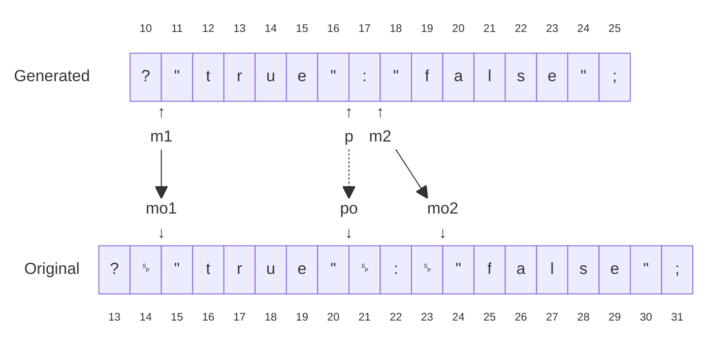

# Common issues {#common-issues}

## Unexpected coverage {#unexpected-coverage}

| Symptom | Likely cause | What to do |
| --- | --- | --- |
| No report was generated | The command failed, the tests did not execute the code under test, or no usable coverage was collected or imported. | Check the exit status and collected data, then follow the report generation steps for [V8](/pages/v8#generate) or [Istanbul](/pages/istanbul#generate). |
| One or more files are missing | A filter excluded them, or the files are absent from both collected data and sourcemaps. | For V8, check entry URLs, unpacked source paths, and final report paths in [filtering order](/pages/filtering#filtering-pipeline). To count untested files, [include them with `all`](/pages/untested-files). |
| Covered lines or branches do not match what ran | Build artifacts may not match, or a coverage endpoint may fall between mapping points. | Follow the [sourcemap checks](./sourcemaps#quick-diagnosis). If all artifacts match, check for an [endpoint between mapping points](#between-mapping-points). |

### Between mapping points {#between-mapping-points}

This example uses esbuild with whitespace minification. The generated code has the same behavior but different character offsets.

**Generated JavaScript:**

<!-- eslint-skip -->
```js
const a=tf?"true":"false";
```

**Original JavaScript:**

<!-- eslint-skip -->
```js
const a = tf ? "true" : "false";
```



**How to read the diagram.** It shows the relevant part of each line. Numbers are zero-based offsets into the full lines above, and `␠` represents a space. An arrow next to a label points to the boundary before a character. A solid connector is a mapping recorded in the sourcemap; the dashed connector is a position inferred by MCR.

- `p` (17) is the end of a V8 coverage range in the generated code, between the closing quote of `"true"` and the colon. For example, V8 reports an uncovered range ending there when `tf` is false.
- The closest sourcemap entries on either side map `m1` (11) to `mo1` (15), and `m2` (18) to `mo2` (24). These are the opening quotes of `"true"` and `"false"` in the two versions. They are mapping points, not coverage endpoints.

**Goal.** Find `po`, the position in the original source that corresponds to `p`. A generated coverage start maps to an original start, and a generated end maps to an original end. V8 ranges include the start and exclude the end (`[startOffset, endOffset)`).

**Why a lookup is not enough.** This sourcemap has no entry at `p`. A conventional lookup can return the original position of the preceding or following mapping, depending on the lookup rule. Either way, `mo1` or `mo2` points to an opening quote, not the end of `"true"`.

**How MCR refines the result.** MCR compares the text between `m1` and `m2` with the text between `mo1` and `mo2` when the two original anchors are on the same line and in order. Here it compares `"true":` with `"true"␠:␠`, locating `po` at offset 21, just after the closing quote in the original. It can use `diff-sequences` to align matching text when needed. The result is not always exact: compiling JSX or Vue templates can rewrite the code so that the generated endpoint has no exact counterpart. In such cases, the accuracy of the reported position depends on how faithfully the build tool’s sourcemap describes the transformation.

If minification makes the mapping hard to follow, try rebuilding with minification disabled, rerun coverage on that build, then [inspect the sourcemap and debug data](/pages/sourcemaps).

V8 supplies runtime ranges and counts, not source-level statement or branch counters. MCR combines abstract syntax tree (AST) analysis with V8 ranges to derive function, statement, branch, and line metrics. For compiled code, it analyzes the JavaScript that ran and uses the sourcemap to map coverage back to the original source. Some counts cannot be inferred independently: for a default parameter such as `x = 1` (`AssignmentPattern`), MCR uses the enclosing range's count, not the number of times the default value was used. This is one reason [V8 and Istanbul reports](/pages/compare-reports) can differ.

## Unparsable source {#unparsable-source}

JSX and Vue templates, for example, require different parsing than ordinary JavaScript. Identify whether the failing file is the generated code that ran, the original source in a sourcemap, or an untested file included through `all`:

- **Code that ran:** Keep the JavaScript that actually executed and its corresponding sourcemap. Do not substitute newly compiled code after collection: V8 offsets refer to the source that ran.
- **Original source in a sourcemap:** If the report shows the wrong source or positions, [inspect the sourcemap](/pages/sourcemaps#inspect-sourcemaps) and check that it and the original source match the build that ran.
- **Native TypeScript:** Check the [Node.js version and supported syntax](/pages/typescript#supported-syntax). For syntax Node cannot run natively, compile it with sourcemaps before running the tests or use an [external loader](/pages/typescript#external-loaders) during execution.
- **Untested files:** Use [`all.transformer`](/pages/untested-files#transform-source-code) when preparing empty coverage, and preserve the matching sourcemap.

For example, with `@swc/core` installed, transform untested `.ts` files under `src/` into JavaScript before MCR parses them. This example does not handle JSX, TSX, or Vue files, and it does not change the code that ran during the tests.

```js
import { fileURLToPath } from 'node:url';
import { transform } from '@swc/core';

const coverageOptions = {
    all: {
        dir: ['./src'],
        filter: '**/*.ts',
        transformer: async (entry) => {
            const { code, map } = await transform(entry.source, {
                filename: fileURLToPath(entry.url),
                sourceMaps: true,
                isModule: true,
                jsc: {
                    parser: {
                        syntax: 'typescript'
                    }
                }
            });
            entry.source = code;
            entry.sourceMap = JSON.parse(map);
        }
    }
};
```

## JavaScript heap out of memory {#javascript-heap-out-of-memory}

Even when MCR processes files one at a time, a single large JavaScript bundle can exhaust the heap: its code, V8 coverage ranges, AST, and sourcemap may all be in memory at once.

1. **Check the largest bundles.** [Timing logs](/pages/sourcemaps#view-timing-logs) show only completed stages. If MCR crashes mid-stage, check the largest bundles first. If possible, split them and collect coverage again with matching sourcemaps.
2. **Reclaim temporary memory.** [`gc: 1024`](/pages/options#gc) triggers garbage collection at processing checkpoints above 1024 MB of heap usage. It cannot free data still in use.
3. **Raise the heap limit if needed.** If the machine has enough memory, set `NODE_OPTIONS` for the process running MCR. For example, in GitHub Actions:

```yaml
- run: npx mcr merge --inputDir ./raw --outputDir ./coverage-reports/merged
  env:
    NODE_OPTIONS: --max-old-space-size=8192
```

Substitute your actual collection or merge command, and use a dedicated report output directory.
