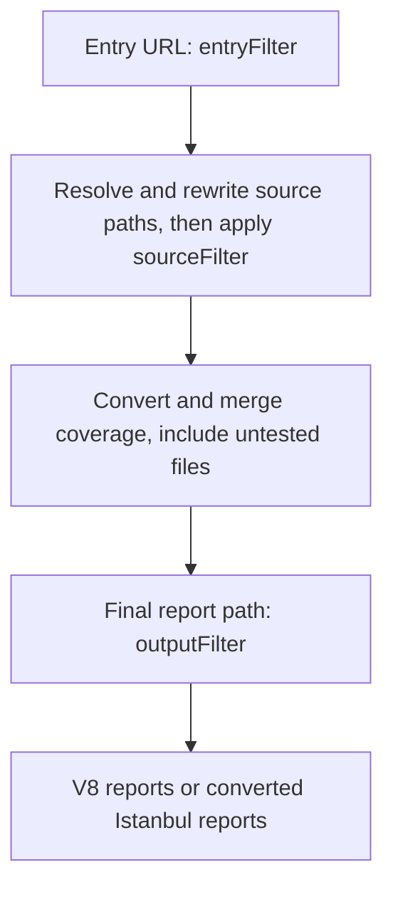

# Filtering {#filtering}

V8 input can be filtered at three stages: collected entries, unpacked sources, and final report files. Use `entryFilter` and `sourceFilter` to avoid processing unwanted files; use `outputFilter` to match the paths shown in the report. See the [trade-offs](#filtering-approaches).

## Filtering pipeline {#filtering-pipeline}



The diagram omits raw data export; `outputFilter` does not affect [raw reports](/pages/reports#raw). See [source path rewrites](/pages/source-path) and [including untested files](/pages/untested-files).

## entryFilter + sourceFilter {#entryfilter-sourcefilter}

`entryFilter` receives a [`V8CoverageEntry`](/pages/types#v8coverageentry). Keep the entry URLs you need, such as `dist/main.js`, and exclude separate entries such as `dist/vendor.js`. If dependencies and application code share a bundle, keep the bundle and use `sourceFilter` to select normalized paths (after any `sourcePath` rewrites) under `src/` instead of `node_modules/`. After successful mapping, the generated entry is normally hidden unless [debug logging](/pages/sourcemaps#enable-debugging) is enabled.

For example:
```js
const coverageOptions = {
    entryFilter: (entry) => entry.url.indexOf('main.js') !== -1,
    sourceFilter: (sourcePath) => sourcePath.search(/src\//) !== -1
};
```
Or using [`minimatch`](https://github.com/isaacs/minimatch) pattern:
```js
const coverageOptions = {
    entryFilter: '**/main.js',
    sourceFilter: '**/src/**'
};
```
Support multiple patterns:
```js
const coverageOptions = {
    entryFilter: {
        '**/node_modules/**': false,
        '**/vendor.js': false,
        '**/src/**': true
    },
    sourceFilter: {
        '**/node_modules/**': false,
        '**/**': true
    }
};
```
As CLI args (JSON-like string. Added in: v2.8):
```sh
npx mcr --sourceFilter "{'**/node_modules/**':false,'**/**':true}" -- node demo.js
```
Note, those patterns will be transformed to a function, and the order of the patterns will impact the results:
```js
const coverageOptions = {
    entryFilter: (entry) => {
        if (minimatch(entry.url, '**/node_modules/**')) {
            return false;
        }
        if (minimatch(entry.url, '**/vendor.js')) {
            return false;
        }
        if (minimatch(entry.url, '**/src/**')) {
            return true;
        }
        // else unmatched
        return false;
    }
};
```

## filter {#filter}

If you don't want to define both `entryFilter` and `sourceFilter`, you can use `filter` instead. (Added in: v2.8)
```js
const coverageOptions = {
    // combined patterns
    filter: {
        '**/node_modules/**': false,
        '**/vendor.js': false,
        '**/src/**': true,
        '**/**': true
    }
};
```

## outputFilter {#outputfilter}

Use `outputFilter` to filter the final file list.

> **Version requirement:** `outputFilter` is introduced in **v3.0.0**. It is not supported in v2.13.x or earlier.

For V8 input, `outputFilter` filters both V8 reports and converted Istanbul reports. It defaults to `null` (disabled).

Like `entryFilter` and `sourceFilter`, it supports strings and ordered pattern objects (the first matching pattern wins; unmatched files are excluded). Patterns match the final `sourcePath`, including any `sourcePath` rewrites. A function receives the final file [`entry`](/pages/types#coveragefile) (`CoverageFile`), not a path string.

```js
const coverageOptions = {
    outputFilter: {
        '**/node_modules/**': false,
        '**/src/**': true
    }
};
// Alternatively:
// outputFilter: '**/src/**'
// outputFilter: (entry) => entry.sourcePath.startsWith('src/')
```

CLI examples (quote patterns to prevent shell expansion):
```sh
mcr merge --inputDir ./raw --outputFilter "**/src/**"
mcr merge --inputDir ./raw --outputFilter "{'**/node_modules/**':false,'**/src/**':true}"
```

`outputFilter` does not change raw coverage exports and does not apply to Istanbul input.

## Filtering approaches {#filtering-approaches}

You can choose either input filtering (`entryFilter` + `sourceFilter`) or output filtering (`outputFilter`), depending on your needs. Each has advantages and trade-offs, and they can also be used together. The combined `filter` option is shorthand for `entryFilter` + `sourceFilter`; it does not configure `outputFilter`.

| Approach | When and what it filters | Advantages | Trade-offs |
| :-- | :-- | :-- | :-- |
| `entryFilter` + `sourceFilter` (or `filter`) | Filters inputs during discovery: `entryFilter` matches entry URLs, and `sourceFilter` matches source paths as sourcemaps are unpacked. | Excludes unwanted files earlier, avoiding unnecessary downstream processing. Prefer this approach for better performance, especially with large projects or bundles. | Requires understanding entry files versus sourcemap sources and configuring both stages. Excluding a bundle via `entryFilter` also removes any desired sources inside it. |
| `outputFilter` | Filters final files by `sourcePath` after sourcemap conversion, merging and adding untested files (`all`), immediately before report generation. | Simpler configuration: use one filter against the final file list, without distinguishing entries from unpacked sources. | Unwanted files are still discovered and processed before being discarded. This does not save their earlier processing cost and can increase generation time and memory usage, especially when many files will ultimately be excluded. |

**Using one approach:** use input filtering (`entryFilter` + `sourceFilter`, or `filter`) when performance matters. Choose `outputFilter` when simpler configuration and filtering the final results are more important, and the extra processing cost is acceptable.

**Combining approaches is also supported**, but overlapping or conflicting rules can easily exclude files unintentionally. Define a clear responsibility for each stage: for example, use `entryFilter` to retain the required bundles, `sourceFilter` to exclude known unwanted sources, and `outputFilter` to select the final files by their rewritten `sourcePath`.

Input filters run first; `outputFilter` only filters the resulting final file list. It cannot restore sources excluded by `entryFilter` or `sourceFilter`. In particular, excluding a bundle also excludes the sources inside it. When combining approaches, check the entry URLs, sourcemap source paths, and final paths separately to ensure that the rules at each stage match your intent.

::: info Related guides
- [Untested files](./untested-files#filter-files): include files with `all` and check which filters still apply.
- [Source paths](./source-path#path-normalization): check the rewritten paths that `sourceFilter` and `outputFilter` match.
:::
