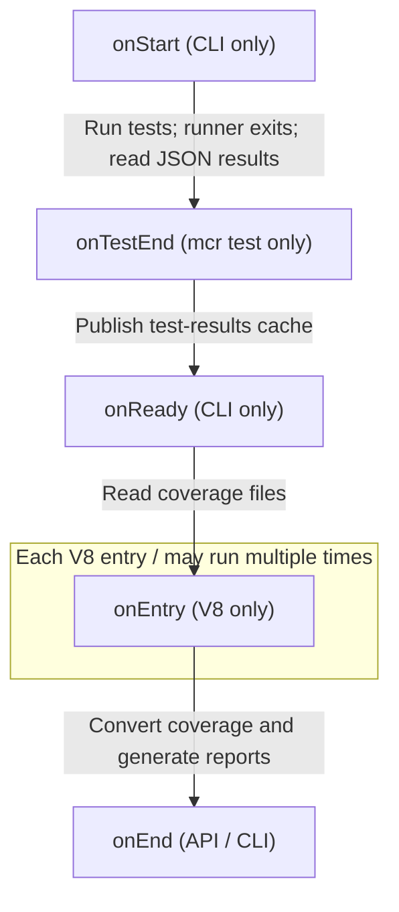

# Hooks {#hooks}

## Workflow {#test-end-workflow}

The diagram shows the normal `mcr test` flow with configured hooks and usable test results and coverage. Each hook is awaited. `onTestEnd` runs once before `onReady`; `onEntry` runs for each V8 entry and may run multiple times.



## `onStart` {#onstart--onready--cli-only}

Only available when using `mcr <command>`. `onStart(coverageReport)` runs before the child process is spawned.

Parameter: [`coverageReport`](/reference/types#coveragereport), of type `CoverageReport`.

```js
// mcr.config.js
export default {
    onStart: async (coverageReport) => {
        // perform setup before starting the child process
    }
};
```

## `onTestEnd` {#ontestend--mcr-test-only}

Available with `mcr test` only. See [Run tests with mcr test](/getting-started/node-test-runner#run-tests-with-mcr-test) for configuration and usage.

`onTestEnd(testResults)` runs once after the test runner exits and its JSON results are collected, before publishing the test results cache, `onReady`, and coverage generation. It is awaited even when assertions fail. Other commands, API calls, and runs skipped because no targets were supplied do not call it. The existing `onEnd(coverageResults)` is unchanged.

Parameter: [`testResults`](/reference/types#testresults), of type `TestResults`.

### Usage {#test-end-usage}

`mcr test` always collects structured test results using an internal JSON reporter, preserving terminal output and user-specified reporter/destination pairs. `onTestEnd` is optional; omitting it does not disable result collection. To retain results for later use, enable `raw` reports or debug logging; normal cache cleanup still applies.

```js
// mcr.config.js
export default {
    test: './test/**/*.test.js',
    onTestEnd: (testResults) => {
        console.log(testResults.summary);
        for (const test of testResults.tests) {
            console.log(test.name, test.status, test.error);
        }
    }
};
```

### Result structure {#test-results}

- `id`: a collection ID generated with the same `Util.uid()` mechanism as coverage cache data.
- `framework`: `'node:test'`.
- `complete`: whether the final runner summary was received, not whether tests passed.
- `summary`: `{ tests, suites, passed, failed, cancelled, skipped, todo, duration, success }`; `null` if incomplete. Counts come from the runner's final summary; `tests` excludes suites. Durations are in milliseconds.
- `tests`: completed test and suite records, including nested tests: `{ name, type, nesting, testNumber, file?, line?, column?, duration, status, skip?, todo?, error? }`. Status is `passed`, `failed`, `cancelled`, `skipped`, or `todo`. Errors always include string `name` and `message` (defaults: `'Error'` and `''`). Other own enumerable data properties are copied only when their values are strings, booleans, finite numbers, or `null`; BigInts become decimal strings. Getters/setters, objects/arrays, functions, symbols, `undefined`, `NaN`, and infinities are omitted without recursive traversal. Apart from the two fixed fields, inherited/non-enumerable properties are not collected, so normal `stack` is omitted and fields inside `cause` are not flattened. Explicitly enumerable string `stack` is copied like any other string. Reserved keys `__proto__`, `constructor`, and `prototype` are excluded; the fixed fields cannot be overwritten by extra properties.

### Failure handling {#test-end-errors}

Test failures, incomplete/missing/invalid reports, and hook errors keep the command nonzero. An incomplete report is delivered with `complete: false`; a missing or invalid JSON report cannot be delivered and is logged as a collection error. A nonzero `process.exitCode` set by `onTestEnd` cannot be cleared by later coverage hooks. Hook/collection errors do not prevent MCR from attempting coverage generation. If the hook throws, test results are not published or exported, rather than falling back to possibly unredacted data. Test results are independent of coverage, so this hook can run even if coverage generation later fails.

### Cache and export {#test-results-cache}

Test results use the same ID and filename mechanism as coverage cache data: `outputDir/.cache/test-results-<id>.json`, with the same `id` stored in the JSON. The reporter streams records into `.json.tmp` with its collection ID already included. A small `.meta.tmp` completion record verifies the final byte count. Without a hook, MCR reads only this completion record and renames the JSON, without loading or rewriting the full report. With a hook, MCR reads the full result object and publishes its mutations after the hook completes. Temporary output and metadata are removed before coverage generation. Finalized JSON follows the coverage cache lifecycle: normally cleaned after generation, retained in debug mode, or exported by `raw` (including ZIP). It is not embedded in HTML/coverage JSON reports, and importing raw data does not yet merge test results. Save results yourself if needed; files written into `outputDir` by this hook may be removed by the subsequent coverage cleanup when `clean: true`.

### Sensitive data {#sensitive-data}

Primitive does not mean non-sensitive: a string `token`, `password`, or response body is also copied. Messages, test names, and paths may contain credentials or personal data; large strings can also increase report size. MCR does not redact them automatically. Keep the output directory private and review raw/debug artifacts before uploading them. Mutate results in `onTestEnd` to sanitize the persisted JSON; this does not redact Node's terminal output or data already written to temporary files. For example, adapt the following rule to your application's data:

```js
export default {
    onTestEnd: (results) => {
        for (const test of results.tests) {
            if (test.error) {
                for (const [key, value] of Object.entries(test.error)) {
                    if (typeof value === 'string') {
                        test.error[key] = value.replace(/(Bearer\s+)\S+/gi, '$1[REDACTED]');
                    }
                }
            }
        }
    }
};
```

## `onReady` {#onready}

Only available when using `mcr <command>`. `onReady(coverageReport, nodeV8CoverageDir, subprocess)` runs after the child exits, before MCR reads coverage from `nodeV8CoverageDir`. Useful when the child hasn't finished flushing coverage data and needs to be waited on.

Parameters:

- [`coverageReport`](/reference/types#coveragereport): `CoverageReport`.
- `nodeV8CoverageDir`: `string`, the Node.js V8 coverage directory.
- `subprocess`: `any`, the Node.js `ChildProcess` object.

```js
// mcr.config.js
export default {
    onReady: async (coverageReport, nodeV8CoverageDir, subprocess) => {
        // wait for something, or pre-process the raw files
    }
};
```

## `onEntry` {#onentry--before-each-v8-entry-is-processed-v8-only}

Runs before each V8 entry is processed (V8 only).

Parameter: [`entry`](/reference/types#v8coverageentry), of type `V8CoverageEntry`.

Use this to mutate the entry (for example, transform non-standard sources into valid ECMAScript before the AST parser runs). See [Unparsable source](/troubleshooting/common-issues#unparsable-source).
```js
const coverageOptions = {
    onEntry: async (entry) => {
        // entry.source, entry.sourceMap, entry.fake, ...
    }
};
```

## `onEnd` {#onend--after-the-report-is-generated}

Runs after the report is generated.

Parameter: [`coverageResults`](/reference/types#coverageresults), of type `CoverageResults | undefined`.

```js
const coverageOptions = {
    onEnd: async (coverageResults) => {
        // coverageResults.type, coverageResults.summary, coverageResults.files, ...
    }
};
```

### Coverage thresholds {#coverage-thresholds}

Typical use case: enforce coverage thresholds. Throw on failure so API callers can handle the error and the CLI exits nonzero, without forcing `process.exit()` before cleanup finishes.
```js
const getCoverageError = (metric, summary, minimum) => {
    if (!summary || !(summary.total > 0)) {
        return `${metric}: missing or empty coverage`;
    }
    const { pct } = summary;
    if (typeof pct !== 'number' || !Number.isFinite(pct) || pct < minimum) {
        return `${metric}: ${pct}%, required ${minimum}%`;
    }
    return '';
};
const coverageOptions = {
    name: 'My Coverage Report',
    outputDir: './coverage-reports',
    onEnd: (coverageResults) => {
        if (!coverageResults) {
            throw new Error('No coverage results');
        }
        const thresholds = {
            bytes: 80,
            lines: 60
        };
        const errors = [];
        for (const [metric, minimum] of Object.entries(thresholds)) {
            const error = getCoverageError(metric, coverageResults.summary?.[metric], minimum);
            if (error) {
                errors.push(error);
            }
        }
        if (errors.length) {
            throw new Error(errors.join('\n'));
        }
    }
};
```

This policy rejects missing/zero-total metrics; adapt it explicitly if a metric is legitimately empty. With no usable input, `generate()` may return `undefined` without calling `onEnd`. API callers must check that result; ordinary CLI workflows should use a fresh output directory and verify a newly generated nonempty report. See the [strict CI recipes](https://github.com/cenfun/monocart-coverage-reports/blob/main/skills/monocart-coverage-reports/references/reports-and-ci.md#reject-stale-reports-and-missing-collection-in-ci).
