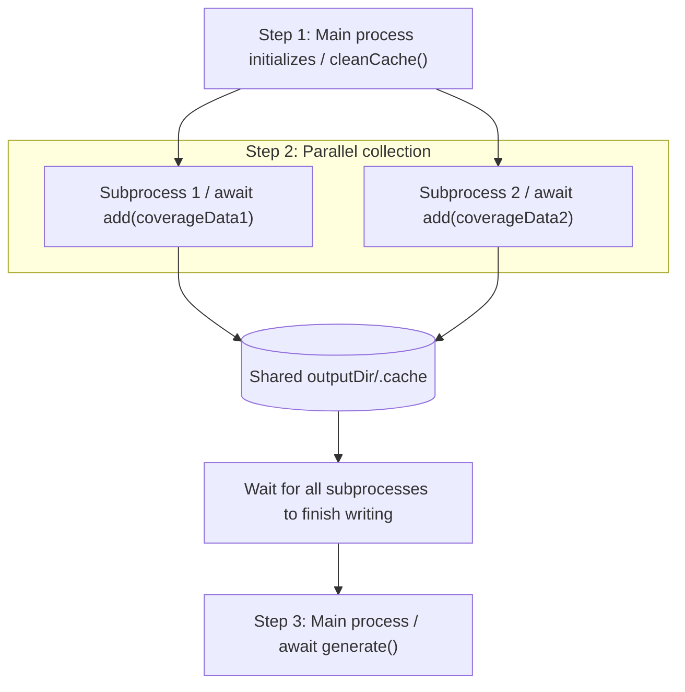

# Multiple processes {#multiprocessing-support}
> The data will be added to `[outputDir]/.cache`, After the generation of the report, this data will be removed unless debugging has been enabled or a raw report has been used, see [Debug for Coverage and Sourcemap](/troubleshooting/sourcemaps#debug-for-coverage-and-sourcemap)

## Workflow {#workflow}

The subprocesses run in parallel and write to the same cache. Report generation starts only after all subprocesses have finished writing.



## Step 1: Initialize the main process {#initialize}

```js
import { MCR } from 'monocart-coverage-reports';
import coverageOptions from 'path-to/same-options.js';
const mcr = MCR(coverageOptions);
// clean previous cache before the start of testing
// unless the running environment is new and no cache
mcr.cleanCache();
```

## Step 2: Collect coverage in parallel {#collect-in-subprocesses}

Subprocesses can run concurrently; the two examples below have no required order. Use the same `outputDir` to share the cache, and do not clear it or generate reports while collection is still running.

### Subprocess 1 {#subprocess-1}

```js
import { MCR } from 'monocart-coverage-reports';
import coverageOptions from 'path-to/same-options.js';
const mcr = MCR(coverageOptions);
await mcr.add(coverageData1);
```

### Subprocess 2 {#subprocess-2}

```js
import { MCR } from 'monocart-coverage-reports';
import coverageOptions from 'path-to/same-options.js';
const mcr = MCR(coverageOptions);
await mcr.add(coverageData2);
```

## Step 3: Generate the report in the main process {#generate-report}

Wait for all subprocesses to finish writing coverage data before calling `generate()` once in the main process.

```js
// generate coverage reports after the completion of testing
import { MCR } from 'monocart-coverage-reports';
import coverageOptions from 'path-to/same-options.js';
const mcr = MCR(coverageOptions);
await mcr.generate();
```
