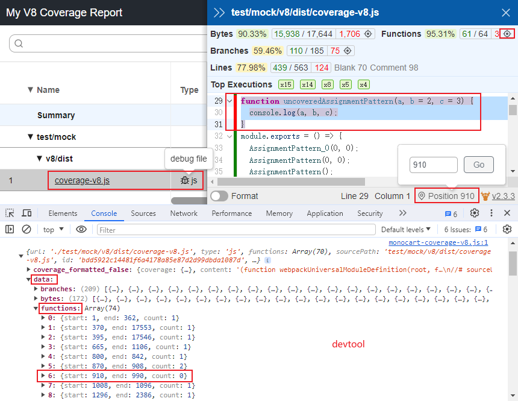
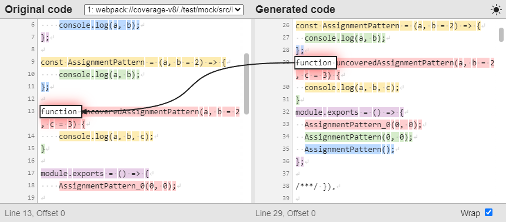

# Sourcemaps and CSS {#debug-for-coverage-and-sourcemap}
> Sometimes, the coverage is not what we expect. The next step is to figure out why, and we can easily find out the answer step by step through debugging.
- Start debugging for v8 report with option `logging: 'debug'`
```js
const coverageOptions = {
    logging: 'debug',
    reports: [
        ['v8'],
        ['console-details']
    ]
};
```
When `logging` is `debug`, the raw report data is preserved in `[outputDir]/.cache` (or `[outputDir]/raw` if the `raw` report is used). The dist file is also kept in the V8 list, so you can open the browser's devtools and visually verify the coverage data.


- Check sourcemap with [Source Map Visualization](https://evanw.github.io/source-map-visualization/)



- Generate additional source and sourcemap files to cache or raw dir
```js
const coverageOptions = {
    logging: 'debug',
    sourceMap: true
};
```

- Show time logs with env `MCR_LOG_TIME`
```js
process.env.MCR_LOG_TIME = true;
```

## CSS coverage issues {#css-coverage-issues}

CSS coverage from multiple bundles is merged as a union for each original source.

For preprocessor syntax that `all` cannot parse directly, use `all.transformer` to compile to CSS, set `entry.type = 'css'`, and preserve the sourcemap.

### Sass mixins and `@include` {#sass-mixins-and-include}

Sass `@include` can map a generated rule to non-contiguous source locations. When a rule cannot be reliably mapped, MCR reports the **whole bundle as generated CSS** instead of the preprocessor sources. That bundle's coverage is not merged into the original-source coverage.

### Line coverage of untested preprocessor sources {#line-coverage-of-untested-preprocessor-sources}

Untested files included through `all` have `0%` byte coverage, including sourcemap originals. Lines outside parsed or mapped rules (such as variables or unused mixins) may appear covered; use **bytes** coverage for these files.

### Source map can be inaccurate after minification {#source-map-can-be-inaccurate-after-minification}
CSS minification can produce imprecise sourcemaps and trigger fallback to generated CSS. If source mapping is inaccurate, try **disabling CSS minification**.

### V8 covered the whole block {#v8-covered-the-whole-block}

Chromium may mark an entire media query or nested CSS block as covered. Consider [postcss-atomic-selectors](https://www.npmjs.com/package/postcss-atomic-selectors) as a potential workaround.
