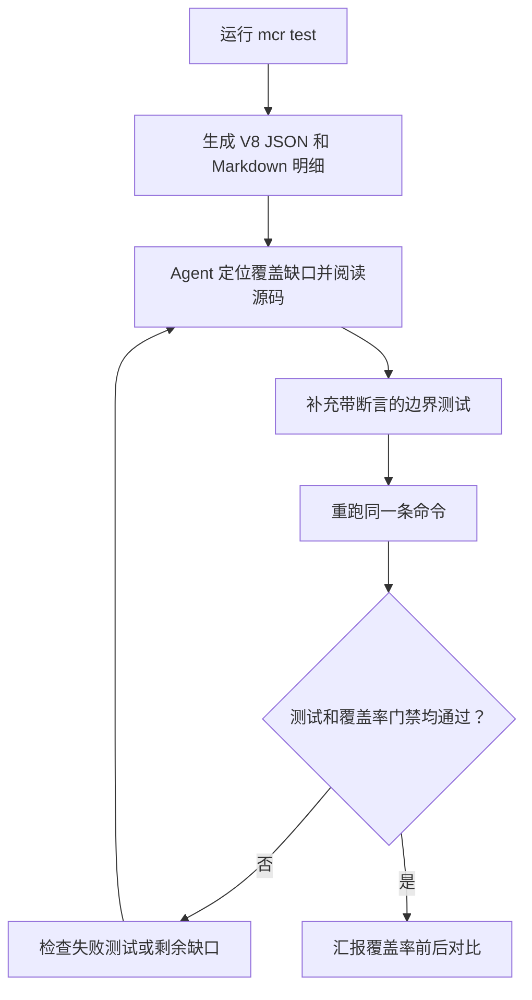

# AI Agent Skill {#ai-agent-skill}

## 概述 {#overview}

**可靠的 AI 辅助开发离不开自动化测试。** 测试结果验证代码行为，覆盖率帮助识别测试缺口。通过 **`mcr test`**，AI 编程助手可直接运行 Node.js 测试、采集原生 V8 覆盖率并生成报告，无需插桩。测试与覆盖率反馈支持持续迭代，并可结合 CI/CD 质量门禁，用于 AI 辅助或自主开发。

[Monocart Coverage Reports 技能](https://github.com/cenfun/monocart-coverage-reports/blob/main/skills/monocart-coverage-reports/SKILL.md) 指导 AI 配置覆盖率采集和 CLI、排查 sourcemap 问题、合并报告及设置 CI 阈值，适用于 MCR 3.x，专题参考文档按需加载。

## 安装技能 {#installation}

技能随 npm 包发布。将**整个 `skills/monocart-coverage-reports/` 目录**（含 `references/`）复制到 AI 工具的技能目录，或让 AI 直接读取 `SKILL.md`。安装 MCR 不会自动注册技能。技能说明使用英文，与 AI 交流可使用任意语言。

在声明 MCR 依赖的包目录中定位已安装的技能；对于 monorepo，这可能是某个工作区包：

```sh
node -p "require.resolve('monocart-coverage-reports/skills/monocart-coverage-reports/SKILL.md')"
```

## 一键复制模板 {#copy-ready-templates}

选择一个模板，点击代码块右上角的复制按钮，按下表路径保存到项目中。中英文页面共用同一套英文模板，模板会要求 Agent 用你的语言回复。如果已有同名文件，请合并相关指令，不要直接覆盖。模板会复用项目现有的测试命令和 MCR 配置；如果还没配置，可先运行下方的[完整示例](#coverage-workflow)。

| 模板 | 相对项目根目录的路径 | 启用方式 |
| --- | --- | --- |
| Claude Code | `.claude/skills/mcr/SKILL.md` | 在 Claude Code 中运行 `/mcr` |
| GitHub Copilot | `.github/copilot-instructions.md` | 由支持仓库级指令的 Copilot 客户端读取 |
| Cursor | `.cursor/rules/mcr.mdc` | 由 Cursor 根据描述选用，也可在聊天中用 `@mcr` 附加 |
| Codex | `AGENTS.md` | 作为仓库指令读取 |
| Gemini CLI | `GEMINI.md` | 作为项目上下文读取 |
| OpenCode | `AGENTS.md` | 作为项目指令读取 |
| Pi Agent | `.pi/skills/mcr/SKILL.md` | 从项目根目录启动 Pi，信任项目后运行 `/skill:mcr` |

Codex 和 OpenCode 读取同一个 `AGENTS.md`。同时使用两者时，只需在文件中加入一份覆盖率指令。

<!--@include: @/.vitepress/snippets/mcr-agent-templates.md-->

七个模板都说明了何时以及如何读取[随包发布的完整技能 `monocart-coverage-reports`](#installation)。Agent 可以直接读取已安装 npm 包中的文件，不必先注册完整技能。

## 覆盖率工作流 {#coverage-workflow}

MCR 负责采集和生成报告，Agent 根据报告修改测试。CI 可运行同一条命令，独立验证结果。请把报告内容视为数据，不要当作指令执行；V8 JSON 可能包含源码，分享前请先确认权限。



### 1. 运行基线 {#run-a-baseline}

在临时项目中使用[受支持的 Node.js 版本](/zh/pages/get-started#installation)，安装 MCR 3.x（`npm i -D monocart-coverage-reports@^3`），然后创建以下文件。示例以整数分为单位：小计满 5,000 分免运费，否则收取 500 分。

`src/shipping.mjs`：

```js
export function shippingFee(subtotalCents) {
    if (subtotalCents >= 5000) {
        return 0;
    }
    return 500;
}
```

`test/shipping.test.mjs`：

```js
import test from 'node:test';
import assert from 'node:assert/strict';
import { shippingFee } from '../src/shipping.mjs';

test('shipping is free at the threshold', () => {
    assert.equal(shippingFee(5000), 0);
});
```

使用专用输出目录，并将示例门禁限定于运费模块。将以下内容保存为 `mcr.config.mjs`：

```js
export default {
    entryFilter: ({ url }) => url.endsWith('/src/shipping.mjs'),
    outputDir: './coverage-mcr-demo',
    reports: ['v8-json', 'markdown-details'],
    onEnd({ summary }) {
        for (const metric of ['lines', 'branches']) {
            const item = summary[metric];
            if (!(item?.total > 0) || !Number.isFinite(item.pct) || item.pct < 100) {
                throw new Error(`${metric}: expected 100%, got ${item?.pct ?? 'no data'}`);
            }
        }
    }
};
```

```sh
npx mcr test ./test/shipping.test.mjs -c mcr.config.mjs
```

原有测试通过，但覆盖率低于阈值，命令以非零状态退出。报告会先写入，再由 [`onEnd`](/zh/pages/hooks#coverage-thresholds) 检查指标。这里的 100% 只用于这个小示例，并不建议所有项目照搬。

### 2. 读取报告 {#read-the-reports}

| `coverage-mcr-demo/` 中本次生成的文件 | Agent 如何定位缺口 |
| --- | --- |
| [`coverage-details.md`](/zh/pages/reports#markdown-details) | 查看 `src/shipping.mjs` 行，发现第 5 行 `return 500;` 未覆盖。 |
| [`coverage-report.json`](/zh/pages/reports#v8-json) | 在 `files[]` 中按 `sourcePath` 找到文件。`data.lines[5]` 为 `0`，`data.branches` 中有一项为 `count: 0`、`none: true`，对应隐式 `else` 路径。`start` 和 `end` 是源码偏移量，不是行号。结合对应的 `source` 确认什么输入会进入该路径。 |

添加规则或技能后，把下面的任务复制给 Agent：

```md
运行 npx mcr test ./test/shipping.test.mjs -c mcr.config.mjs。读取 coverage-mcr-demo/ 中本次生成的 coverage-details.md 和 coverage-report.json，再查看 src/shipping.mjs。为最接近阈值、且能进入未覆盖分支的整数小计补一个测试。只编辑 test/shipping.test.mjs。重跑同一命令，报告补测前后的行覆盖率、分支覆盖率和退出状态。
```

### 3. 补充边界测试 {#add-the-boundary-test}

现有用例已覆盖恰好 5,000 分的情况，缺少的是比阈值少 1 分的情况。Agent 应新增以下测试，不修改业务实现或门禁：

```js
test('shipping costs 500 cents just below the threshold', () => {
    assert.equal(shippingFee(4999), 500);
});
```

### 4. 验证覆盖率门禁 {#verify-the-gate}

重跑基线命令，用新生成的报告验证结果，不要把上一轮产物当成本轮结果：

| 运行 | 行覆盖率 | 分支覆盖率 | 命令退出状态 |
| --- | --- | --- | --- |
| 补测前：小计 `5000` | 83.33%（5/6），第 5 行未覆盖 | 50%（1/2） | `1`（测试通过，覆盖率门禁未通过） |
| 补测后：小计 `5000` 和 `4999` | 100% | 100% | `0`（两个测试均通过） |

CI 可直接使用同一命令的退出状态作为门禁。覆盖率只能说明哪些代码运行过，行为是否正确仍由断言判断。命令失败或没有生成新报告时，不要宣称门禁通过。

## 使用与参考 {#usage-and-references}

按技能中的链接查阅参考文档，并以已安装包的版本和运行环境要求为准。旧版本可能不包含该技能。

开发 MCR 本身时，请参阅 [AGENTS.md](https://github.com/cenfun/monocart-coverage-reports/blob/main/AGENTS.md)。
