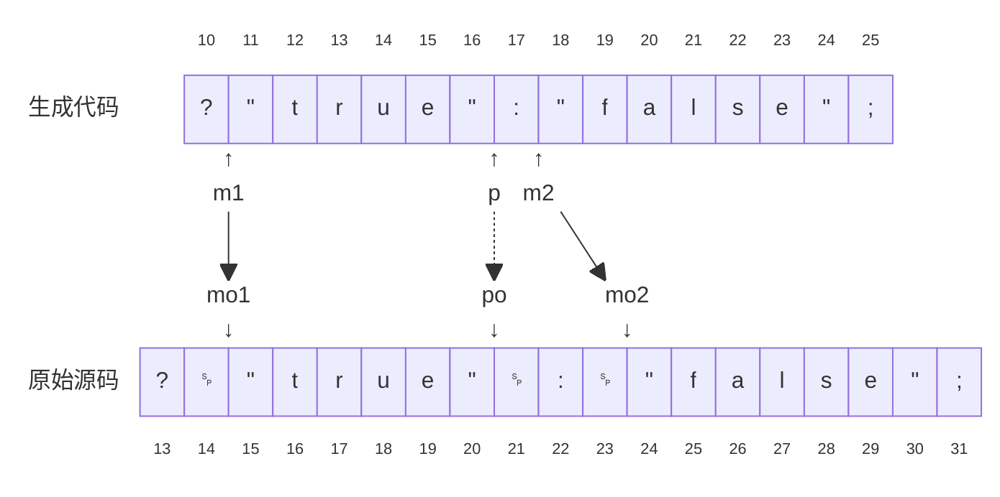

# 常见问题 {#common-issues}

## 覆盖率与预期不符 {#unexpected-coverage}

| 症状 | 可能原因 | 处理方法 |
| --- | --- | --- |
| 没有生成报告 | 命令失败、测试未执行被测代码，或未采集或导入可用的覆盖率数据。 | 检查命令退出状态和采集数据，再按 [V8](/zh/pages/v8#generate) 或 [Istanbul](/zh/pages/istanbul#generate) 的步骤生成报告。 |
| 报告缺少文件 | 文件被过滤规则排除，或既不在采集数据中，也未出现在 sourcemap 中。 | 对于 V8，按[过滤顺序](/zh/pages/filtering#filtering-pipeline)核对入口 URL、解包后的源码路径和最终报告路径。如需统计未测试文件，[用 `all` 将其纳入报告](/zh/pages/untested-files)。 |
| 命中的行或分支与实际执行不符 | 构建产物可能不匹配，或覆盖率端点落在两个映射点之间。 | 先按 [sourcemap 速查表](./sourcemaps#quick-diagnosis)核对构建产物；若确认一致，再检查[端点是否落在两个映射点之间](#between-mapping-points)。 |

### 两个映射点之间 {#between-mapping-points}

这个例子用 esbuild 压缩空白。生成代码的行为不变，但字符偏移量变了。

**生成代码：**

<!-- eslint-skip -->
```js
const a=tf?"true":"false";
```

**原始源码：**

<!-- eslint-skip -->
```js
const a = tf ? "true" : "false";
```



**怎么看图。** 图中截取了两行代码的相关部分。数字是相对于各自完整代码行、从 0 开始的偏移量，`␠` 表示空格。标记旁的箭头指向字符前的边界。实线连接 sourcemap 记录的映射，虚线表示 MCR 推断的位置。

- `p`（17）是生成代码中的一个 V8 覆盖率终点，位于 `"true"` 的闭引号和冒号之间。例如，`tf` 为 false 时，V8 会记录一个在此结束的未覆盖区间。
- `p` 前后最近的两个 sourcemap 条目分别把 `m1`（11）映射到 `mo1`（15），把 `m2`（18）映射到 `mo2`（24）。它们分别位于两段代码中 `"true"` 和 `"false"` 的开引号前，是映射点，不是覆盖率端点。

**要找什么。** `po` 是 `p` 在原始源码中的对应位置。生成代码中的覆盖率起点对应源码区间的起点，终点对应源码区间的终点。V8 区间是左闭右开的：`[startOffset, endOffset)`。

**为什么不能直接查到。** 这份 sourcemap 没有 `p` 的映射条目。常规查找可能按规则返回前一个映射的 `mo1` 或后一个映射的 `mo2`。但这两个位置都在开引号前，不是 `"true"` 的结束位置。

**MCR 如何推断。** 当 `mo1` 和 `mo2` 位于源码的同一行且顺序一致时，MCR 会比较生成代码中 `m1` 到 `m2` 的片段与源码中 `mo1` 到 `mo2` 的片段。本例比较的是 `"true":` 和 `"true"␠:␠`，找出的 `po` 是偏移量 21，正好位于原始代码的闭引号之后。必要时，MCR 会用 `diff-sequences` 对齐相同的文本。结果不一定总是精确：例如 JSX 或 Vue 模板编译可能改变代码结构，使生成代码中的端点在源码里没有精确对应的位置。此时，MCR 只能依赖构建工具生成的 sourcemap；报告中的位置是否可靠，取决于 sourcemap 能否准确反映这次转换。

如果压缩让映射难以核对，可以关闭压缩后重新构建、重新采集覆盖率，再[检查 sourcemap 和调试数据](/zh/pages/sourcemaps)。

V8 提供运行时区间和计数，不提供源码级的语句或分支计数。MCR 结合抽象语法树（AST）分析和 V8 区间，推导函数、语句、分支和行覆盖率。对于编译后的代码，MCR 分析实际执行的 JavaScript，再通过 sourcemap 把覆盖率映射回原始源码。某些计数无法单独推断：例如默认参数 `x = 1`（`AssignmentPattern`）使用的是所在区间的计数，不代表实际使用默认值的次数。这也是 [V8 与 Istanbul 报告](/zh/pages/compare-reports)可能不同的原因之一。

## 无法解析源码 {#unparsable-source}

JavaScript 转换或源码解析可能遇到 JSX、Vue 模板等语法。先确定出错的是实际执行的生成文件、sourcemap 中的原始文件，还是通过 `all` 纳入的未测试文件：

- **被测代码：** 使用实际执行的 JavaScript 与对应的 sourcemap，不要在采集后替换为另一次编译的代码。V8 区间偏移量对应的是实际执行的源码。
- **sourcemap 中的原始源码：** 如果报告中的源码或位置不对，先[检查 sourcemap](/zh/pages/sourcemaps#inspect-sourcemaps)，确认它和原始源码都对应实际执行的构建。
- **原生 TypeScript：** 检查 [Node.js 版本和支持的语法](/zh/pages/typescript#supported-syntax)；对于无法原生执行的语法，可以在运行测试前编译并生成 sourcemap，或在执行时使用[外部加载器](/zh/pages/typescript#external-loaders)。
- **未测试文件：** 可在生成空覆盖率时使用 [`all.transformer`](/zh/pages/untested-files#transform-source-code)，并保留对应 sourcemap。

例如，安装 `@swc/core` 后，可以在 MCR 解析前将 `src/` 下未执行的 `.ts` 文件转成 JavaScript。此示例不处理 JSX、TSX 或 Vue 文件，也不会改动测试中实际执行的代码。

```js
import { fileURLToPath } from 'node:url';
import { transform } from '@swc/core';

const coverageOptions = {
    all: {
        dir: ['./src'],
        filter: '**/*.ts',
        transformer: async (entry) => {
            const { code, map } = await transform(entry.source, {
                filename: fileURLToPath(entry.url),
                sourceMaps: true,
                isModule: true,
                jsc: {
                    parser: {
                        syntax: 'typescript'
                    }
                }
            });
            entry.source = code;
            entry.sourceMap = JSON.parse(map);
        }
    }
};
```

## JavaScript 堆内存不足 {#javascript-heap-out-of-memory}

即使逐个处理文件，单个大 JavaScript bundle 也可能撑满堆：源码、V8 覆盖率区间、AST 和 sourcemap 可能同时占用内存。

1. **先查大文件。** [耗时日志](/zh/pages/sourcemaps#view-timing-logs)只记录已完成的阶段。如果中途崩溃，优先检查体积最大的 bundle。能拆包时，拆分后用新构建及对应的 sourcemap 重新采集。
2. **回收临时数据。** 设置 [`gc: 1024`](/zh/pages/options#gc)，在处理检查点发现堆用量超过 1024 MB 时触发 GC。仍在使用的数据不能回收。
3. **必要时提高堆上限。** 如果机器内存充足，为运行 MCR 的进程设置 `NODE_OPTIONS`。例如，在 GitHub Actions 中：

```yaml
- run: npx mcr merge --inputDir ./raw --outputDir ./coverage-reports/merged
  env:
    NODE_OPTIONS: --max-old-space-size=8192
```

将命令替换为实际使用的采集或合并命令，并使用独立的报告输出目录。
