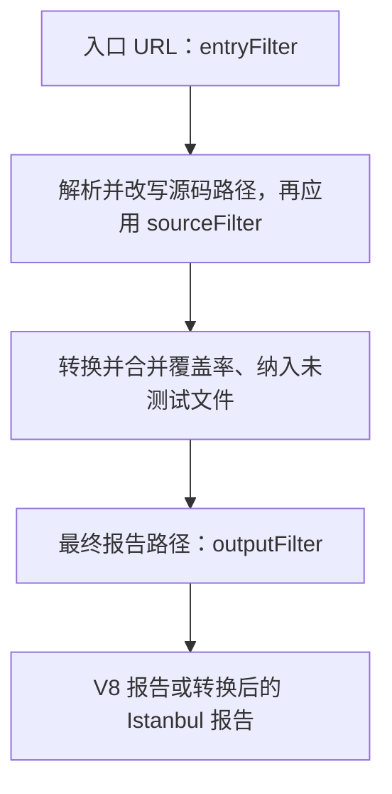

# 过滤覆盖率 {#filtering}

V8 输入可以在采集入口、解包后的源码或最终报告文件三个阶段过滤。先选对阶段：想减少处理成本，优先使用 `entryFilter` 和 `sourceFilter`；只想按报告里显示的路径筛选，使用 `outputFilter`。参见[方案对比](#filtering-approaches)。

## 过滤流程 {#filtering-pipeline}



图中省略了原始数据导出；`outputFilter` 不影响 [raw 报告](/zh/pages/reports#raw)。另见[源码路径改写](/zh/pages/source-path)和[纳入未测试文件](/zh/pages/untested-files)。

## entryFilter + sourceFilter {#entryfilter-sourcefilter}

`entryFilter` 接收 [`V8CoverageEntry`](/zh/pages/types#v8coverageentry)，通常按 URL 保留需要处理的入口，例如 `dist/main.js`，并排除独立的 `dist/vendor.js`。如果依赖和业务代码打在同一个 bundle 中，不要丢掉整个入口；保留 bundle，再用 `sourceFilter` 按标准化并经 `sourcePath` 改写后的路径保留 `src/`，排除 `node_modules/`。成功映射回源码后，生成的入口通常不显示，除非启用了[调试模式](/zh/pages/sourcemaps#enable-debugging)。

过滤可以使用函数:
```js
const coverageOptions = {
    entryFilter: (entry) => entry.url.indexOf('main.js') !== -1,
    sourceFilter: (sourcePath) => sourcePath.search(/src\//) !== -1
};
```
也可以使用便捷的[`minimatch`](https://github.com/isaacs/minimatch)来匹配（推荐）:
```js
const coverageOptions = {
    entryFilter: '**/main.js',
    sourceFilter: '**/src/**'
};
```
支持多个匹配:
```js
const coverageOptions = {
    entryFilter: {
        '**/node_modules/**': false,
        '**/vendor.js': false,
        '**/src/**': true
    },
    sourceFilter: {
        '**/node_modules/**': false,
        '**/**': true
    }
};
```
作为CLI参数（JSON字符串，Added in: v2.8）:
```sh
npx mcr --sourceFilter "{'**/node_modules/**':false,'**/**':true}" -- node demo.js
```
注意，这些匹配实际上会转换成一个过滤函数（如下），所以如果一个匹配成功则会直接返回，后面的将不再继续匹配。请注意先后顺序，如果存在包含关系的，可以调整上下顺序，最后如果都未匹配，则默认返回false
```js
const coverageOptions = {
    entryFilter: (entry) => {
        if (minimatch(entry.url, '**/node_modules/**')) {
            return false;
        }
        if (minimatch(entry.url, '**/vendor.js')) {
            return false;
        }
        if (minimatch(entry.url, '**/src/**')) {
            return true;
        }
        // else unmatched
        return false;
    }
};
```

## filter {#filter}

如果你不想定义两个过滤器，可以使用 `filter` 选项代替，可以将多个匹配合并在一起. (Added in: v2.8)
```js
const coverageOptions = {
    // combined patterns
    filter: {
        '**/node_modules/**': false,
        '**/vendor.js': false,
        '**/src/**': true,
        '**/**': true
    }
};
```

## outputFilter {#outputfilter}

使用 `outputFilter` 过滤最终文件列表。

> **版本要求：** `outputFilter` 是 **v3.0.0** 新增的选项，v2.13.x 及更早版本不支持。

对于 V8 输入，`outputFilter` 同时作用于 V8 报告和转换后的 Istanbul 报告。默认值为 `null`，不启用过滤。

它与 `entryFilter` 和 `sourceFilter` 使用相同的字符串和有序对象匹配规则：按顺序返回第一个匹配项的值，未匹配的文件不保留。匹配目标是经过 `sourcePath` 改写后的最终路径。函数形式接收最终文件对象 [`entry`](/zh/pages/types#coveragefile)（`CoverageFile`），而不是路径字符串。

```js
const coverageOptions = {
    outputFilter: {
        '**/node_modules/**': false,
        '**/src/**': true
    }
};
// 也可以使用：
// outputFilter: '**/src/**'
// outputFilter: (entry) => entry.sourcePath.startsWith('src/')
```

命令行示例（使用引号避免 shell 展开匹配规则）：
```sh
mcr merge --inputDir ./raw --outputFilter "**/src/**"
mcr merge --inputDir ./raw --outputFilter "{'**/node_modules/**':false,'**/src/**':true}"
```

`outputFilter` 不改变 raw 原始覆盖率导出，也不适用于 Istanbul 格式的输入数据。

## 如何选择和组合过滤方案 {#filtering-approaches}

可以根据需要，单独选择输入过滤（`entryFilter` + `sourceFilter`）或输出过滤（`outputFilter`），两套方案各有优劣，也支持混合使用。合并选项 `filter` 只是 `entryFilter` + `sourceFilter` 的简写，不会配置 `outputFilter`。

| 方案 | 过滤时机和对象 | 优点 | 代价与注意事项 |
| :-- | :-- | :-- | :-- |
| `entryFilter` + `sourceFilter`（或 `filter`） | 从输入端过滤：在发现入口文件时，`entryFilter` 按 URL 过滤；在 sourcemap 解包源文件时，`sourceFilter` 按源路径过滤。 | 尽早排除不需要的文件，减少后续无效处理，性能更高。大型项目或 bundle 较多时，优先推荐此方案。 | 需要区分入口文件和 sourcemap 源文件，并配置两个阶段的规则。如果通过 `entryFilter` 排除整个 bundle，其中需要保留的源文件也会一起丢失。 |
| `outputFilter` | 从输出结果过滤：在 sourcemap 转换、合并和添加未测试文件（`all`）完成后、生成报告前，按最终 `sourcePath` 过滤。 | 配置更简单，一套规则直接面向最终文件列表，无需区分入口文件和解包后的源文件。 | 不需要的文件在被丢弃前仍会经历前期发现和处理，无法节省这些开销。当最终排除的文件较多时，可能带来明显的生成耗时和内存开销，存在性能问题。 |

**单独使用时：** 优先考虑性能，选择输入过滤（`entryFilter` + `sourceFilter`，或 `filter`）；更看重配置简单、希望直接过滤最终结果，且可以接受额外处理成本时，选择 `outputFilter`。

**也可以混合使用两套方案**，但规则重叠或冲突时容易误删文件，需要明确各阶段的职责。例如，使用 `entryFilter` 保留需要处理的 bundle，使用 `sourceFilter` 排除已知不需要的源文件，再使用 `outputFilter` 按改写后的最终 `sourcePath` 筛选报告文件。

输入过滤先执行，`outputFilter` 只对处理后的最终文件列表继续筛选，无法恢复已被 `entryFilter` 或 `sourceFilter` 排除的源文件。尤其要注意，排除整个 bundle 也会排除其中的源文件。混用时应分别检查入口 URL、sourcemap 源路径和最终路径，确保每个阶段的规则都符合预期。

::: info 相关指南
- [未测试文件](./untested-files#filter-files)：用 `all` 纳入未测试文件，并检查哪些过滤规则仍然适用。
- [源码路径](./source-path#path-normalization)：核对 `sourceFilter` 和 `outputFilter` 匹配的是哪些改写后的路径。
:::
