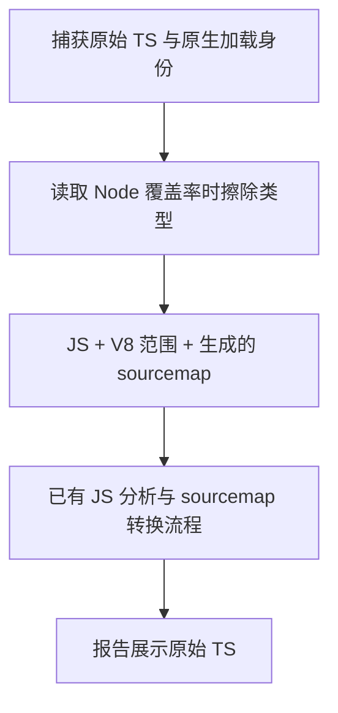

# TypeScript 支持 {#typescript-support}

::: warning 仅适用于 Node.js
本页介绍的原生 TypeScript 执行能力仅适用于 Node.js。浏览器应用仍需先将 TS 编译为 JavaScript，采集实际执行的 JS 覆盖率，再通过 sourcemap 还原原始源码。
:::

::: tip MCR 3.3 新功能
原生 TypeScript 覆盖率支持需要 MCR 3.3 或更高版本。
:::

MCR 支持 Node.js 通过默认的**类型擦除**直接执行 TypeScript。对于可擦除的 TS 语法，不需要构建步骤、外部 loader 或额外的 TS 解析器：

```sh
npx mcr node ./src/example.ts
npx mcr test "./test/**/*.test.ts"
```

报告展示保留类型信息的原始 TS。MCR 分析擦除类型后的 JavaScript，并生成映射回捕获原文的 sourcemap，复用现有的 JavaScript/sourcemap 报告流程。

## 运行 TS 程序 {#run-a-ts-program}

使用 ESM `.ts` 文件时，在项目的 `package.json` 中设置 `"type": "module"`。将以下内容保存为 `src/math.ts`：

```ts
export interface Input {
    value: number;
}

export function magnitude(input: Input): number {
    if (input.value < 0) {
        return -input.value;
    } else {
        return input.value;
    }
}
```

创建 `src/example.ts`：

```ts
import { magnitude } from './math.ts';

console.log(magnitude({ value: -2 }));
```

安装 MCR 并运行程序：

```sh
npm i -D monocart-coverage-reports
npx mcr node ./src/example.ts -r v8,console-summary -o ./coverage-reports
```

打开 `coverage-reports/index.html`，即可查看原始 TS 的报告。本例只执行负数分支。

`mcr node` 只执行一个入口，`mcr node *.ts` 不表示逐个执行匹配文件。多个测试目标请使用测试运行器。

## 运行 TS 测试 {#run-ts-tests}

创建 `test/math.test.ts`：

```ts
import { test } from 'node:test';
import assert from 'node:assert/strict';
import { magnitude } from '../src/math.ts';

test('negative input', (): void => {
    assert.equal(magnitude({ value: -2 }), 2);
});
```

调用 Node 内置测试运行器并生成覆盖率报告：

```sh
npx mcr test "./test/**/*.test.ts" -r v8,console-summary -o ./coverage-reports
```

- 给 glob 加引号，由 Node 而不是 shell 处理匹配。MCR 将目标传给 `node --test`，不会另行实现 TS 测试发现机制。
- 测试可以使用 `node:test` 和 `node:assert/strict`，无需额外测试运行器。
- 测试失败时仍生成可用的覆盖率报告，并保留非零退出状态。报告生成失败也会非零退出。

测试运行器参数和测试结果 hook 参见[使用 mcr test 运行测试](/zh/pages/node-test-runner#run-tests-with-mcr-test)。

## 配置覆盖率 {#configure-coverage}

仅使用可擦除语法的 `mcr.config.ts` 可以直接使用类型导入和 `satisfies`，无需预加载 loader：

```ts
import type { McrCliOptions } from 'monocart-coverage-reports';

export default {
    test: './test/**/*.test.ts',
    reports: ['v8', 'console-summary'],
    outputDir: './coverage-reports',
    entryFilter: '**/src/**'
} satisfies McrCliOptions;
```

```sh
npx mcr -c ./mcr.config.ts node ./src/example.ts
# 使用配置中的测试目标
npx mcr -c ./mcr.config.ts test
```

`entryFilter` 只保留应用源码，不包含测试文件。`sourceFilter` 用于过滤通过 sourcemap 展开的源码，原生 TS 也使用这条路径。参见[过滤覆盖率](/zh/pages/filtering#filtering)。

MCR 在其他默认配置文件之后查找 `mcr.config.ts`，已有的 `mcr.config.js` 优先。可使用 `-c` 显式指定配置。相对路径以当前工作目录为基准。配置文件使用超出原生擦除能力的语法时，仍需适当的 loader。

原生 TS 加载身份由 MCR 的捕获 hook 确认，不是仅凭 `.ts` 扩展名或 JavaScript 解析失败来判断。当前实现没有独立的 `typescript` 配置项或 `--typescript` 参数。

## 报告与源码映射 {#reports-and-source-maps}



- **原始源码：** CLI 会捕获加载时的 `.ts`、`.mts` 和 `.cts` 文本，即使没有 sourcemap 注释。生成的映射通过 `sourcesContent` 保留这份原文，报告无需重新读取已修改的源文件。
- **坐标：** 映射记录行边界与保留/替换文本区间的转换点。BOM 被移除时，通过映射表达位置差异，不修改 V8 范围。
- **函数、分支与语句：** 基于擦除后的 JS 分析，再映射回 TS。纯类型模块不会仅因为存在 sourcemap 就被补出虚假的运行时语句。
- **行与字节：** 当前沿用现有 sourcemap 对原始源码的统计规则。擦除的类型语法**尚未作为注释处理**，因此纯类型行可能计入行统计。字节覆盖率使用原始源码长度，并非可执行 TS token 的度量。
- **重复快照：** 同一次目录导入中，每份捕获源码记录只执行一次类型擦除和映射模板生成。各 entry 使用独立的映射对象及数组，`onEntry` 中的修改不会影响后续快照。
- **Raw 报告：** 保留擦除后的 JS、V8 范围、原生身份及包含 TS 原文的生成映射。重新生成与合并不再擦除类型，也不要求原始源文件仍然存在。
- **原有映射注释：** TS 中的 `sourceMappingURL` 注释不会替代 MCR 生成的映射，因为它们可能描述其他编译结果。

来自不同 Node 进程或 worker 线程的捕获记录会关联各自的源码版本，即使它们共享 URL 和采集目录；捕获的 JavaScript 也使用相同规则。请保留 Node 覆盖率原始文件名及源码执行元数据。旧版捕获记录的兼容性及同进程限制参见 [Node 覆盖率导入](/zh/pages/v8#generate)，独立采集数据的合并参见[合并报告](/zh/pages/merging#merging-reports)。

## 支持的语法 {#supported-syntax}

Node 的可擦除 TS 语法包括类型标注、接口、类型别名、类型导入/导出、泛型参数、重载签名、`as`、`satisfies` 和非空断言。具体语法支持以当前 Node.js 版本为准。

| 扩展名 | 模块系统 |
| --- | --- |
| `.ts` | 与 `.js` 相同；使用 ESM 时设置 `"type": "module"`。 |
| `.mts` | 始终为 ESM。 |
| `.cts` | 始终为 CommonJS，运行时导出使用 CommonJS 写法。 |

相对导入要写实际扩展名，例如 `import './math.ts'`。仅用于类型的导入应使用 `import type`。本功能不会在 `.js` 文件中启用类型标注。

### 检查不可擦除的语法 {#check-erasable-syntax}

Node.js 只擦除类型，不会为 `enum`、构造函数参数属性或包含运行时代码的 namespace 生成 JavaScript。要在运行前发现这类语法，可以在项目的 `tsconfig.json` 中启用 `erasableSyntaxOnly`（需要 TypeScript **5.8 或更高版本**）：

```json
{
    "compilerOptions": {
        "target": "esnext",
        "module": "nodenext",
        "noEmit": true,
        "allowImportingTsExtensions": true,
        "verbatimModuleSyntax": true,
        "erasableSyntaxOnly": true,
        "types": ["node"]
    },
    "include": ["src", "test", "mcr.config.ts"]
}
```

按项目结构调整 `include`，确保它覆盖由 Node.js 直接执行的 TypeScript 文件。安装 TypeScript 和 Node.js 类型声明后，即可在本地或 CI 中运行检查：

```sh
npm i -D typescript @types/node
npx tsc --noEmit
```

Node.js 不读取 `tsconfig.json`；此检查只报告不可擦除的语法，不会自动改写代码。要让代码在 Node.js 中直接运行，可以改用标准 JavaScript 和可擦除的类型写法。

#### 字符串枚举 {#replace-string-enums}

将 `enum Status { Pending = 'pending', Done = 'done' }` 改为 `as const` 对象，并从对象的值推导联合类型：

```ts
export const Status = {
    Pending: 'pending',
    Done: 'done'
} as const;

export type Status = (typeof Status)[keyof typeof Status];
```

运行时仍可使用 `Status.Pending`，而 `Status` 类型是 `'pending' | 'done'`。

#### 构造函数参数属性 {#replace-constructor-parameter-properties}

将 `constructor(public readonly name: string) {}` 改为显式声明字段，再在构造函数中赋值：

```ts
export class User {
    readonly name: string;

    constructor(name: string) {
        this.name = name;
    }
}
```

#### 包含运行时代码的命名空间 {#replace-runtime-namespaces}

优先使用独立模块的具名导出。如果要保留 `MathUtils.double(2)` 这样的调用方式，可以将 `namespace MathUtils { export function double(...) { ... } }` 改为普通对象：

```ts
export const MathUtils = {
    double(value: number): number {
        return value * 2;
    }
};
```

## Node.js 要求 {#nodejs-requirements}

MCR 要求 **Node.js 22.18.0 或更高版本**。通过 `node --version` 检查启动 MCR 的版本。

| Node.js | 默认启用类型擦除 | 版本说明 |
| --- | --- | --- |
| [22.x](https://nodejs.org/docs/latest-v22.x/api/typescript.html) | 从 **22.18.0** 起 | 22.6.0–22.17.x 需使用 `--experimental-strip-types`，且低于 MCR 的最低版本要求。Node 的 `--require` 会在源码捕获前加载 `.cts`，这些文件可能不会出现在报告中。请改用 `--import`，或在程序入口中加载。 |
| [24.x](https://nodejs.org/docs/latest-v24.x/api/typescript.html) | 是 | 类型擦除从 **24.12.0** 起成为稳定功能。 |
| [26.x](https://nodejs.org/docs/latest-v26.x/api/typescript.html) | 是 | 类型擦除已稳定。Node 在 **26.0.0** 移除了 `--experimental-transform-types`。 |

上表仅说明 Node 内置的类型擦除能力，并非完整的 TypeScript 转译。测试发现与支持的语法取决于当前 Node.js 版本。

MCR 使用 Node 内置的 `module.stripTypeScriptTypes()`，并采用 strip 模式。该 API 有独立的稳定性状态，即使某个 Node.js 版本已将直接执行 TS 标记为稳定，生成报告时仍可能输出实验性警告。MCR 不会全局屏蔽这些警告。

运行时语法限制参见 [Node.js TypeScript 文档](https://nodejs.org/api/typescript.html)。

## 使用限制 {#limitations}

- **不做类型检查。** 如有需要，单独运行 `tsc --noEmit`。原生执行与覆盖率采集本身不要求安装 TypeScript。
- **不应用 `tsconfig.json` 执行设置。** Node 不解析 `paths`，不转换模块系统，也不按 `target` 降级 JS。
- **不转换 JSX/TSX 或装饰器。** 使用适当的 loader 或构建工具。
- **不支持转换模式。** Node 26 已移除 `--experimental-transform-types`。在仍接受此参数的旧版 Node 上，MCR 不会捕获转换模式下的原生 TS 源码。覆盖率仍按原有流程导入，可使用 Node 提供的 sourcemap；JavaScript 报告不受影响。枚举、构造函数参数属性和包含运行时代码的命名空间的检查方法和替代写法，参见[检查不可擦除的语法](#check-erasable-syntax)。如果需要保留这些语法，请使用[外部加载器](#external-loaders)，或使用能生成 JavaScript 和 sourcemap 的构建工具。
- **不新增未执行 TS 的原生分析能力。** `all` 保留原有行为。未执行 TS 如需准确的 AST 指标，应通过 `all.transformer` 提供 JS 与 sourcemap；参见[未测试文件](/zh/pages/untested-files#transform-source-code)。
- **不是直接发布 TS 依赖的捷径。** Node 通常拒绝擦除 `node_modules` 下的 TS，库一般仍应发布编译后的 JS。

## 外部加载器 {#external-loaders}

如果项目使用了 Node.js 无法仅靠类型擦除执行的 TypeScript 语法，可以使用外部加载器，或先编译再运行。外部加载器和预编译 JavaScript 沿用原有的覆盖率处理流程。

### [tsx](https://github.com/privatenumber/tsx) {#tsx}

安装 `tsx`，然后在运行脚本或 Node.js 内置测试运行器时预加载它：

```sh
npm i -D tsx
npx mcr --import tsx node ./src/example.ts
npx mcr --import tsx test "./test/**/*.test.ts"
```

如果改用 `tsx` 命令行工具运行脚本，则无需预加载：

```sh
npx mcr tsx ./src/example.ts
```

### [ts-node](https://github.com/TypeStrong/ts-node) {#ts-node}

如果现有 ESM 项目（`"type": "module"`）使用 `ts-node`，可参考以下示例，它使用 `ts-node` 10.9.2 和 TypeScript 5.9.3。该版本的 `ts-node` 无法与 TypeScript 7.0.2 搭配使用，且其 [ESM 加载器仍属实验性](https://typestrong.org/ts-node/docs/imports/#native-ecmascript-modules)。

```sh
npm i -D ts-node@10.9.2 typescript@5.9.3 @types/node cross-env
npx cross-env NODE_OPTIONS="--loader ts-node/esm" mcr node ./src/example.ts
```

如果之前启用了 `erasableSyntaxOnly`，运行不可擦除的语法时，请在 `ts-node` 使用的 TypeScript 配置中关闭该选项。

## 仓库示例 {#repository-examples}

在 MCR 源码仓库中安装依赖并构建运行时包后，运行：

```sh
npm run test-node-ts
npm run test-mcr-test-ts
```

它们直接执行 `test/node-ts/`，不构建这些 TS 文件，也不加载 `tsx`。配置文件分别是 `test/mcr.config.node-ts.ts` 和 `test/mcr.config.mcr-test-ts.ts`。

报告分别生成到 `.temp/site/reports/node-ts/index.html` 和 `.temp/site/reports/mcr-test-ts/index.html`。案例覆盖 `.ts`、`.mts`、`.cts`、纯类型模块和运行时分支，不启用 `all`。在线链接参见[报告示例](/zh/pages/examples#report-examples)。
