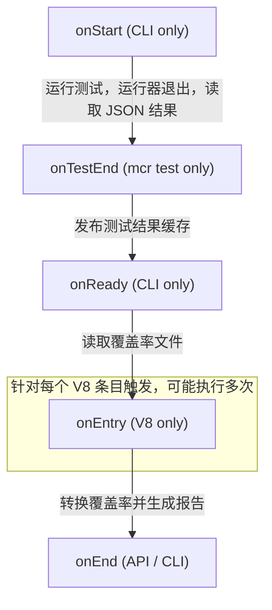

# Hooks {#hooks}

## 生命周期 {#lifecycle}

各 hook 分别用于介入命令执行、测试结果收集、覆盖率处理和报告生成。下图以 `mcr test` 的正常生命周期为例，展示它们的执行顺序与适用范围。各 hook 均可按需配置，已配置的异步 hook 会等待执行完成；CLI、测试命令及 V8 专属限制以图中标注为准。



## `onStart` {#onstart}

仅在使用 `mcr <command>` 时有效。`onStart(coverageReport)` 在子进程启动前触发。

参数：[`coverageReport`](/zh/reference/types#coveragereport)，类型为 `CoverageReport`。

```js
// mcr.config.js
export default {
    onStart: async (coverageReport) => {
        // 在启动子进程前执行准备工作
    }
};
```

## `onTestEnd` {#ontestend}

仅适用于 `mcr test`。配置及用法参见 [使用 mcr test 运行测试](/zh/getting-started/node-test-runner#run-tests-with-mcr-test)。

`onTestEnd(testResults)` 在测试运行器退出、JSON 测试结果采集完成后触发一次，早于测试结果缓存发布、`onReady` 和覆盖率报告生成。支持异步等待，测试断言失败时也会触发。其他命令、API 调用，以及因未提供目标而跳过的测试，不触发该 hook。现有 `onEnd(coverageResults)` 保持不变。

参数：[`testResults`](/zh/reference/types#testresults)，类型为 `TestResults`。

### 用法示例 {#usage}

`mcr test` 始终通过内部 JSON reporter 采集结构化测试结果，同时保留终端输出和用户指定的 reporter/destination 配对。`onTestEnd` 为可选回调，不配置也不会关闭采集。如需留待后续使用，请启用 `raw` 报告或 debug 日志；默认的缓存清理规则仍然生效。

```js
// mcr.config.js
export default {
    test: './test/**/*.test.js',
    onTestEnd: (testResults) => {
        console.log(testResults.summary);
        for (const test of testResults.tests) {
            console.log(test.name, test.status, test.error);
        }
    }
};
```

### 结果结构 {#result-structure}

- `id`：采用与覆盖率缓存数据相同的 `Util.uid()` 机制生成的采集 ID。
- `framework`：`'node:test'`。
- `complete`：是否收到运行器最终汇总，不代表测试是否通过。
- `summary`：`{ tests, suites, passed, failed, cancelled, skipped, todo, duration, success }`，报告不完整时为 `null`。计数采用运行器最终汇总，`tests` 不包含 suite，耗时单位为毫秒。
- `tests`：已完成的测试及 suite 记录，包含嵌套测试：`{ name, type, nesting, testNumber, file?, line?, column?, duration, status, skip?, todo?, error? }`。状态为 `passed`、`failed`、`cancelled`、`skipped` 或 `todo`。错误固定包含字符串 `name`、`message`，不可用或非字符串时分别使用 `'Error'`、`''`。其余只复制自有、可枚举的数据属性，值仅限字符串、布尔值、有限数字和 `null`；BigInt 转为十进制字符串。不递归遍历，跳过 getter/setter、对象/数组、函数、Symbol、`undefined`、`NaN` 和无穷数。除两个固定字段外，不采集继承或不可枚举属性，因此通常不包含 `stack`，也不展开 `cause` 内的字段；明确设为可枚举的字符串 `stack` 仍按普通字符串复制。过滤 `__proto__`、`constructor`、`prototype` 等特殊键，额外属性不会覆盖固定字段。

### 失败处理 {#failure-handling}

测试失败、报告不完整/缺失/损坏或 hook 抛错，均保持非零退出状态。不完整报告以 `complete: false` 交付；缺失或无效的 JSON 无法交付，会明确记录采集错误。`onTestEnd` 设置的非零 `process.exitCode` 不会被后续覆盖率 hook 清零。hook 或采集失败后仍尝试生成覆盖率报告。hook 抛错时不会发布或导出测试结果，避免回退导出可能尚未脱敏的数据。测试结果独立于覆盖率，因此即使后续覆盖率生成失败，此 hook 仍可执行。

### 缓存与导出 {#cache-and-export}

测试结果复用覆盖率缓存的 ID 和文件命名机制：`outputDir/.cache/test-results-<id>.json`，JSON 内容保存同一个 `id`。reporter 将记录逐条写入 `.json.tmp`，输出时即包含采集 ID，并通过很小的 `.meta.tmp` 完成记录校验最终字节数。没有 hook 时，MCR 只读取完成记录并重命名 JSON，不会加载或重写完整报告；配置 hook 时，读取完整结果对象，在 hook 完成后将修改后的数据发布为正式缓存。临时输出和元数据均在生成覆盖率前清理。正式 JSON 遵循覆盖率缓存生命周期：正常生成后清理、调试模式保留，或由 `raw` 报告导出（包括 ZIP）。它不会嵌入 HTML/覆盖率 JSON 报告，导入 raw 数据目前也不会合并测试结果。如需持久化，请自行保存；当 `clean: true` 时，此 hook 写入 `outputDir` 的文件可能被后续覆盖率清理流程删除。

### 敏感数据 {#sensitive-data}

基础类型不等于非敏感数据，字符串 `token`、`password` 或响应正文同样会被复制。错误消息、测试名称和路径也可能包含凭据或个人信息，大字符串仍可能增大报告体积，MCR 不会自动脱敏。请保护输出目录，并在上传 raw/debug 产物前审查内容。可在 `onTestEnd` 中修改结果，对正式保存的 JSON 脱敏；这不会处理 Node 的终端输出或已经写入临时文件的数据。以下规则仅为示例，请按业务数据调整：

```js
export default {
    onTestEnd: (results) => {
        for (const test of results.tests) {
            if (test.error) {
                for (const [key, value] of Object.entries(test.error)) {
                    if (typeof value === 'string') {
                        test.error[key] = value.replace(/(Bearer\s+)\S+/gi, '$1[REDACTED]');
                    }
                }
            }
        }
    }
};
```

## `onReady` {#onready}

仅在使用 `mcr <command>` 时有效。`onReady(coverageReport, nodeV8CoverageDir, subprocess)` 在子进程退出后、MCR 读取 `nodeV8CoverageDir` 之前触发。用于子进程尚未写完覆盖数据、需要等待的场景。

参数：

- [`coverageReport`](/zh/reference/types#coveragereport)：`CoverageReport`。
- `nodeV8CoverageDir`：`string`，Node.js V8 覆盖率目录。
- `subprocess`：`any`，Node.js `ChildProcess` 对象。

```js
// mcr.config.js
export default {
    onReady: async (coverageReport, nodeV8CoverageDir, subprocess) => {
        // 等待某个信号，或先对 raw 文件做一些预处理
    }
};
```

## `onEntry` {#onentry}

每个 V8 入口在处理前触发，仅适用于 V8 数据。

参数：[`entry`](/zh/reference/types#v8coverageentry)，类型为 `V8CoverageEntry`。

可以在进入AST解析前改写 entry（例如对非标准语法的源码做预编译），参见 [Unparsable source](/zh/troubleshooting/common-issues#unparsable-source)
```js
const coverageOptions = {
    onEntry: async (entry) => {
        // entry.source, entry.sourceMap, entry.fake, ...
    }
};
```

## `onEnd` {#onend}

报告生成后触发。

参数：[`coverageResults`](/zh/reference/types#coverageresults)，类型为 `CoverageResults | undefined`。

```js
const coverageOptions = {
    onEnd: async (coverageResults) => {
        // coverageResults.type, coverageResults.summary, coverageResults.files, ...
    }
};
```

### 覆盖率阈值 {#coverage-thresholds}

典型用法：检测覆盖率是否达标，失败时抛错，让 API 调用方处理异常、CLI 返回非零状态；不要使用 `process.exit()` 提前中断清理。
```js
const getCoverageError = (metric, summary, minimum) => {
    if (!summary || !(summary.total > 0)) {
        return `${metric}: missing or empty coverage`;
    }
    const { pct } = summary;
    if (typeof pct !== 'number' || !Number.isFinite(pct) || pct < minimum) {
        return `${metric}: ${pct}%, required ${minimum}%`;
    }
    return '';
};
const coverageOptions = {
    name: 'My Coverage Report',
    outputDir: './coverage-reports',
    onEnd: (coverageResults) => {
        if (!coverageResults) {
            throw new Error('No coverage results');
        }
        const thresholds = {
            bytes: 80,
            lines: 60
        };
        const errors = [];
        for (const [metric, minimum] of Object.entries(thresholds)) {
            const error = getCoverageError(metric, coverageResults.summary?.[metric], minimum);
            if (error) {
                errors.push(error);
            }
        }
        if (errors.length) {
            throw new Error(errors.join('\n'));
        }
    }
};
```

本示例拒绝缺失或总数为零的指标；如果某项指标允许为空，应明确调整策略。没有可用输入时，`generate()` 可能直接返回 `undefined` 而不调用 `onEnd`。API 调用方必须检查返回值；普通 CLI 流程应使用干净的输出目录，并验证本次生成的非空报告。参见 [严格 CI 示例](https://github.com/cenfun/monocart-coverage-reports/blob/main/skills/monocart-coverage-reports/references/reports-and-ci.md#reject-stale-reports-and-missing-collection-in-ci)。
