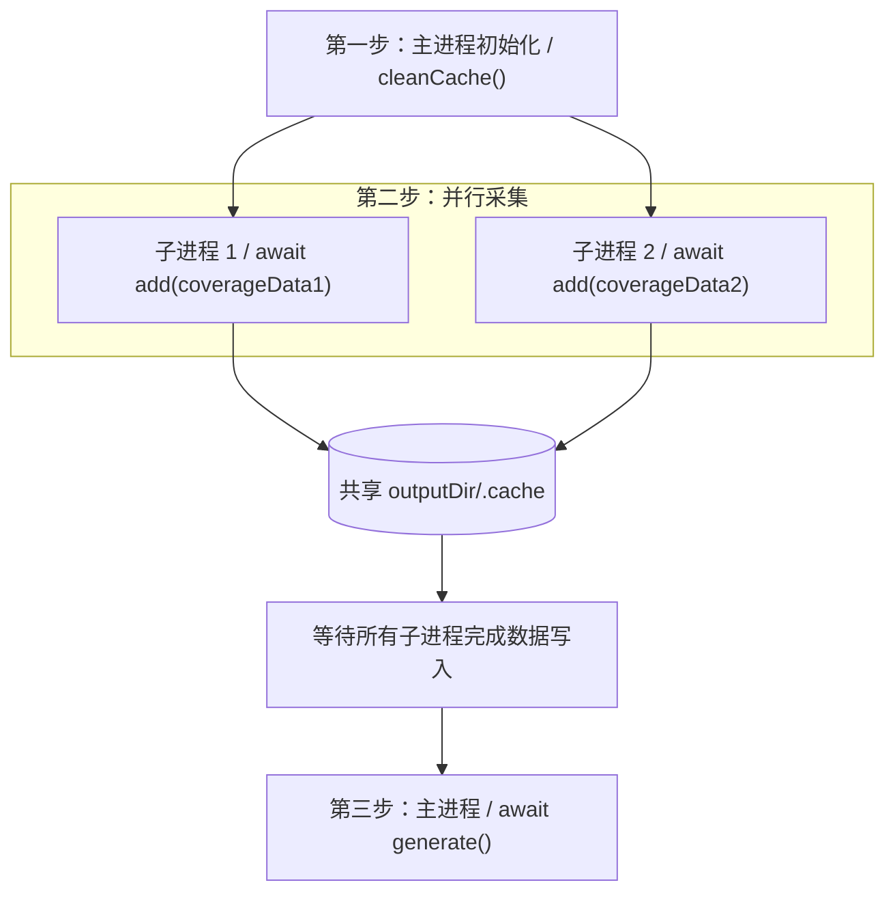

# 多进程 {#multiprocessing-support}
> 多进程支持可以很好的解决异步并行的情况。所有的覆盖率数据会保存到`[outputDir]/.cache`，在报告生成之后，这些缓存数据会被清除。除非开启了[调试模式](/zh/troubleshooting/sourcemaps#debug-for-coverage-and-sourcemap)，或者使用了`raw`报告

## 流程概览 {#workflow}

子进程并行执行，并将数据写入同一个缓存目录。只有所有子进程完成数据写入后，主进程才生成报告。



## 第一步：主进程初始化 {#initialize}

```js
import { MCR } from 'monocart-coverage-reports';
import coverageOptions from 'path-to/same-options.js';
const mcr = MCR(coverageOptions);
// clean previous cache before the start of testing
// unless the running environment is new and no cache
mcr.cleanCache();
```

## 第二步：子进程并行采集覆盖率 {#collect-in-subprocesses}

各子进程可以并行执行，下面两个示例没有先后顺序。使用相同的 `outputDir` 共享缓存；采集期间不要清理缓存或生成报告。

### 子进程 1 {#subprocess-1}

```js
import { MCR } from 'monocart-coverage-reports';
import coverageOptions from 'path-to/same-options.js';
const mcr = MCR(coverageOptions);
await mcr.add(coverageData1);
```

### 子进程 2 {#subprocess-2}

```js
import { MCR } from 'monocart-coverage-reports';
import coverageOptions from 'path-to/same-options.js';
const mcr = MCR(coverageOptions);
await mcr.add(coverageData2);
```

## 第三步：主进程统一生成报告 {#generate-report}

等待所有子进程完成覆盖率数据写入后，再由主进程调用一次 `generate()`。

```js
// generate coverage reports after the completion of testing
import { MCR } from 'monocart-coverage-reports';
import coverageOptions from 'path-to/same-options.js';
const mcr = MCR(coverageOptions);
await mcr.generate();
```
