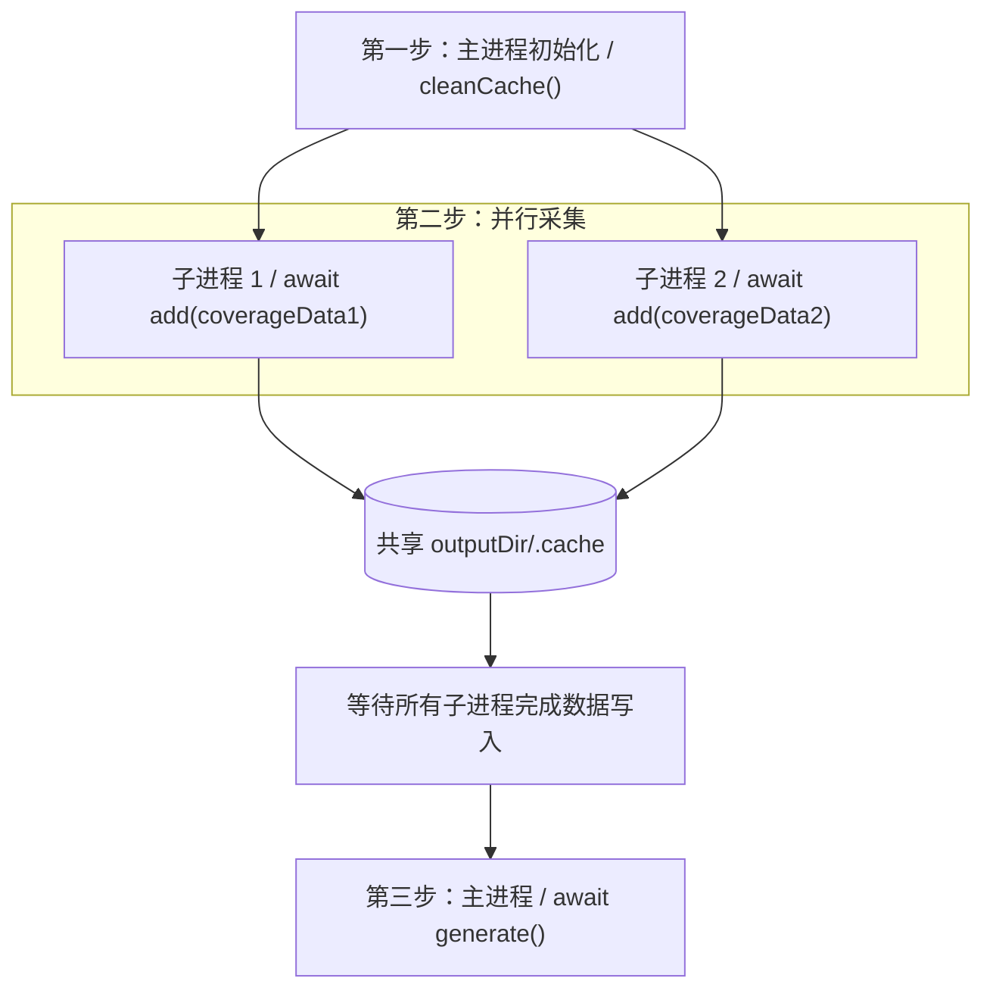

# 多进程 {#multiple-processes}

本页适用于能共享同一 `outputDir/.cache` 的进程。不能共享缓存的 CI 分片、容器或机器，应各自导出 [raw 报告并合并](/zh/reference/merging#manual-merging)。非调试模式下，成功生成报告后会清理缓存；生成 `raw` 报告时，缓存会移到 raw 输出位置。

## 流程概览 {#workflow}

子进程并行执行，并将数据写入同一个缓存目录。只有所有子进程完成数据写入后，主进程才生成报告。



## 第一步：主进程初始化 {#initialize}

```js
import { MCR } from 'monocart-coverage-reports';
import coverageOptions from 'path-to/same-options.js';
const mcr = MCR(coverageOptions);
// clean previous cache before the start of testing
// unless the running environment is new and no cache
mcr.cleanCache();
```

## 第二步：子进程并行采集覆盖率 {#collect-in-subprocesses}

各子进程可以并行执行。使用同一个 `outputDir`（若工作目录不同，请使用同一个绝对路径），并保持 [`cleanCache: false`](/zh/reference/options#cleancache)。采集期间不要清理缓存或生成报告。

### 子进程 1 {#subprocess-1}

```js
import { MCR } from 'monocart-coverage-reports';
import coverageOptions from 'path-to/same-options.js';
const mcr = MCR(coverageOptions);
await mcr.add(coverageData1);
```

### 子进程 2 {#subprocess-2}

```js
import { MCR } from 'monocart-coverage-reports';
import coverageOptions from 'path-to/same-options.js';
const mcr = MCR(coverageOptions);
await mcr.add(coverageData2);
```

## 第三步：主进程统一生成报告 {#generate-report}

等待所有子进程完成覆盖率数据写入后，再由主进程调用一次 `generate()`。

```js
// generate coverage reports after the completion of testing
import { MCR } from 'monocart-coverage-reports';
import coverageOptions from 'path-to/same-options.js';
const mcr = MCR(coverageOptions);
await mcr.generate();
```
