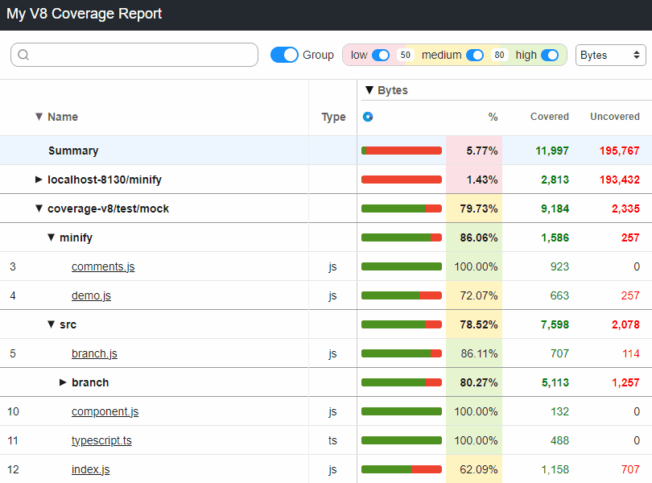
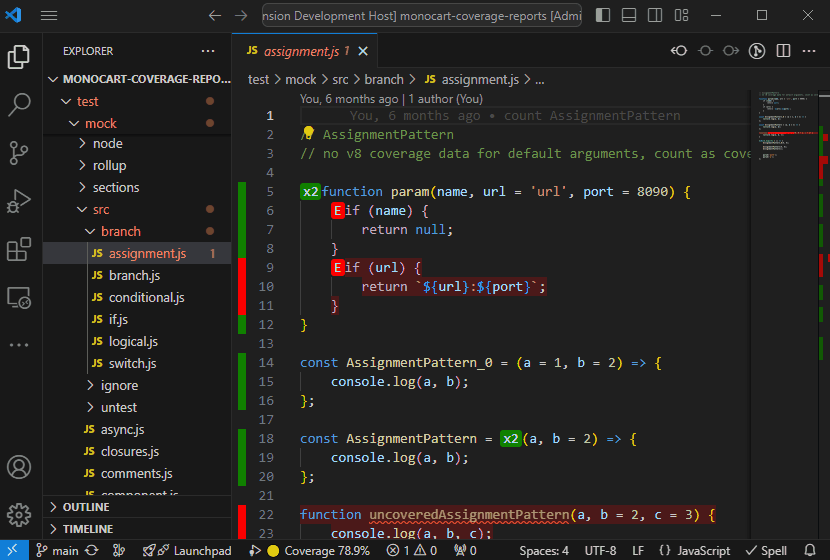
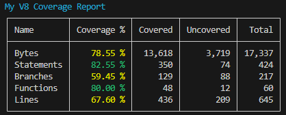
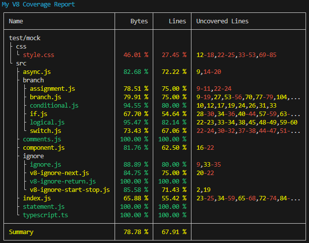
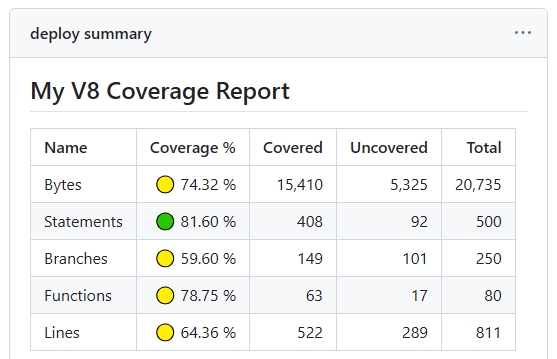

# 报告与自定义 Reporter {#available-reports}

> 内置V8报告(仅V8格式数据支持):

- `v8`
    - 推荐使用:
        - 全新的原生V8覆盖率报告界面，更好的用户体验
        - 支持原生的Bytes覆盖率指标
        - 支持高性能处理大数据
        - 支持任何运行时代码的覆盖率（压缩后的）
        - 支持CSS代码覆盖率（用于分析CSS的冗余代码）
        - 对Sourcemap转换有更好的支持
    - 预览: [V8](https://cenfun.github.io/monocart-coverage-reports/reports/v8) and [更多](/zh/examples)



- `v8-json`
    - 保存 `CoverageResults` 到一个json文件 (默认是 [`coverage-report.json`](https://cenfun.github.io/monocart-coverage-reports/reports/v8-and-istanbul/coverage-report.json))
    - 用于VSCode扩展来显示原生V8代码覆盖率: [Monocart Coverage for VSCode](https://github.com/cenfun/monocart-coverage-vscode)



> 内置Istanbul报告 (V8和Istanbul格式数据都支持):

- `clover`
- `cobertura`
- `html`
    - [Istanbul html](https://cenfun.github.io/monocart-coverage-reports/reports/istanbul/)
    - [V8 to Istanbul](https://cenfun.github.io/monocart-coverage-reports/reports/v8-and-istanbul/istanbul)
- `html-spa`
- `json`
- `json-summary`
- `lcov`
- `lcovonly`
    - [V8 lcov.info](https://cenfun.github.io/monocart-coverage-reports/reports/v8/lcov.info)
    - [Istanbul lcov.info](https://cenfun.github.io/monocart-coverage-reports/reports/istanbul/lcov.info)
- `none`
- `teamcity`
- `text`
- `text-lcov`
- `text-summary`

> 其他内置报告 (V8和Istanbul格式数据都支持):

- `codecov` 保存覆盖率数据到 [Codecov](https://docs.codecov.com/docs/codecov-custom-coverage-format) 专属的json文件 (默认是`codecov.json`), 见[例子](https://app.codecov.io/github/cenfun/monocart-coverage-reports)

- `codacy` 保存覆盖率数据到 [Codacy](https://api.codacy.com/swagger#tocscoveragereport) 专属的json文件 (默认是`codacy.json`)

- `console-summary` 在控制台显示覆盖率概要



- `console-details` 在控制台显示每个文件的覆盖率概要。如果是Github actions，可以使用环境变量`FORCE_COLOR: true`来强制开启颜色支持



- `markdown-summary` 保存概要信息到markdown文件 (默认是`coverage-summary.md`)。 如果是Github actions, 可以把markdown的内容添加到[a job summary](https://docs.github.com/en/actions/using-workflows/workflow-commands-for-github-actions#adding-a-job-summary)
```sh
cat path-to/coverage-summary.md >> $GITHUB_STEP_SUMMARY
```


- `markdown-details` 保存覆盖率详情到markdown文件 (默认是 `coverage-details.md`)
    - 预览运行结果 [runs](https://github.com/cenfun/monocart-coverage-reports/actions/workflows/ci.yml)

- `raw` 只是保存原始覆盖率数据, 用于使用`inputDir`参数来导入多个原始数据进行合并报告。参见 [合并覆盖率报告](/zh/guide/merging#merge-coverage-reports)

- 自定义报告
    ```js
    const coverageOptions = {
        reports: [
            [path.resolve('./test/custom-istanbul-reporter.js'), {
                type: 'istanbul',
                file: 'custom-istanbul-coverage.text'
            }],
            [path.resolve('./test/custom-v8-reporter.js'), {
                type: 'v8',
                outputFile: 'custom-v8-coverage.json'
            }],
            [path.resolve('./test/custom-v8-reporter.mjs'), {
                type: 'both'
            }]
        ]
    };
    ```
    - Istanbul自定义报告
    > 例子: [./test/custom-istanbul-reporter.js](https://github.com/cenfun/monocart-coverage-reports/blob/main/test/custom-istanbul-reporter.js), see [istanbul built-in reporters' implementation](https://github.com/istanbuljs/istanbuljs/tree/master/packages/istanbul-reports/lib) for reference.
    - V8自定义报告
    > 例子: [./test/custom-v8-reporter.js](https://github.com/cenfun/monocart-coverage-reports/blob/main/test/custom-v8-reporter.js)

    `type` 选项决定报告接口及执行时机：
    - `'istanbul'` — 使用 Istanbul 报告接口：先调用 `new Reporter(reportOptions)`，再调用 `execute(context)`。context 提供 Istanbul 报告树和源码查找能力。V8 输入会先转换为 Istanbul 覆盖率数据。
    - `'v8'`（默认值）— 对 V8 输入，先调用 `new Reporter(reportOptions, globalOptions)`，再调用 `await generate(reportData)`。`reportData` 是 V8 覆盖率结果，包含 `type`、`summary` 和 `files`；每个文件包含 V8 覆盖范围和汇总。
    - `'both'` — 对 V8 或 Istanbul 输入均使用上述 `generate(reportData)` 接口。请检查 `reportData.type`，按对应的结果结构处理。它**不会**同时提供两份原始格式的数据，结果中不存在 `v8Data` 或 `istanbulData` 属性。

    报告统一使用原生 ESM `import()` 加载。ESM 报告使用 `export default Reporter`；通过 Node 内置互操作，也可加载 `module.exports = Reporter` 的 CommonJS 报告（在 ESM 项目中使用 `.cjs`）。本地路径必须明确指定文件扩展名，不补全扩展名、不解析目录入口，不提供独立的 CommonJS 加载器。报告加载或初始化失败会使报告生成失败，不会静默跳过。

## Multiple Reports: {#multiple-reports}
如何配置多个报告
```js
import { MCR } from 'monocart-coverage-reports';
const coverageOptions = {
    outputDir: './coverage-reports',
    reports: [
        // built-in reports
        ['console-summary'],
        ['v8'],
        ['html', {
            subdir: 'istanbul'
        }],
        ['json', {
            file: 'my-json-file.json'
        }],
        'lcovonly',

        // custom reports
        // Specify reporter name with the NPM package
        ['custom-reporter-1'],
        ['custom-reporter-2', {
            type: 'istanbul',
            key: 'value'
        }],
        // Specify reporter name with local path
        ['/absolute/path/to/custom-reporter.js']
    ]
};
const mcr = MCR(coverageOptions);
```
