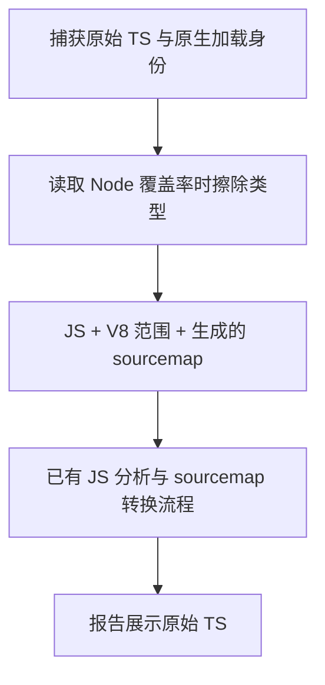

# TypeScript 支持 {#typescript-support}

::: warning 仅适用于 Node.js
本页介绍的原生 TypeScript 执行能力仅适用于 Node.js。浏览器应用仍需先将 TS 编译为 JavaScript，采集实际执行的 JS 覆盖率，再通过 sourcemap 还原原始源码。
:::

MCR 支持 Node.js 通过默认的**类型擦除**直接执行 TypeScript。对于可擦除的 TS 语法，不需要构建步骤、外部 loader 或额外的 TS 解析器：

```sh
npx mcr node ./src/example.ts
npx mcr test "./test/**/*.test.ts"
```

报告展示保留类型信息的原始 TS。MCR 分析擦除类型后的 JavaScript，并生成映射回捕获原文的 sourcemap，复用现有的 JavaScript/sourcemap 报告流程。

## Node.js 要求 {#nodejs-requirements}

使用 **Node.js >=22.18.0**，这些版本默认启用原生类型擦除。通过 `node --version` 检查启动 MCR 的版本。测试发现与支持的语法取决于当前 Node.js 版本。

MCR 使用 Node 内置的 `module.stripTypeScriptTypes()`，并采用 strip 模式。该 API 有独立的稳定性状态，即使某个 Node.js 版本已将直接执行 TS 标记为稳定，生成报告时仍可能输出实验性警告。MCR 不会全局屏蔽这些警告。

运行时语法限制参见 [Node.js TypeScript 文档](https://nodejs.org/api/typescript.html)。

## 运行 TS 程序 {#run-a-ts-program}

使用 ESM `.ts` 文件时，在项目的 `package.json` 中设置 `"type": "module"`。将以下内容保存为 `src/math.ts`：

```ts
export interface Input {
    value: number;
}

export function magnitude(input: Input): number {
    if (input.value < 0) {
        return -input.value;
    } else {
        return input.value;
    }
}
```

创建 `src/example.ts`：

```ts
import { magnitude } from './math.ts';

console.log(magnitude({ value: -2 }));
```

安装 MCR 并运行程序：

```sh
npm i -D monocart-coverage-reports
npx mcr node ./src/example.ts -r v8,console-summary -o ./coverage-reports
```

打开 `coverage-reports/index.html`，即可查看原始 TS 的报告。本例只执行负数分支。

`mcr node` 只执行一个入口，`mcr node *.ts` 不表示逐个执行匹配文件。多个测试目标请使用测试运行器。

## 运行 TS 测试 {#run-ts-tests}

创建 `test/math.test.ts`：

```ts
import { test } from 'node:test';
import assert from 'node:assert/strict';
import { magnitude } from '../src/math.ts';

test('negative input', (): void => {
    assert.equal(magnitude({ value: -2 }), 2);
});
```

调用 Node 内置测试运行器并生成覆盖率报告：

```sh
npx mcr test "./test/**/*.test.ts" -r v8,console-summary -o ./coverage-reports
```

- 给 glob 加引号，由 Node 而不是 shell 处理匹配。MCR 将目标传给 `node --test`，不会另行实现 TS 测试发现机制。
- 测试可以使用 `node:test` 和 `node:assert/strict`，无需额外测试运行器。
- 测试失败时仍生成可用的覆盖率报告，并保留非零退出状态。报告生成失败也会非零退出。

测试运行器参数和测试结果 hook 参见[使用 mcr test 运行测试](/zh/getting-started/node-test-runner#run-tests-with-mcr-test)。

## 配置覆盖率 {#configure-coverage}

仅使用可擦除语法的 `mcr.config.ts` 可以直接使用类型导入和 `satisfies`，无需预加载 loader：

```ts
import type { McrCliOptions } from 'monocart-coverage-reports';

export default {
    test: './test/**/*.test.ts',
    reports: ['v8', 'console-summary'],
    outputDir: './coverage-reports',
    entryFilter: '**/src/**'
} satisfies McrCliOptions;
```

```sh
npx mcr -c ./mcr.config.ts node ./src/example.ts
# 使用配置中的测试目标
npx mcr -c ./mcr.config.ts test
```

`entryFilter` 只保留应用源码，不包含测试文件。`sourceFilter` 用于过滤通过 sourcemap 展开的源码，原生 TS 也使用这条路径。参见[过滤覆盖率](/zh/reference/filtering#filtering)。

MCR 在其他默认配置文件之后查找 `mcr.config.ts`，已有的 `mcr.config.js` 优先。可使用 `-c` 显式指定配置。相对路径以当前工作目录为基准。配置文件使用超出原生擦除能力的语法时，仍需适当的 loader。

原生 TS 加载身份由 MCR 的捕获 hook 确认，不是仅凭 `.ts` 扩展名或 JavaScript 解析失败来判断。当前实现没有独立的 `typescript` 配置项或 `--typescript` 参数。

## 报告与源码映射 {#reports-and-source-maps}



- **原始源码：** CLI 会捕获加载时的 `.ts`、`.mts` 和 `.cts` 文本，即使没有 sourcemap 注释。生成的映射通过 `sourcesContent` 保留这份原文，报告无需重新读取已修改的源文件。
- **坐标：** 映射记录行边界与保留/替换文本区间的转换点。BOM 被移除时，通过映射表达位置差异，不修改 V8 范围。
- **函数、分支与语句：** 基于擦除后的 JS 分析，再映射回 TS。纯类型模块不会仅因为存在 sourcemap 就被补出虚假的运行时语句。
- **行与字节：** 当前沿用现有 sourcemap 对原始源码的统计规则。擦除的类型语法**尚未作为注释处理**，因此纯类型行可能计入行统计。字节覆盖率使用原始源码长度，并非可执行 TS token 的度量。
- **重复快照：** 同一次目录导入中，每份捕获源码记录只执行一次类型擦除和映射模板生成。各 entry 使用独立的映射对象及数组，`onEntry` 中的修改不会影响后续快照。
- **Raw 报告：** 保留擦除后的 JS、V8 范围、原生身份及包含 TS 原文的生成映射。重新生成与合并不再擦除类型，也不要求原始源文件仍然存在。
- **原有映射注释：** TS 中的 `sourceMappingURL` 注释不会替代 MCR 生成的映射，因为它们可能描述其他编译结果。

来自不同 Node 进程或 worker 线程的捕获记录会关联各自的源码版本，即使它们共享 URL 和采集目录；捕获的 JavaScript 也使用相同规则。请保留 Node 覆盖率原始文件名及源码执行元数据。旧版捕获记录的兼容性及同进程限制参见 [Node 覆盖率导入](/zh/coverage-collection/v8#generate)，独立采集数据的合并参见[合并报告](/zh/reference/merging#merging-reports)。

## 支持的语法 {#supported-syntax}

Node 的可擦除 TS 语法包括类型标注、接口、类型别名、类型导入/导出、泛型参数、重载签名、`as`、`satisfies` 和非空断言。具体语法支持以当前 Node.js 版本为准。

| 扩展名 | 模块系统 |
| --- | --- |
| `.ts` | 与 `.js` 相同；使用 ESM 时设置 `"type": "module"`。 |
| `.mts` | 始终为 ESM。 |
| `.cts` | 始终为 CommonJS，运行时导出使用 CommonJS 写法。 |

相对导入要写实际扩展名，例如 `import './math.ts'`。仅用于类型的导入应使用 `import type`。本功能不会在 `.js` 文件中启用类型标注。

## 使用限制 {#limitations}

- **不做类型检查。** 如有需要，单独运行 `tsc --noEmit`。原生执行与覆盖率采集本身不要求安装 TypeScript。
- **不应用 `tsconfig.json` 执行设置。** Node 不解析 `paths`，不转换模块系统，也不按 `target` 降级 JS。
- **不转换 JSX/TSX 或装饰器。** 使用适当的 loader 或构建工具。
- **不转换非可擦除语法。** 枚举、构造函数参数属性和包含运行时代码的 namespace 需要其他工具链。此原生路径不支持 `--experimental-transform-types`。
- **不新增未执行 TS 的原生分析能力。** `all` 保留原有行为。未执行 TS 如需准确的 AST 指标，应通过 `all.transformer` 提供 JS 与 sourcemap；参见[未测试文件](/zh/reference/untested-files#transform-source-code)。
- **不是直接发布 TS 依赖的捷径。** Node 通常拒绝擦除 `node_modules` 下的 TS，库一般仍应发布编译后的 JS。

项目超出这些限制时，可以继续使用 `tsx` 等外部运行时：

```sh
npm i -D tsx
npx mcr --import tsx node ./src/example.ts
npx mcr --import tsx test "./test/**/*.test.ts"
```

外部 loader 和预编译 JS 保留已有覆盖率路径。参见[框架与工具](/zh/integrations/frameworks-and-tools#typescript)。

## 仓库示例 {#repository-examples}

在 MCR 源码仓库中安装依赖并构建运行时包后，运行：

```sh
npm run test-node-ts
npm run test-mcr-test-ts
```

它们直接执行 `test/node-ts/`，不构建这些 TS 文件，也不加载 `tsx`。配置文件分别是 `test/mcr.config.node-ts.ts` 和 `test/mcr.config.mcr-test-ts.ts`。

报告分别生成到 `.temp/site/reports/node-ts/index.html` 和 `.temp/site/reports/mcr-test-ts/index.html`。案例覆盖 `.ts`、`.mts`、`.cts`、纯类型模块和运行时分支，不启用 `all`。在线链接参见[报告示例](/zh/getting-started/examples#report-examples)。
